# 05 — System Architecture

Converse is a **modular monolith**: one codebase and one database, deployed as a few process types. Modules talk to each other through service interfaces and domain events, never by reaching into each other's tables. This keeps a later split into services possible without paying for it now.

## 1. High-level system architecture

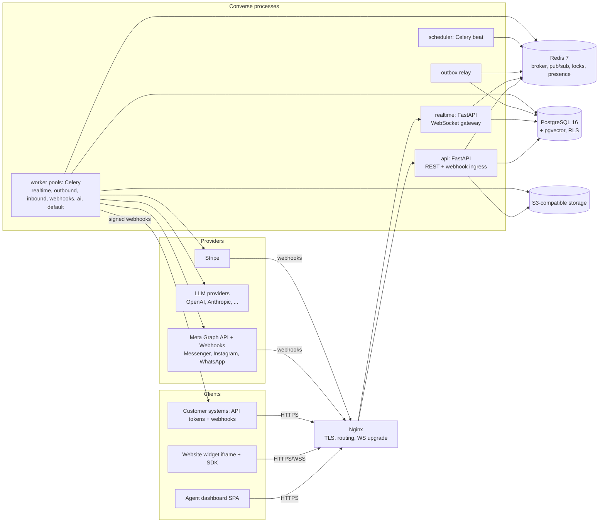

| Process | Scales by | Notes |
|---|---|---|
| `api` | CPU / request rate | Stateless. Also hosts `/webhooks/*` ingress, which only verifies, records and enqueues |
| `realtime` | Concurrent connections | Same codebase, different entry point (`converse.realtime.app`). Holds WebSocket connections, subscribes to Redis |
| `worker-*` | Queue depth | One Celery worker deployment per queue group so a slow queue can't starve a fast one |
| `beat` | Exactly **1** replica | Periodic tasks (snooze wake-up, auto-resolve, token refresh, outbox sweeper) |
| `relay` | 1–2 replicas | Reads `event_outbox` with `FOR UPDATE SKIP LOCKED` and enqueues handler tasks |

## 2. Backend component architecture

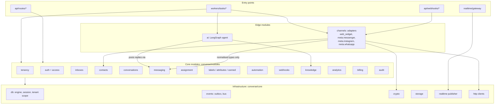

**Dependency rules** (enforced with `import-linter`, see [backend/PROJECT_STRUCTURE.md](backend/PROJECT_STRUCTURE.md)):

1. `modules/*` never import `channels/*` or `ai/*`.
2. `channels/*` import only `channels/base`, `core/*` and the public service interfaces of `messaging`, `contacts`, `conversations`.
3. `ai/*` reads through repositories/services and writes only through `messaging.MessageService` and `conversations.ConversationService`.
4. `api/*` and `workers/*` are the only places that wire things together.

## 3. Database architecture

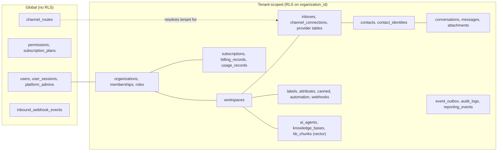

One PostgreSQL database, one schema. Two DB roles: `converse_app` (RLS enforced) and `converse_system` (BYPASSRLS, used only by ingress routing, the outbox relay, cross-tenant schedulers and platform admin). Details: [06_DATABASE_ARCHITECTURE.md](06_DATABASE_ARCHITECTURE.md).

## 4. Multi-tenant architecture

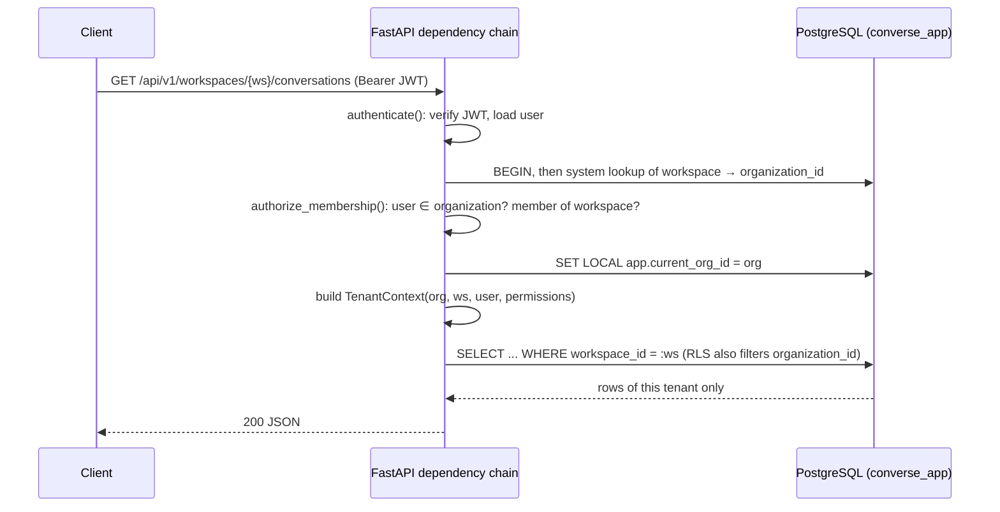

Three independent layers protect tenant data: (1) every repository method takes a `TenantContext` and filters by `workspace_id`; (2) composite foreign keys `(workspace_id, parent_id)` make cross-tenant references impossible to store; (3) RLS hides other tenants' rows even if layers 1 and 2 have a bug. See [09_MULTI_TENANCY.md](09_MULTI_TENANCY.md).

## 5. Social media integration architecture

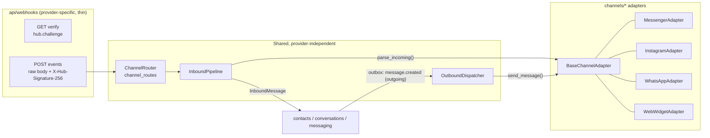

Provider-specific: signature secret location, payload parsing, media download, send API, error codes, 24 h window rules, token refresh. Provider-independent: routing, dedup, ordering, contact/conversation resolution, persistence, events, realtime, retries. Full contract: [integrations/CHANNEL_ADAPTER_ARCHITECTURE.md](integrations/CHANNEL_ADAPTER_ARCHITECTURE.md).

## 6. Message processing architecture

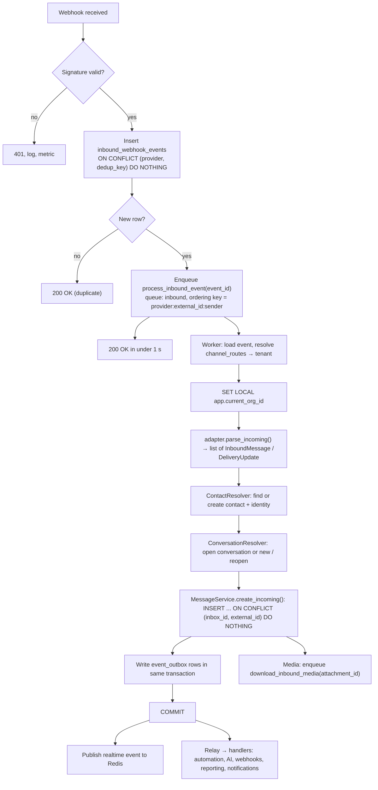

Details, ordering and failure handling: [backend/MESSAGE_PROCESSING.md](backend/MESSAGE_PROCESSING.md).

## 7. Real-time event architecture

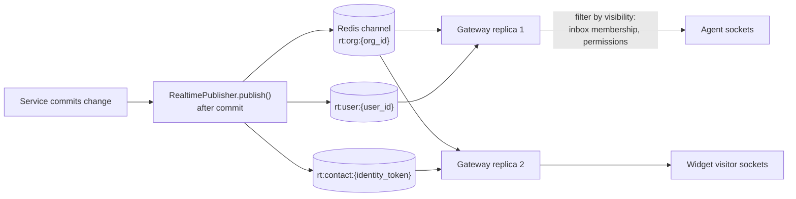

Publishing happens in-process right after commit (lowest latency, same as Chatwoot's `SyncDispatcher`). If a publish is lost, clients recover on reconnect by refetching `since=<last_event_ts>`. Realtime is a speed layer, never the source of truth. Details: [backend/REALTIME_COMMUNICATION.md](backend/REALTIME_COMMUNICATION.md).

## 8. AI chatbot architecture

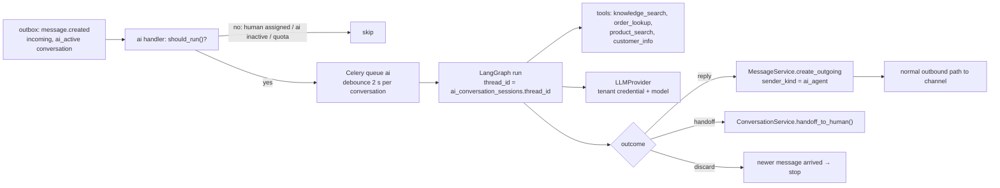

The AI module never touches channel APIs or message tables directly. Details: [ai/AI_ARCHITECTURE.md](ai/AI_ARCHITECTURE.md).

## 9. Authentication and authorization architecture

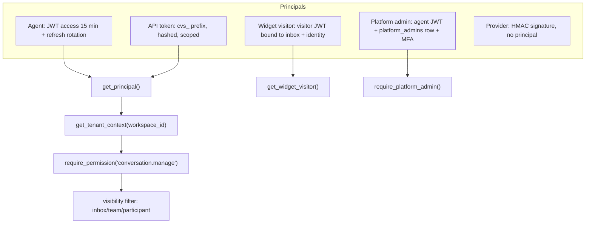

Details: [10_AUTHENTICATION_AND_RBAC.md](10_AUTHENTICATION_AND_RBAC.md).

## 10. Background job architecture

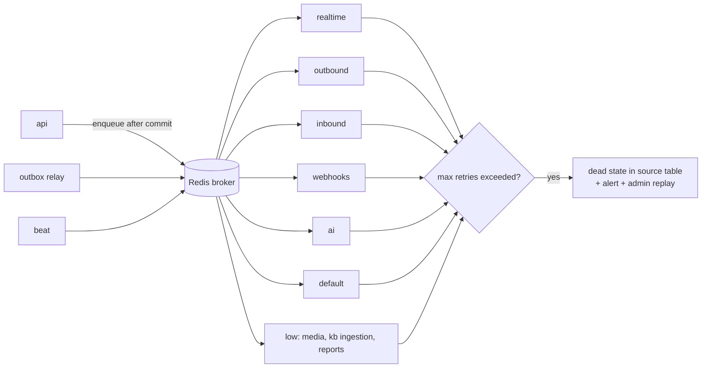

Details: [backend/BACKGROUND_JOBS.md](backend/BACKGROUND_JOBS.md).

---

## 11. End-to-end message flows

### 11.1 WhatsApp (customer → agent/AI → customer)

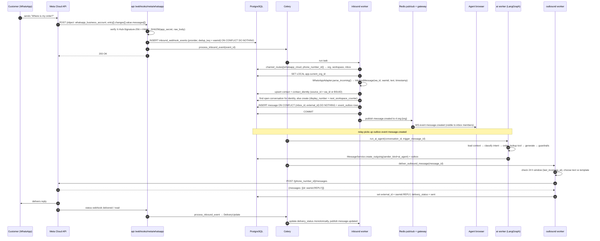

Step-by-step:

| # | Step | Component | Notes |
|---|---|---|---|
| 1 | Webhook verification (one-time, at subscription) | `GET /webhooks/meta/whatsapp` | Compare `hub.verify_token` to the platform verify token; echo `hub.challenge` |
| 2 | Signature validation | ingress route | Use the **raw** body bytes; constant-time compare; reject with 401 |
| 3 | Duplicate check | `inbound_webhook_events` | `dedup_key` = `wamid` for messages, `wamid:status` for statuses |
| 4 | Tenant identification | `ChannelRouter` | `value.metadata.phone_number_id` → `channel_routes` |
| 5 | Channel identification | same | Gives `inbox_id` and `channel_connection_id`; inactive connection → event `ignored` |
| 6 | Normalization | `WhatsAppAdapter.parse_incoming` | text, image, document, audio/voice, video, sticker, location, contacts, interactive replies, button replies, reactions (stored as `content_attributes.reaction` on the target), unsupported |
| 7 | Contact identification | `ContactResolver` | `(inbox_id, source_id)` unique; name from `contacts[].profile.name`; phone normalised to E.164 |
| 8 | Conversation identification | `ConversationResolver` | Latest non-resolved conversation for the identity; if resolved and `allow_messages_after_resolved` → new conversation, or reopen if `lock_to_single_conversation` |
| 9 | Persistence | `MessageService.create_incoming` | Idempotent; updates `last_incoming_at`, `last_activity_at`, `waiting_since` |
| 10 | Event publishing | outbox | `message.created`, maybe `conversation.created` / `conversation.opened` |
| 11 | Realtime inbox update | `RealtimePublisher` | After commit |
| 12 | AI processing | `ai` handler | Only when `conversations.ai_active` and no human assignee |
| 13 | Agent or bot response | `MessageService.create_outgoing` | Same path for both |
| 14 | WhatsApp API | `WhatsAppAdapter.send_message` | Outside 24 h → template required, else error `window_closed` shown to agent |
| 15 | Customer receives reply | Meta | Delivery/read statuses update the message |

### 11.2 Facebook Messenger

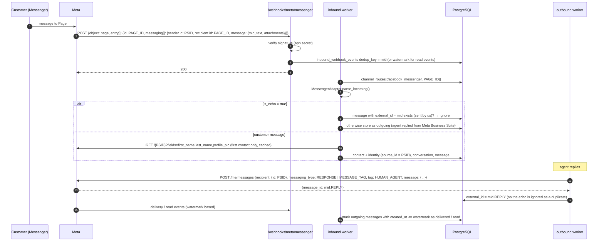

Differences from WhatsApp: tenant key is the **Page id**; contact key is the **PSID**; profile data comes from a Graph API call; delivery/read events carry a **watermark** timestamp rather than a message id; replies outside 24 h need the `HUMAN_AGENT` tag (allowed up to 7 days, requires Meta approval for the app); echo events arrive for our own sends.

### 11.3 Instagram (Instagram Login)

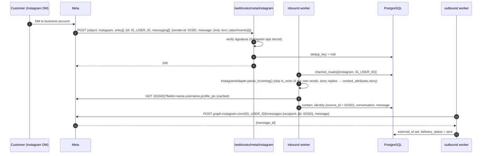

Differences: long-lived user access token **expires after 60 days** and must be refreshed (beat task `refresh_expiring_tokens`); 24 h window with `HUMAN_AGENT` tag up to 7 days; attachment types are image, video, audio, file, plus story mentions/replies and shares.

### 11.4 Website live chat

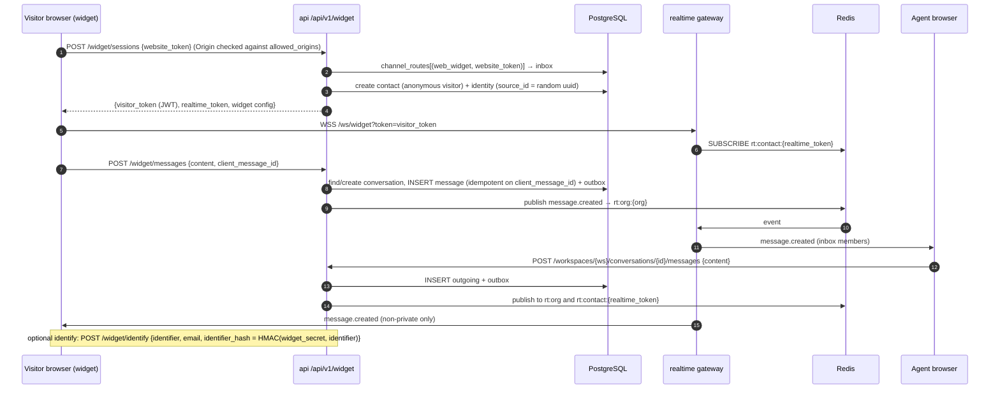

Differences: no provider API. "Sending" to the customer is a realtime publish to the contact channel (the `WebWidgetAdapter.send_message` just publishes, plus an email fallback later). Anonymous visitors become identified contacts via `identify` with HMAC verification. Conversation continuity across devices requires verified identity. Details: [integrations/WEBSITE_CHAT.md](integrations/WEBSITE_CHAT.md).

## 12. Scalability notes

| Component | First bottleneck | Plan |
|---|---|---|
| `messages` table | Size (hundreds of millions of rows) | Indexes on `(conversation_id, sequence_number)`; plan monthly range partitioning by `created_at` once above ~200M rows ([06](06_DATABASE_ARCHITECTURE.md#7-growth-and-partitioning)) |
| Conversation list queries | Sorting by `last_activity_at` with filters | Composite indexes per common filter; keyset pagination; no `COUNT(*)` on large lists (cached counts) |
| Inbound bursts (e.g. campaign replies) | inbound queue | Horizontal workers; per-tenant fairness limits |
| Realtime fan-out | Large orgs with many agents | Per-org channel + client-side filter in gateway; split hot orgs per workspace channel |
| AI | LLM latency and cost | Separate queue and pool; per-tenant concurrency cap; debounce |
| Outbox relay | Single table hot spot | `SKIP LOCKED` batches; prune dispatched rows after 7 days |
