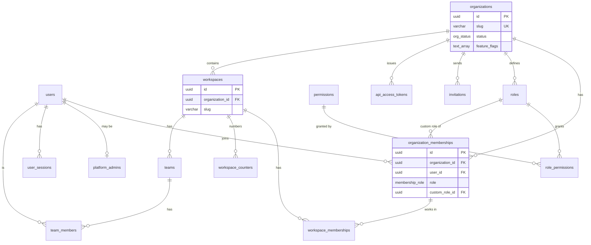
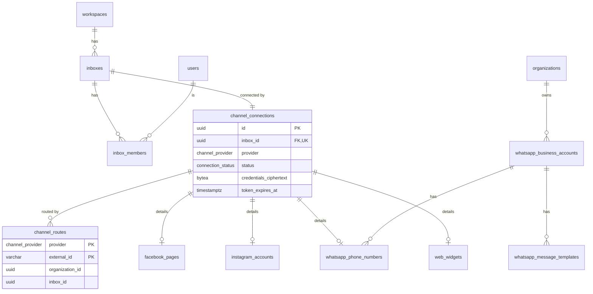
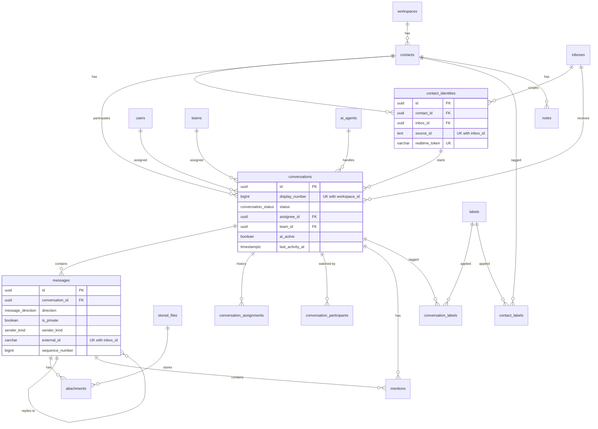
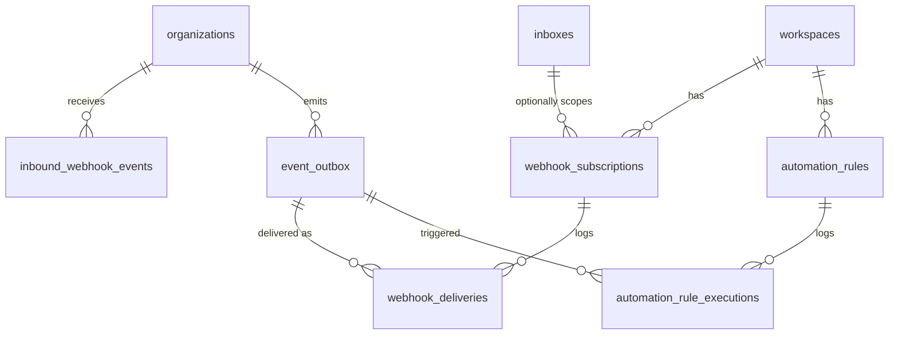
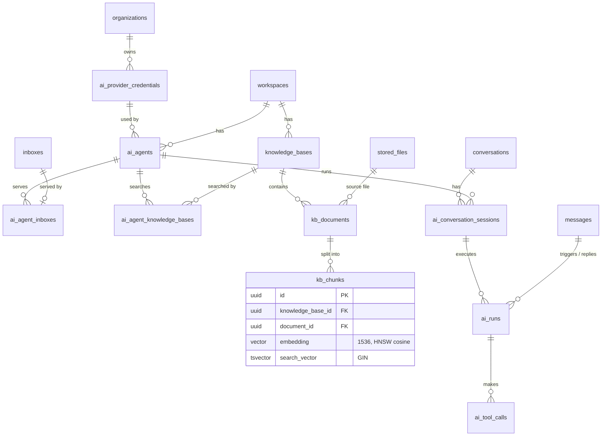
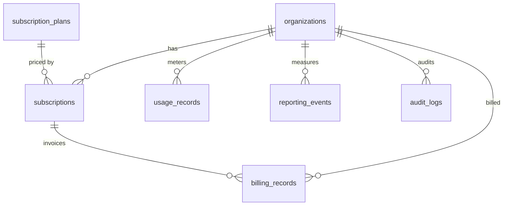

# 08 — Database Relationships

Entity-relationship diagrams by domain. The complete foreign-key list with delete behaviour (149 FKs, exported from the tested database) is in [database/RELATIONSHIPS.md](database/RELATIONSHIPS.md).

Notation: `||--o{` one-to-many, `||--||` one-to-one, `}o--o{` many-to-many (through a join table shown explicitly).

## 1. Tenancy and access

**Rules**
- A user is global; a membership attaches them to one organization with one base role (`owner`, `administrator`, `agent`) and optionally one custom role.
- A member works in a workspace only if a `workspace_memberships` row exists. Owners and administrators implicitly have access to all workspaces (checked in code, so new workspaces don't need backfilled rows).
- Teams belong to one workspace.

## 2. Inboxes and channels

**Rules**
- Exactly one `channel_connections` row per inbox, and exactly one provider detail row per connection (the detail table matching `provider`; enforced in `InboxService`).
- `channel_routes.external_id` per provider: Facebook → Page id, Instagram → IG user id, WhatsApp → `phone_number_id`, web widget → `website_token`.
- A WABA can serve several phone numbers (each its own inbox); templates are per WABA.

## 3. Contacts, conversations, messages

**Rules**
- A contact can have many identities (one per inbox they've used). A conversation belongs to exactly one identity, therefore to one inbox and one contact.
- At most one **non-resolved** conversation per identity at a time (enforced by `ConversationResolver` under the per-identity ordering lock, not by a constraint, because `lock_to_single_conversation = false` inboxes may still create a new conversation after resolution).
- A message's sender is exactly one of user / contact / AI agent / system / automation (`messages_sender_chk`).

## 4. Automation, webhooks, events

## 5. AI and knowledge

**Rules**
- One AI agent per inbox (`ai_agent_inboxes` PK is `inbox_id`); one agent may serve many inboxes.
- An AI agent searches only the knowledge bases linked to it. All are in the same workspace (composite FKs).
- `ai_conversation_sessions` is unique per `(conversation_id, ai_agent_id)`; `ai_runs` is unique per `(session_id, trigger_message_id)`, so one customer message triggers at most one run even if the event is delivered twice.

## 6. Billing, reporting, audit

- At most one live (`trialing`/`active`/`past_due`/`incomplete`) subscription per organization (`subscriptions_one_live_per_org`).
- `reporting_events` keeps loose references (no FK to conversations/users) so metrics survive deletions; it is still tenant-bound through the workspace FK.
- `audit_logs` keeps loose references on purpose: the audit trail must outlive the resources it describes.
