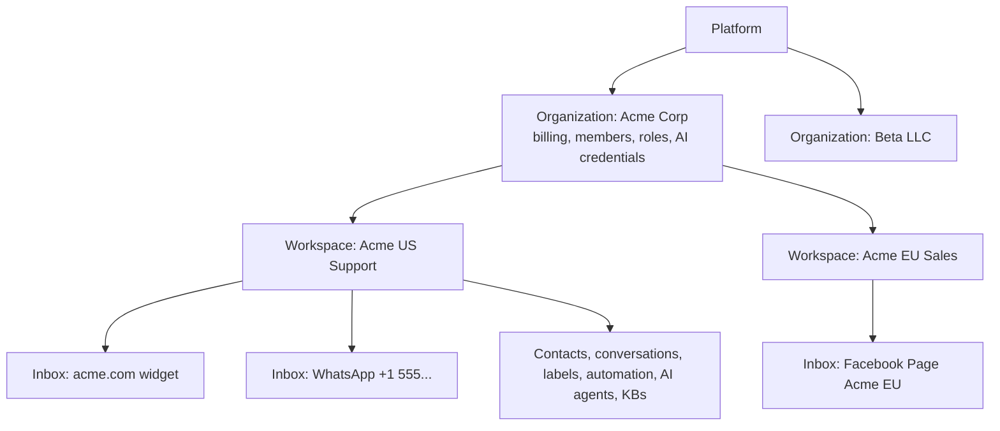

# 09 — Multi-Tenancy

## 1. Model

**Shared database, shared schema, tenant discriminator column, plus PostgreSQL RLS.**

| Option | Isolation | Cost | Decision |
|---|---|---|---|
| Database per tenant | Strongest | Migrations × N, connection pools × N, cross-tenant ops hard | No |
| Schema per tenant | Strong | Same migration fan-out; catalog bloat beyond a few thousand tenants | No |
| **Shared schema + `organization_id` + RLS** | Strong when RLS is enforced | One migration, one pool | **Yes** |

Chatwoot uses shared schema + `account_id` **without** RLS (isolation relies on `Current.account` scoping in controllers; see [01](01_CHATWOOT_ANALYSIS.md#6-multi-tenancy)). Converse keeps the model and adds database enforcement.

Very large customers who require physical isolation can be served later by deploying a dedicated instance of the same stack. No code changes are needed.

## 2. Hierarchy



| Level | Owns | Isolation guarantee |
|---|---|---|
| Organization | Members, roles, subscription, billing, API tokens, AI provider credentials, WABAs, audit log | **Hard**: RLS on `organization_id` |
| Workspace | Inboxes, contacts, conversations, messages, teams, labels, attributes, canned responses, automation, webhooks, AI agents, knowledge bases, reports | **Hard within the org**: composite FKs + every query filtered by `workspace_id` + workspace membership check |

Contacts are **per workspace**. The same person writing to two workspaces is two contacts. Workspaces are meant to be separate operations (different brands, regions, or clients of an agency).

## 3. Tenant context

Every request and every task runs with an explicit `TenantContext`:

```python
# converse/core/tenancy/context.py
from dataclasses import dataclass
from uuid import UUID

@dataclass(frozen=True, slots=True)
class TenantContext:
    organization_id: UUID
    workspace_id: UUID | None          # None for org-level endpoints (billing, members)
    principal: "Principal"             # user, api token, widget visitor, system
    permissions: frozenset[str]        # resolved once per request
    membership_role: "MembershipRole | None"

    def require_workspace(self) -> UUID:
        if self.workspace_id is None:
            raise WorkspaceRequiredError()
        return self.workspace_id
```

### API request scoping

```python
# converse/api/deps/tenancy.py  (simplified)
async def get_tenant_context(
    workspace_id: UUID,
    principal: Principal = Depends(get_principal),
    session: AsyncSession = Depends(get_session),
) -> TenantContext:
    workspace = await system_lookup.workspace_owner(workspace_id)     # converse_system read, id → org
    if workspace is None or workspace.deleted_at is not None:
        raise NotFound()
    membership = await access_service.resolve(principal, workspace.organization_id, workspace_id)
    if membership is None:
        raise NotFound()                                               # 404, not 403: don't confirm existence
    if workspace.organization_status != "active":
        raise OrganizationSuspended()
    await bind_tenant(session, workspace.organization_id)              # SET LOCAL app.current_org_id
    return TenantContext(
        organization_id=workspace.organization_id,
        workspace_id=workspace_id,
        principal=principal,
        permissions=membership.permissions,
        membership_role=membership.role,
    )
```

```python
# converse/core/db/tenant.py
async def bind_tenant(session: AsyncSession, organization_id: UUID) -> None:
    # set_config(..., is_local => true) == SET LOCAL; parameterised, so no SQL injection
    await session.execute(
        select(func.set_config("app.current_org_id", str(organization_id), True))
    )
```

- The session dependency opens one transaction per request (`async with session.begin()`), so `SET LOCAL` covers every statement and resets on commit/rollback. That makes it safe with PgBouncer in transaction mode.
- A 404 (not 403) is returned for workspaces the caller can't access, so ids from other tenants can't be probed.

### Worker task scoping

Every task payload carries `organization_id` (and `workspace_id` where relevant). The task base class binds it:

```python
# converse/workers/base.py
class TenantTask(celery.Task):
    def __call__(self, *args, organization_id: str, **kwargs):
        with tenant_session(UUID(organization_id)) as session:   # sync engine, SET LOCAL inside
            structlog.contextvars.bind_contextvars(organization_id=organization_id)
            return self.run(*args, session=session, **kwargs)
```

Tasks that legitimately span tenants (outbox relay, snooze wake-up scan, token refresh scan, purge) use `system_session()` (role `converse_system`) only to **find work**, then enqueue one tenant-scoped task per tenant/item.

### Webhook ingress

Provider webhooks arrive before we know the tenant. Ingress uses `converse_system` to read `channel_routes` (one indexed lookup by `(provider, external_id)`), then all processing runs in a `TenantTask`.

### WebSocket connections

The gateway authenticates the socket, resolves the memberships once, and subscribes only to the channels the principal may receive (`rt:org:{org}` filtered by workspace/inbox visibility, `rt:user:{id}`, or `rt:contact:{token}`). See [backend/REALTIME_COMMUNICATION.md](backend/REALTIME_COMMUNICATION.md).

## 4. Database enforcement

1. **RLS:** `converse_app` connects with RLS `FORCE`d on every table with `organization_id`. Policy: `organization_id = current_org_id()`. Unset context = zero rows. Full SQL and test results: [database/TENANT_ISOLATION.md](database/TENANT_ISOLATION.md).
2. **Composite foreign keys:** `(workspace_id, parent_id)` → parent `(workspace_id, id)`, and `(organization_id, workspace_id)` → `workspaces(organization_id, id)`. A row can't point at another workspace's parent.
3. **Unique constraints scoped by tenant:** e.g. `contacts_email_per_ws_uniq (workspace_id, email)`. Uniqueness never leaks information across tenants.

## 5. Application enforcement

1. **Repositories take `TenantContext`**, never bare ids:
   ```python
   class ConversationRepository:
       async def get(self, ctx: TenantContext, conversation_id: UUID) -> Conversation:
           stmt = select(Conversation).where(
               Conversation.workspace_id == ctx.require_workspace(),
               Conversation.id == conversation_id,
           )
           return await self._one_or_404(stmt)
   ```
2. **No `session.get(Model, id)`** in application code (it skips the workspace filter). A Ruff custom rule / grep check in CI flags it.
3. **Visibility filters** for agents (inbox membership, team membership, participation) are applied in the repository from `ctx.permissions` (see [10](10_AUTHENTICATION_AND_RBAC.md#5-conversation-visibility)).
4. **Cache keys include the tenant**: `org:{org_id}:ws:{ws_id}:...`. A helper builds them; raw string keys are not allowed.
5. **Storage keys include the tenant**: `org/{org_id}/ws/{ws_id}/attachments/{file_id}`. Presigned URLs are generated only after an authorization check.
6. **Logs and traces** carry `organization_id`/`workspace_id`. Message content is never logged.

## 6. Per-tenant configuration and limits

| Setting | Stored in | Enforced by |
|---|---|---|
| Plan limits (agents, inboxes, workspaces, AI responses, storage) | `subscription_plans.limits`, overridden by `organizations.limits_override` | `LimitsService.check(ctx, "inboxes")` before create; returns `402 plan_limit_reached` |
| Feature flags | `subscription_plans.features` ∪ `organizations.feature_flags` | `require_feature("ai_agent")` dependency |
| AI provider/model/prompt | `ai_agents`, `ai_provider_credentials` | AI module |
| Rate limits | Config by plan | Redis token bucket keyed by org (API) and by inbox (outbound sends) |

## 7. Noisy-neighbour protection

- **API:** per-organization request budget (e.g. 600 req/min on Business), per-token budget, per-IP budget for unauthenticated endpoints.
- **Workers:** tasks carry `organization_id`; a Redis concurrency counter per org and queue (`limit:org:{id}:ai` ≤ 5 concurrent AI runs) makes excess tasks re-queue with a short countdown instead of occupying workers.
- **Outbound:** Meta enforces per-number throughput; the outbound adapter applies per-inbox rate limits so one tenant's broadcast can't delay others.
- **Database:** `statement_timeout = 5s` for the API role, `30s` for workers; list endpoints are always paginated (max 100).

## 8. Tenant lifecycle

| Event | Action |
|---|---|
| Sign-up | Create user (if new), organization, owner membership, default workspace, trial subscription, in one transaction |
| Suspend (platform admin or unpaid) | `organizations.status = 'suspended'`: API returns `403 organization_suspended`; inbound webhooks are still **recorded** (so no customer messages are lost) but not processed until reactivated; outbound sends stop |
| Delete (owner) | `status = 'pending_deletion'`, `deleted_at = now()`; disconnect channels (unsubscribe Meta webhooks), revoke tokens; purge after 30 days in batches |
| Export | `export_organization` task writes JSONL per table to storage and emails a signed link |
