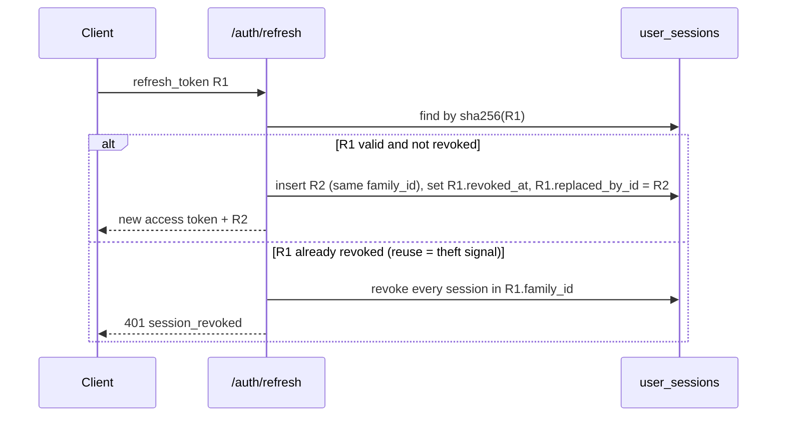

# 10 — Authentication and RBAC

## 1. Principals

| Principal | Credential | Lifetime | Used by |
|---|---|---|---|
| **User** (agent/admin/owner) | JWT access token (`Authorization: Bearer`) + refresh token (HttpOnly cookie for web, body for mobile) | Access 15 min; refresh 30 days sliding, absolute max 90 days | Dashboard, mobile |
| **API token** | `Authorization: Bearer cvs_<prefix>_<secret>` | Until revoked or `expires_at` | Customer integrations, external bots |
| **Widget visitor** | Visitor JWT (`X-Visitor-Token`) bound to `inbox_id` + `contact_identity_id` | 30 days, renewed on activity | Website widget |
| **Platform admin** | User JWT + `platform_admins` row + MFA required | Same as user | Platform admin API |
| **Provider** | HMAC signature on raw body | Per request | Meta, Stripe webhooks |
| **System** | None (internal) | — | Workers, scheduler |

## 2. User authentication

### 2.1 Passwords
- argon2id (`argon2-cffi`, OWASP parameters: m=19 MiB, t=2, p=1 minimum; we use m=64 MiB, t=3, p=4 and re-hash on login if parameters change).
- Minimum 10 characters; checked against a breached-password list (k-anonymity HIBP API or local top-100k list).
- Login throttles (mirroring Chatwoot's `rack-attack` rules): 5 attempts per 5 min per IP, 10 per 15 min per email; generic error message "Invalid email or password".

### 2.2 Tokens

**Access token (JWT, HS256 with key id, or EdDSA):**

```json
{
  "iss": "converse",
  "sub": "00000000-0000-0000-0000-00000000a002",
  "sid": "4b6e9f6a-...-session-id",
  "iat": 1762560000,
  "exp": 1762560900,
  "typ": "access",
  "mfa": true
}
```

The access token carries **no** organization or role claims. Memberships and permissions are resolved per request (cached in Redis for 60 s, invalidated on membership/role change). A removed agent therefore loses access within one minute, not when the token expires.

**Refresh token rotation with reuse detection:**



- Refresh tokens are 256-bit random strings; only `sha256(token)` is stored (`user_sessions.refresh_token_hash`).
- Logout revokes the session. "Log out everywhere" revokes all sessions of the user. Password change revokes all sessions except the current one.

### 2.3 MFA (R1)
- TOTP (pyotp) with the secret encrypted in `users.mfa_secret_ciphertext`. Ten single-use backup codes are stored as SHA-256 hashes in `users.mfa_backup_code_hashes`; a used code is removed from the array.
- Login with MFA enabled returns `{"mfa_required": true, "mfa_token": "<5-min JWT typ=mfa>"}`; `/auth/mfa/verify` exchanges it for real tokens.
- Organizations can require MFA for all members (`organizations.settings.require_mfa`). Platform admins always require MFA.

### 2.4 Email verification, invitation, password reset
- Tokens are random 256-bit values; only hashes are stored; single use; expiry 24 h (invites 7 days).
- Accepting an invitation for an email without an account creates the user; for an existing account, it adds the membership after login.

## 3. API tokens

- Format: `cvs_<8-char prefix>_<32-byte base62 secret>`. The prefix is stored in clear (`token_prefix`) to show in the UI and to find the row; the full token is SHA-256 hashed (`token_hash`).
- Shown once at creation.
- **Scopes** narrow what a token can do, intersected with the owner's permissions: `conversations:read`, `conversations:write`, `contacts:read`, `contacts:write`, `messages:write`, `webhooks:manage`, `reports:read`.
- Organization-level tokens (no `user_id`) act as a bot principal with `sender_kind = 'system'` in messages, unless created for an AI/bot integration.
- `last_used_at` is updated at most once per minute (Redis debounce) to avoid write amplification.

## 4. Authorization model

### 4.1 Base roles

The full who-sees-what / who-manages-whom matrix and the organization lifecycle are in [12_ORGANIZATION_LEVELS_AND_PERMISSIONS.md](12_ORGANIZATION_LEVELS_AND_PERMISSIONS.md). Administrators manage other administrators and agents; nobody but the owner (through transfer) touches the owner.

| Capability | owner | administrator | agent |
|---|---|---|---|
| Billing, delete organization, transfer ownership | ✅ | ❌ | ❌ |
| Organization settings, workspaces, members, roles | ✅ | ✅ | ❌ |
| Inboxes, channel connections, teams | ✅ | ✅ | ❌ |
| Automation, webhooks, API tokens | ✅ | ✅ | ❌ |
| AI agents, knowledge bases, AI playground | ✅ | ✅ | ❌ (custom role can grant) |
| AI provider credentials | ✅ | ✅ | ❌ (never grantable to custom roles) |
| See AI activity, pause/resume AI on visible conversations | ✅ | ✅ | ✅ |
| Labels, canned responses, custom attributes | ✅ | ✅ | ❌ (custom role can grant) |
| View all conversations in workspace | ✅ | ✅ | ❌ (custom role can grant) |
| View/reply in conversations of member inboxes or teams | ✅ | ✅ | ✅ |
| Contacts read/update | ✅ | ✅ | ✅ |
| Contacts delete/merge/export | ✅ | ✅ | ❌ (custom role can grant) |
| Reports | ✅ | ✅ | ❌ (custom role can grant) |
| Audit log | ✅ | ✅ | ❌ |

### 4.2 Permission codes

Seeded in `permissions` (see [database/SEED_DATA_SQL.md](database/SEED_DATA_SQL.md)):

`conversation.view_all`, `conversation.view_unassigned`, `conversation.view_participating`, `conversation.manage`, `conversation.delete`, `contact.manage`, `contact.export`, `inbox.manage`, `team.manage`, `member.manage`, `label.manage`, `canned_response.manage`, `custom_attribute.manage`, `automation.manage`, `webhook.manage`, `ai.agent.manage`, `ai.credentials.manage`, `ai.knowledge.manage`, `ai.playground.use`, `ai.activity.view`, `conversation.ai_control`, `report.view`, `billing.manage`, `audit_log.view`, `organization.manage`.

The AI permissions, the AI agent's own permissions (actions, tools, data scope) and customer verification for the chatbot are covered in [ai/AI_ROLES_AND_PERMISSIONS.md](ai/AI_ROLES_AND_PERMISSIONS.md).

Resolution:

```python
BASE_ROLE_PERMISSIONS = {
    "owner": ALL_PERMISSIONS,
    "administrator": ALL_PERMISSIONS - {"billing.manage"},
    "agent": {"conversation.view_participating", "conversation.view_unassigned", "conversation.manage", "contact.manage",
              "ai.activity.view", "conversation.ai_control"},
}
NEVER_IN_CUSTOM_ROLES = {"ai.credentials.manage", "billing.manage", "organization.manage", "member.manage"}

def effective_permissions(role, custom_role_permissions) -> frozenset[str]:
    # A custom role REPLACES the agent defaults; it never applies to owners/administrators
    # (also a DB check: org_memberships_custom_role_agent_chk). Code: app/core/permissions.py
    if role == "agent" and custom_role_permissions is not None:
        return custom_role_permissions - NEVER_IN_CUSTOM_ROLES
    return BASE_ROLE_PERMISSIONS[role]
```

Custom roles can only be assigned to `agent` members (owners/administrators always have their full set), matching Chatwoot's Enterprise behaviour.

### 4.3 Enforcement in FastAPI

```python
def require_permission(code: str):
    async def checker(ctx: TenantContext = Depends(get_tenant_context)) -> TenantContext:
        if code not in ctx.permissions:
            raise PermissionDenied(code)              # 403 {"error": "permission_denied", "permission": code}
        return ctx
    return checker

@router.post("/workspaces/{workspace_id}/inboxes", status_code=201)
async def create_inbox(
    body: InboxCreate,
    ctx: TenantContext = Depends(require_permission("inbox.manage")),
    service: InboxService = Depends(get_inbox_service),
) -> InboxRead:
    return await service.create(ctx, body)
```

API token scopes are checked by the same dependency: `ctx.permissions` for a token = owner permissions ∩ scope-mapped permissions.

## 5. Conversation visibility

Visibility is a **query filter**, not a per-row check, so lists and counts are correct and fast. This mirrors Chatwoot's `ConversationPolicy#show?` (administrator, or inbox member, or team member).

```python
def visible_conversations(ctx: TenantContext, stmt: Select) -> Select:
    if "conversation.view_all" in ctx.permissions:
        return stmt
    user_id = ctx.principal.user_id
    in_my_inbox = Conversation.inbox_id.in_(
        select(InboxMember.inbox_id).where(InboxMember.user_id == user_id)
    )
    in_my_team = Conversation.team_id.in_(
        select(TeamMember.team_id).where(TeamMember.user_id == user_id)
    )
    clauses = []
    if "conversation.view_participating" in ctx.permissions:
        clauses.append(Conversation.assignee_id == user_id)
        clauses.append(Conversation.id.in_(
            select(ConversationParticipant.conversation_id).where(ConversationParticipant.user_id == user_id)
        ))
    if "conversation.view_unassigned" in ctx.permissions:
        clauses.append(and_(Conversation.assignee_id.is_(None), or_(in_my_inbox, in_my_team)))
    # Default agent behaviour (no custom role): everything in member inboxes/teams
    if ctx.membership_role == "agent" and ctx.principal.custom_role_id is None:
        clauses.append(or_(in_my_inbox, in_my_team))
    return stmt.where(or_(*clauses)) if clauses else stmt.where(false())
```

Single-conversation endpoints run the same filter, so an invisible conversation returns 404.

## 6. Widget visitor authentication

1. `POST /api/v1/widget/sessions` with `website_token`; the `Origin` header must be in `web_widgets.allowed_origins` (empty list = allow any, with a warning in the admin UI).
2. The server creates (or, with an existing `visitor_token`, resumes) the contact identity and returns a visitor JWT:
   ```json
   { "typ": "visitor", "iid": "<inbox_id>", "cid": "<contact_identity_id>", "org": "<org_id>", "exp": 1765152000 }
   ```
3. **Identity verification (optional, recommended):** the customer's backend computes `identifier_hash = HMAC_SHA256(widget_identity_secret, identifier)` and the page passes it to `window.converse.identify({identifier, email, name, identifier_hash})`. A valid hash marks `contact_identities.identity_verified = true` and links the visitor to an existing contact with that identifier. If `identity_verification_required` is on, unverified `identify` calls are rejected. Same mechanism as Chatwoot's `hmac_token`/`hmac_verified`.
4. A visitor can only read/write conversations of its own identity (and, if verified, of the same contact on the same inbox).

## 7. Platform admin

- `/api/v1/platform/*` routes require `require_platform_admin()`: valid user JWT with `mfa: true` and a `platform_admins` row.
- Platform admin queries use `converse_system`. Every platform admin action writes an `audit_logs` row with `actor_kind = 'platform_admin'`.
- Impersonation (R2): issues a short-lived (30 min) access token with `act: {sub: <admin id>}` claim, shown as a banner in the UI and logged on every request (Chatwoot has an equivalent `ImpersonationLogger`).

## 8. Security checklist for auth

- Constant-time comparison for every token/HMAC (`hmac.compare_digest`).
- JWT: verify `exp`, `iat`, `typ`, `iss`; reject `alg: none`; pin allowed algorithms; support key rotation via `kid` header with two active keys.
- Refresh cookie: `HttpOnly; Secure; SameSite=Strict; Path=/api/v1/auth`.
- CSRF: the API uses Bearer tokens in headers (not cookies) for every endpoint except `/auth/refresh`, which requires `SameSite=Strict` plus a custom `X-Requested-With` header.
- CORS: dashboard origin allow-list for `/api/v1/*`; widget endpoints allow `web_widgets.allowed_origins` per inbox.
- Audit log entries for: login success/failure (security events), MFA changes, role changes, member add/remove, API token create/revoke, channel connect/disconnect, AI credential changes, webhook changes, data exports, organization deletion.
