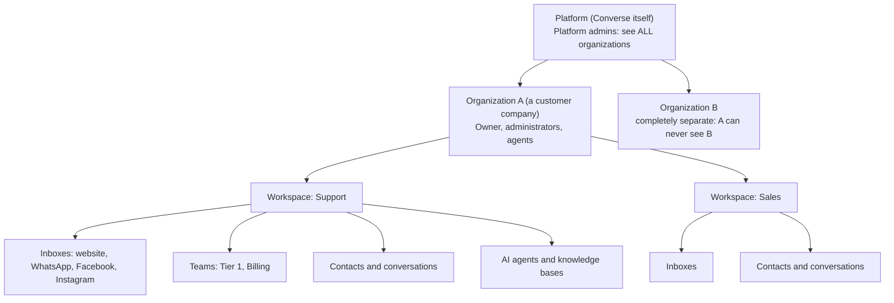
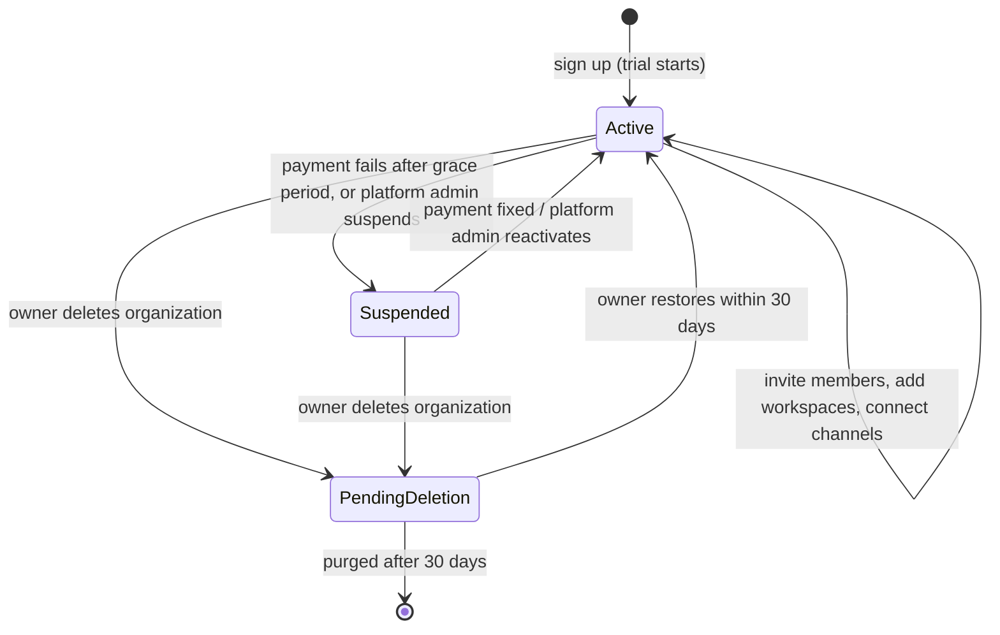
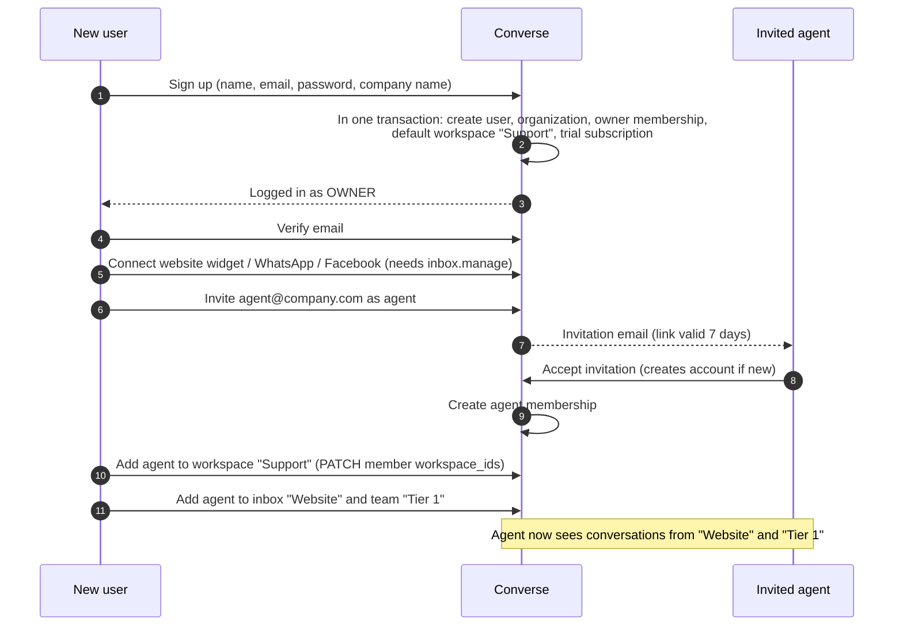
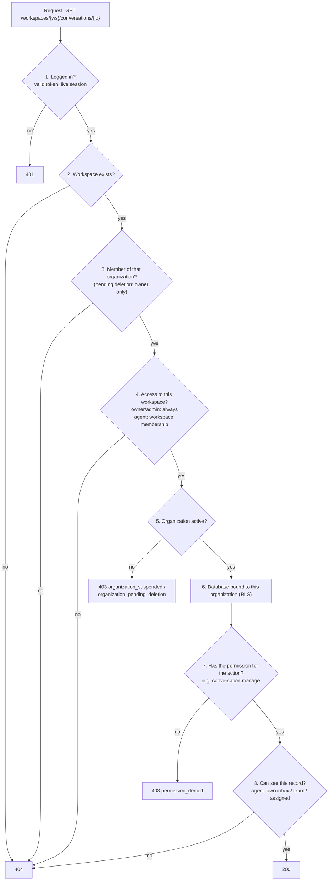
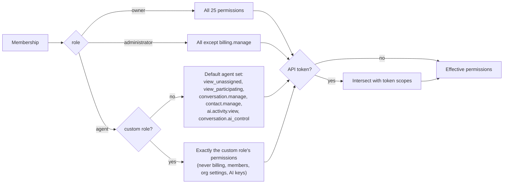

# 12 — Organization Levels and Permissions

This document answers: **who exists at each level of Converse, what each person can see, what each person can do, and how an organization moves from sign-up to deletion.** It brings together rules that are spread across [09_MULTI_TENANCY.md](09_MULTI_TENANCY.md), [10_AUTHENTICATION_AND_RBAC.md](10_AUTHENTICATION_AND_RBAC.md) and [ai/AI_ROLES_AND_PERMISSIONS.md](ai/AI_ROLES_AND_PERMISSIONS.md). If those documents and this one ever disagree, fix both.

How it's built (code, files, status): [implementation/ORGANIZATION_LEVELS_IMPLEMENTATION.md](implementation/ORGANIZATION_LEVELS_IMPLEMENTATION.md). Frontend: [frontend-implamentation/05_ORGANIZATION_LEVELS.md](frontend-implamentation/05_ORGANIZATION_LEVELS.md) (all levels) and [03_ORGANIZATIONS_AND_MEMBERS.md](frontend-implamentation/03_ORGANIZATIONS_AND_MEMBERS.md) (screens).

## 1. The levels

| Level | What it is | Who works here | Hard boundary? |
|---|---|---|---|
| **Platform** | The Converse service, run by us | Platform admins | — |
| **Organization** | One customer company: the tenant. Owns billing, members, roles, AI keys, audit log | Owner, administrators, agents | **Yes.** Enforced by the database (RLS). Nothing crosses organizations |
| **Workspace** | An operating unit inside the organization (a brand, region or department). Owns inboxes, contacts, conversations, teams, labels, automation, AI agents | Members added to that workspace | **Yes within the organization.** Agents only see workspaces they were added to |
| **Team** | A group of agents inside a workspace, used for routing and visibility | Team members | No. A grouping, not a security wall (admins see all teams) |
| **Inbox** | One connected channel | Inbox members | No. Decides which conversations a default agent sees |

**Answer to "does the owner see all organizations?"** No. An owner sees **only their own organization** (all of its workspaces). Only **platform admins** (our staff) can see every organization, through a separate admin API that requires MFA and writes every action to the audit log.

**One person, many organizations.** A user account is global. The same email can be an owner in organization A and an agent in organization B. Each membership has its own role. The person switches organization in the app; they never see both at once, and their role in A gives them nothing in B.

## 2. The roles

| Role | Level | How many | Summary |
|---|---|---|---|
| **Platform admin** | Platform | Our staff | Manages all organizations: suspend, change limits and plans, replay failed webhooks. Not a member of any organization |
| **Owner** | Organization | **Exactly one** per organization (unique index `org_memberships_one_owner_uniq`) | Everything in the organization, including billing, transferring ownership and deleting the organization |
| **Administrator** | Organization | Any number | Everything except billing and the owner-only actions |
| **Agent** | Organization + chosen workspaces | Any number | Handles conversations in their inboxes and teams |
| **Custom role** (R2) | Applied to an agent | Defined per organization | Replaces the agent's default permissions with a chosen set |

Other actors that hold permissions but aren't people:

| Actor | What it can do |
|---|---|
| **API token** | The permissions of its owner (or, for organization tokens, an admin-like bot) **narrowed by its scopes** |
| **AI agent** | Only its allowed actions and tools, in one conversation at a time ([ai/AI_ROLES_AND_PERMISSIONS.md](ai/AI_ROLES_AND_PERMISSIONS.md#3-what-the-ai-agent-itself-may-do)) |
| **Website visitor / customer** | Only their own conversations in one inbox ([integrations/WEBSITE_CHAT.md](integrations/WEBSITE_CHAT.md)) |

## 3. What each role can see

| Data | Platform admin | Owner | Administrator | Agent (default) |
|---|---|---|---|---|
| Other organizations | ✅ all (admin API) | ❌ | ❌ | ❌ |
| Organization settings, plan name, limits | ✅ | ✅ | ✅ | Plan name only (`limits` is `null`) |
| Billing: invoices, payment, usage costs | ✅ | ✅ | ❌ | ❌ |
| Member list | ✅ | ✅ | ✅ | ✅ names and availability (`email` is `null`) |
| Workspaces | ✅ all | ✅ all | ✅ all | Only workspaces they were added to |
| Inboxes | ✅ | ✅ all | ✅ all | Only inboxes they are a member of |
| Conversations | Via admin tools only (audited) | ✅ all | ✅ all | Conversations in **their inboxes or their teams**, plus ones assigned to them or that they watch |
| Private notes | Same as conversations | ✅ | ✅ | In conversations they can see |
| Contacts | ✅ | ✅ | ✅ | ✅ all contacts in their workspaces |
| Reports | ✅ | ✅ | ✅ | ❌ (custom role can grant) |
| Audit log | ✅ | ✅ | ✅ | ❌ |
| AI activity on conversations | ✅ | ✅ | ✅ | ✅ on conversations they can see |
| AI provider keys | Masked (last 4 digits) | Masked | Masked | ❌ |

Secrets (API keys, channel tokens, webhook secrets) are **never shown in full to anyone** after creation, not even the owner. They are shown once when created, then only the last 4 characters.

## 4. What each role can do

Every action is protected by a permission code. The table below is the complete set of 25 codes (seeded in `permissions`, [database/SEED_DATA_SQL.md](database/SEED_DATA_SQL.md); in code: `app/core/permissions.py`).

| Permission | What it allows | Owner | Admin | Agent | Custom role |
|---|---|---|---|---|---|
| `organization.manage` | Organization settings, create/delete workspaces | ✅ | ✅ | ❌ | never |
| `member.manage` | Invite, remove, change roles, add to workspaces | ✅ | ✅ | ❌ | never |
| `billing.manage` | Plans, payment, invoices, seats | ✅ | ❌ | ❌ | never |
| `audit_log.view` | Read the audit log | ✅ | ✅ | ❌ | grantable |
| `inbox.manage` | Create inboxes, connect/disconnect channels, inbox settings and members | ✅ | ✅ | ❌ | grantable |
| `team.manage` | Create teams, set team members | ✅ | ✅ | ❌ | grantable |
| `label.manage` | Create/edit/delete labels | ✅ | ✅ | ❌ | grantable |
| `canned_response.manage` | Saved replies | ✅ | ✅ | ❌ | grantable |
| `custom_attribute.manage` | Custom field definitions | ✅ | ✅ | ❌ | grantable |
| `automation.manage` | Automation rules and shared macros | ✅ | ✅ | ❌ | grantable |
| `webhook.manage` | Outgoing webhooks and API tokens | ✅ | ✅ | ❌ | grantable |
| `conversation.view_all` | See every conversation in the workspace | ✅ | ✅ | ❌ | grantable |
| `conversation.view_unassigned` | See unassigned conversations in own inboxes/teams | ✅ | ✅ | ✅ | grantable |
| `conversation.view_participating` | See conversations assigned to or watched by them | ✅ | ✅ | ✅ | grantable |
| `conversation.manage` | Reply, add notes, assign, label, change status | ✅ | ✅ | ✅ | grantable |
| `conversation.delete` | Delete conversations | ✅ | ✅ | ❌ | grantable |
| `contact.manage` | Create, edit, merge, delete contacts | ✅ | ✅ | ✅ | grantable |
| `contact.export` | Export contacts | ✅ | ✅ | ❌ | grantable |
| `report.view` | Reports and analytics | ✅ | ✅ | ❌ | grantable |
| `ai.agent.manage` | Configure AI agents | ✅ | ✅ | ❌ | grantable |
| `ai.credentials.manage` | AI provider keys | ✅ | ✅ | ❌ | never |
| `ai.knowledge.manage` | Knowledge bases and documents | ✅ | ✅ | ❌ | grantable |
| `ai.playground.use` | Test AI agents | ✅ | ✅ | ❌ | grantable |
| `ai.activity.view` | See why the AI answered | ✅ | ✅ | ✅ | grantable |
| `conversation.ai_control` | Pause or resume the AI on a conversation | ✅ | ✅ | ✅ | grantable |

"never" means a custom role can't include it (`NEVER_IN_CUSTOM_ROLES` in [10_AUTHENTICATION_AND_RBAC.md](10_AUTHENTICATION_AND_RBAC.md#42-permission-codes)): those stay with owners and administrators.

### Owner-only actions

These are not permission codes; they check `role = 'owner'` directly (`require_owner` in `app/api/deps.py`). A non-owner gets `403 permission_denied` with `"permission": "owner"`.

| Action | Endpoint | Rule |
|---|---|---|
| Transfer ownership | `POST /organizations/{org}/transfer-ownership` `{membership_id, password}` | Owner picks an existing **administrator**; the old owner becomes an administrator. Requires password re-entry |
| Delete the organization | `DELETE /organizations/{org}` `{password}` | Requires password re-entry; starts a 30-day grace period (`ORGANIZATION_DELETION_GRACE_DAYS`) |
| Restore the organization | `POST /organizations/{org}/restore` | Only while pending deletion and before `deletion_scheduled_at` |
| Remove or demote the owner | — | **Nobody** can, including administrators. The owner must first transfer ownership |
| Change billing / plan | (Phase 8) | Via `billing.manage`, which only the owner has by default |

A wrong password returns `403 password_incorrect` (not `401`, which would make clients think the session expired).

### Rules about managing other members

| Who | Can invite | Can change role of | Can remove |
|---|---|---|---|
| Owner | Administrators, agents | Administrators, agents | Administrators, agents |
| Administrator | Administrators, agents | Agents and other administrators | Agents and other administrators |
| Agent | ❌ | ❌ | ❌ (can only leave the organization themselves) |

- Nobody can give someone a role higher than their own, and nobody can make anyone the owner except through "transfer ownership" (inviting or setting `role: owner` returns `403`/`422`).
- An administrator can't remove or demote the owner.
- Nobody edits or removes **their own** membership through the member endpoints (`422`); members leave with `POST /organizations/{org}/leave`. The owner can't leave (`422 owner_cannot_leave`) until they transfer ownership.
- Removing a member (or a member leaving):
  - unassigns their **open, pending and snoozed** conversations (they return to the unassigned queue; resolved conversations keep their assignee for reporting),
  - removes them from every inbox and team in the organization,
  - revokes their personal API tokens for this organization,
  - ends their access **immediately**: memberships and permissions are read from the database on every request. Their login sessions are *not* revoked, because a session is global and the person may still work in other organizations.
- Inviting beyond the plan's agent limit returns `402 plan_limit_reached` with `"limit": "agents", "max": <n>`. Every member is a seat (owner and administrators included), and pending invitations count too. Accepting an invitation re-checks the limit.

## 5. Complete flow of an organization

### 5.1 Lifecycle

`organizations.status` holds the state (`active`, `suspended`, `pending_deletion`); `organizations.deletion_scheduled_at` holds the purge date while pending deletion. Both are returned in every membership (`organization_status`, `deletion_scheduled_at`) from login and `GET /auth/me`, so the app can show the right screen without extra calls.

| State | Members can log in? | API works? | Customer messages |
|---|---|---|---|
| Active | ✅ | ✅ | Received and processed normally |
| Suspended | ✅ (sees a "suspended" screen; owner sees billing) | ❌ `403 organization_suspended` on every organization and workspace route | **Recorded but not processed** (so nothing is lost); no replies are sent |
| Pending deletion | Owner only (to restore). For everyone else the organization disappears from their memberships and its routes return `404` | ❌ `403 organization_pending_deletion` for the owner, except `POST /restore` | Channels disconnected; nothing received |

Customer-message behaviour per state is enforced by the inbound pipeline (Phase 4, [backend/MESSAGE_PROCESSING.md](backend/MESSAGE_PROCESSING.md)), which must check `organizations.status` before processing.

**Purge.** `make purge-organizations` (`app/jobs/purge_organizations.py`, run daily) sets `deleted_at` on every organization whose `deletion_scheduled_at` has passed: it disappears for everyone, including the owner, and its slug is freed. The data-retention job ([backend/BACKGROUND_JOBS.md](backend/BACKGROUND_JOBS.md)) then erases the tenant's rows.

### 5.2 Sign-up to first conversation

### 5.3 How a request is checked

Every request goes through the same steps, in this order:

Steps 2, 3, 4 and 8 return **404**, not 403, so nobody can find out whether another organization's data exists. The status check (5) comes **after** membership for the same reason: a stranger never learns that an organization is suspended.

In code: `get_workspace_context` / `get_org_context` (steps 1–6) and `require_permission` (7) in `app/api/deps.py`. Step 8 (`visible_conversations`) comes with the conversation endpoints in Phase 3.

### 5.4 How permissions are worked out for a member

Permissions are resolved from the database on **every request**, never from the token, so removing someone or changing their role takes effect on their very next request, even on an open session. (If a cache is added later for load reasons, it must expire within 60 seconds and be cleared on membership changes.)

## 6. Example: one organization, four people

**Acme Corp**: workspaces *Support* and *Sales*.

| Person | Role | Workspaces | Inboxes / teams | Result |
|---|---|---|---|---|
| Priya | Owner | (all) | (all) | Sees and does everything, pays the bill |
| Omar | Administrator | (all) | (all) | Sees and configures everything; can't see invoices or delete Acme |
| Arjun | Agent | Support | Inbox "Website", team "Tier 1" | Sees Website conversations and anything routed to Tier 1; can't see WhatsApp conversations of other teams or anything in Sales |
| Lena | Agent + custom role "Support Lead" | Support | Inbox "Website" | Default agent rights **replaced** by: view all conversations, manage conversations, contacts, canned responses, reports, AI activity, AI control |

What Arjun gets when he tries things:

| Arjun tries to… | Result |
|---|---|
| Open a Website conversation | ✅ |
| Open a WhatsApp conversation assigned to team Billing | ❌ 404 |
| Open a Sales workspace URL | ❌ 404 |
| Reply and add a private note | ✅ |
| Pause the AI on his conversation | ✅ |
| Create a label | ❌ 403 |
| Connect a Facebook Page | ❌ 403 |
| Open organization B's conversation id in Acme's URL | ❌ 404 (and the database would return nothing anyway) |
| See Omar's email in the member list | ❌ (`email: null`; name and availability only) |
| Leave Acme | ✅ `POST /organizations/{acme}/leave` |

## 7. Platform admin (our staff)

| Can | Can't |
|---|---|
| List and search all organizations | Log in as a customer without impersonation (R2), which is time-limited, shown in a banner and audited |
| Suspend / reactivate an organization | See full secrets (only the last 4 characters) |
| Change plan limits and feature flags | Bypass MFA (always required) |
| Lock a user, reset their MFA | |
| See and replay failed provider webhooks | |
| See system health (queues, outbox lag) | |

Platform admin endpoints are under `/api/v1/platform/*` ([backend/API_DESIGN.md](backend/API_DESIGN.md#27-platform-admin--apiv1platform)). Every action writes to `audit_logs` with `actor_kind = 'platform_admin'`.

### 7.1 Login and accounts

There is **no separate platform login**. A platform admin is a normal user account plus a `platform_admins` row. They log in with `POST /auth/login` like anyone else; the response (and `GET /auth/me`) has `is_platform_admin: true`, and the app shows a link to the platform console. A staff account usually has **no organization memberships**: being a platform admin doesn't make you a member, so the tenant API (`/organizations/{org}/...`) still returns `404` for organizations they don't belong to. They look at tenants only through `/platform/*`.

| Task | How |
|---|---|
| First platform admin | Command line only (nobody can make themselves one through the API): `make platform-admin ARGS="grant ops@example.com --create --name 'Ops'"`. `--create` makes a staff account with no organization and asks for the password interactively |
| More platform admins | An existing admin: `POST /platform/admins {email}` (the user must have an account), or the command line `grant <email>` |
| Remove one | `DELETE /platform/admins/{user_id}` (not yourself, so the last admin can't lock everyone out), or `revoke <email>` |
| List | `GET /platform/admins` or `make platform-admin ARGS=list` |
| Dev seed | `make seed` creates `platform@demo.example.com` (platform admin, no organization) and also makes `owner@demo.example.com` a platform admin; password `Password123!` |

Non-admins get `404` on every `/platform/*` route, so the API can't be discovered.

### 7.2 MFA (not built yet)

The design requires MFA for platform admins. MFA isn't implemented yet, so `require_platform_admin` **refuses every platform route with `403 mfa_required` unless `ENV` is `local` or `test`**. The platform console therefore works in development only until MFA ships (R1); that's deliberate, so a stolen staff password can't open every tenant in production.

### 7.3 Endpoints (implemented)

| Method | URL | Purpose |
|---|---|---|
| GET | `/platform/stats` | Number of organizations: `{total, active, suspended, pending_deletion}` |
| GET | `/platform/organizations?q&status&limit&offset` | Every organization (newest first) with owner email, member and workspace counts, plan. `q` searches name, slug and owner email. Returns `counts` (global), `matching`, `items` |
| GET | `/platform/organizations/{org}` | Detail: members (name, email, role), workspaces, plan, effective limits, `limits_override`, feature flags |
| PATCH | `/platform/organizations/{org}` | `{status: active\|suspended, limits_override, feature_flags}`. Pending deletion can't be changed here (`409`): only the owner restores |
| GET / POST / DELETE | `/platform/admins[/{user_id}]` | List, grant (by email), revoke platform admins |

Later (R1/R2): users (lock, reset MFA), plans, dead-letter webhooks + replay, system health, impersonation.

## 8. Where this lives in the system

| Concept | Table / code |
|---|---|
| Organizations, workspaces | `organizations` (`status`, `deletion_scheduled_at`), `workspaces` |
| Membership + role | `organization_memberships.role` (`owner` / `administrator` / `agent`), `custom_role_id`; one owner enforced by `org_memberships_one_owner_uniq` |
| Workspace access | `workspace_memberships` (agents only; owners/admins have implicit access) |
| Inbox / team access | `inbox_members`, `team_members` |
| Permission catalog | `permissions`; custom roles: `roles`, `role_permissions`; `app/core/permissions.py` |
| Platform admins | `platform_admins` |
| Invitations | `invitations` (hashed token, 7-day expiry) |
| Audit trail | `audit_logs` (append-only). Actions written here: `member.updated`, `member.removed`, `member.left`, `invitation.*`, `organization.ownership_transferred`, `organization.deletion_scheduled`, `organization.restored`, `organization.purged` |
| Request checks | `get_org_context` / `get_workspace_context`, `require_permission`, `require_owner`, `visible_conversations` (Phase 3) ([10_AUTHENTICATION_AND_RBAC.md](10_AUTHENTICATION_AND_RBAC.md#43-enforcement-in-fastapi)) |
| Member and lifecycle rules | `app/services/tenancy.py` |
| Database isolation | Row-level security on `organization_id` ([database/TENANT_ISOLATION.md](database/TENANT_ISOLATION.md)) |
| Plan limits | `subscription_plans.limits`, `organizations.limits_override` ([09_MULTI_TENANCY.md](09_MULTI_TENANCY.md#6-per-tenant-configuration-and-limits)); `app/services/limits.py` |

## 9. Release plan for these features

| Feature | Release | Status |
|---|---|---|
| Organizations, workspaces, owner/administrator/agent, invitations, workspace access, 404 rules | MVP (Phase 2, [implementation/PHASE_02_AUTHENTICATION.md](implementation/PHASE_02_AUTHENTICATION.md)) | Done |
| Member rules (§4), leave, agent seat limit, suspended / pending-deletion handling, delete + restore + purge, transfer ownership (API) | MVP | Done |
| Inbox/team access in conversation visibility, RLS policies | MVP | With Phase 3 (conversations) |
| Teams, API tokens with scopes, audit log writes, platform admin API, MFA | R1 | |
| Custom roles, transfer ownership UI, audit log UI, impersonation | R2 | |

## 10. Tests

| Test | Assertion | Where |
|---|---|---|
| Role matrix | Every endpoint × owner / administrator / agent / example custom role returns the expected status | `tests/test_route_permissions.py` (every route must declare its required permission or `owner`) |
| Owner protection | Administrator can't remove, demote or replace the owner; exactly one owner at all times | `tests/test_rbac_tenancy.py`, `tests/test_organization_lifecycle.py` |
| No escalation | Nobody can grant a role or permission above their own; custom roles reject the "never" permissions | `tests/test_rbac_tenancy.py`, `tests/test_permissions.py` |
| Workspace access | Agent without a workspace membership gets 404 on every route of that workspace | `tests/test_rbac_tenancy.py` |
| Cross-organization | Ids from another organization return 404 on every route (automated suite, [implementation/TESTING_STRATEGY.md](implementation/TESTING_STRATEGY.md#4-tenant-isolation-suite-automatic)) | `tests/test_rbac_tenancy.py` |
| Removal | Removed member loses access on the next request; their open conversations become unassigned; they leave inboxes and teams | `tests/test_organization_lifecycle.py` |
| Suspension | Suspended organization: API 403, members still log in, outsiders still get 404 (webhooks still recorded, nothing sent: Phase 4) | `tests/test_organization_lifecycle.py` |
| Deletion | Pending deletion hides the organization from everyone but the owner; the owner can restore within 30 days; after that restore fails and the purge job closes it | `tests/test_organization_lifecycle.py` |
| Plan limit | Inviting past the agent limit returns `402 plan_limit_reached` | `tests/test_organization_lifecycle.py` |
