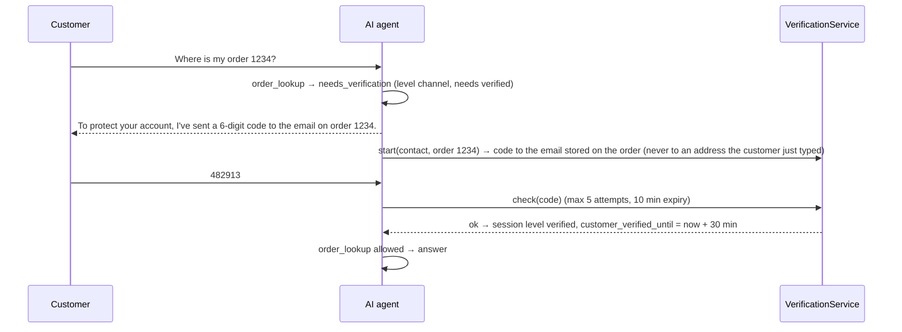
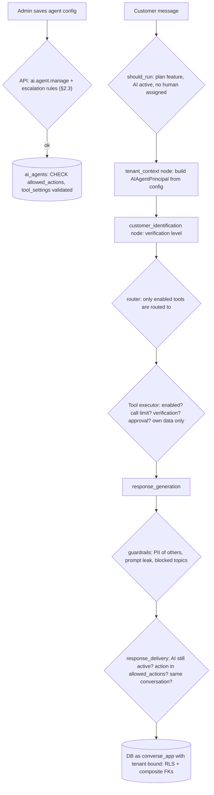

# AI Roles and Permissions

The chatbot raises three separate permission questions. Each has its own model, and all three must pass before the AI reveals data or changes anything:

| # | Question | Who is the subject | Section |
|---|---|---|---|
| 1 | Which **people** may configure, test, watch and control the AI? | Organization members (owner, administrator, agent, custom roles) | [§2](#2-people-who-may-configure-and-control-the-ai) |
| 2 | What may the **AI agent itself** read and do? | The AI agent as a principal | [§3](#3-what-the-ai-agent-itself-may-do) |
| 3 | What may a **customer** obtain through the AI? | The contact talking to the bot | [§4](#4-what-a-customer-may-obtain-through-the-ai) |

Related: [AI_ARCHITECTURE.md](AI_ARCHITECTURE.md), [LANGGRAPH_NODES.md](LANGGRAPH_NODES.md), [HUMAN_HANDOFF.md](HUMAN_HANDOFF.md), [../10_AUTHENTICATION_AND_RBAC.md](../10_AUTHENTICATION_AND_RBAC.md).

## Implementation status

| Part | Status | Code / test |
|---|---|---|
| 6 AI permissions in the catalog and base roles | ✅ | `app/core/permissions.py` |
| `ai.credentials.manage` never in custom roles | ✅ | `NEVER_IN_CUSTOM_ROLES` |
| Escalation rules: `customer_info` needs `custom_attribute.manage`; `update_contact` needs `contact.manage`; KBs/inboxes from the same workspace only | ✅ | `app/ai/policy.py` `check_escalation`; `test_no_privilege_escalation_through_the_ai` |
| Audit of prompt/tool/action changes with old/new values; credentials created/deleted | ✅ | `app/services/ai_agents.py`; `test_config_changes_are_audited_with_old_and_new_values` |
| Activity visibility follows conversation visibility; chunk text only with `ai.knowledge.manage` | ✅ | `GET …/ai-runs`; `test_live_reply_runs_once_and_records_activity` |
| `allowed_actions` validated (`handoff` mandatory) + DB check `ai_agents_actions_chk` | ✅ | `validate_actions`; `test_invalid_agent_config_is_rejected` |
| Tool policies; `tool_settings` can only tighten (`policy_cannot_be_relaxed`) | ✅ | `TOOL_POLICIES`, `effective_policy` |
| Tool executor: enabled / call limit / verification / approval, every decision recorded in `ai_tool_calls` | ✅ | `app/ai/graph/tools.py`; `test_tool_needs_customer_verification` |
| Run bound to one conversation; `reply` checked against `allowed_actions` at delivery | ✅ | `DbRepo.deliver` |
| Actions `add_label`, `set_priority`, `resolve`, `snooze`, `update_contact`, `add_private_note` | 🔜 config accepted and validated; the graph doesn't execute them yet | |
| Verification levels `none` / `channel` / `verified` computed each run, never raised by text | ✅ | `DbRepo.load_customer` |
| Step-up verification (one-time code) | 🔜 R2 | |
| `AIAgentPrincipal` as a separate principal type | Partial: writes are attributed (`sender_kind = ai_agent`, `assigned_by_kind = ai_agent`); a principal class arrives with API tokens (R1) | |

## 1. Chatwoot reference

- **Configuration is admin-only.** `Captain::AssistantPolicy` (`enterprise/app/policies/captain/assistant_policy.rb`) allows `create?`, `update?`, `destroy?`, `sync?` and `drilldown?` only for `administrator`. Any member can `index?`, `show?` and use `playground?`. `tools?` needs an administrator or the `captain_integration` feature flag. Custom tools, MCP servers, scenarios and FAQ suggestions have their own policies in `enterprise/app/policies/captain/`.
- **No AI-specific custom-role permission.** The Enterprise `CustomRole` has `knowledge_base_manage`, but it applies to help-center articles (`enterprise/app/policies/enterprise/article_policy.rb`), not to Captain documents.
- **The AI acts under its own identity.** `Captain::Conversation::ResponseBuilderJob` sets `Current.executed_by = @assistant` while generating, so changes are attributed to the assistant.
- **External bots** (`agent_bots`) authenticate with access tokens and may only touch accounts they're connected to (`EnsureCurrentAccountHelper#account_accessible_for_bot?`).

Converse keeps these ideas (admins configure; the AI is a separate, attributed actor) and makes them more granular.

## 2. People who may configure and control the AI

### 2.1 Permissions

These replace the single `ai.manage` code. They are seeded in `permissions` ([../database/SEED_DATA_SQL.md](../database/SEED_DATA_SQL.md)).

| Permission | Allows | Scope |
|---|---|---|
| `ai.agent.manage` | Create, edit and delete AI agents: prompt, persona, models, enabled tools, allowed actions, tool settings, guardrails, handoff policy; link agents to inboxes and knowledge bases | Workspace |
| `ai.credentials.manage` | Add and delete AI provider API keys (bring your own key) | Organization |
| `ai.knowledge.manage` | Create knowledge bases; add, resync and delete documents; run debug searches | Workspace |
| `ai.playground.use` | Run an agent in the playground. No messages are sent and no tools with side effects run | Workspace |
| `ai.activity.view` | See AI runs, intents, sources, tool calls and handoff reasons on conversations the user can already see | Workspace + conversation visibility |
| `conversation.ai_control` | Pause the AI on a visible conversation, or hand it back to the AI | Workspace + conversation visibility |

### 2.2 Defaults per base role

| Permission | owner | administrator | agent (default) | Custom role |
|---|---|---|---|---|
| `ai.agent.manage` | ✅ | ✅ | ❌ | grantable |
| `ai.credentials.manage` | ✅ | ✅ | ❌ | **not grantable** |
| `ai.knowledge.manage` | ✅ | ✅ | ❌ | grantable |
| `ai.playground.use` | ✅ | ✅ | ❌ | grantable |
| `ai.activity.view` | ✅ | ✅ | ✅ | grantable |
| `conversation.ai_control` | ✅ | ✅ | ✅ | grantable |

Reasoning:
- **Agents can watch and override the AI by default.** An agent working a conversation needs to see why the AI answered as it did and to take over. Replying or self-assigning already switches the AI off ([HUMAN_HANDOFF.md](HUMAN_HANDOFF.md#5-human-takeover-without-a-handoff)), so `conversation.ai_control` adds only the explicit pause/resume buttons.
- **Credentials stay with owners and administrators.** A provider key is a billing and data-processing decision for the whole organization. Custom roles can never include `ai.credentials.manage`; `RoleService` rejects it.
- **Knowledge editing is separate from agent editing.** A content team can maintain the knowledge base (`ai.knowledge.manage`) without being able to change the bot's prompt, tools or handoff rules.
- **The playground is gated** (unlike Chatwoot, where every member can use it) because it spends model tokens and shows knowledge-base content to the tester.

Example custom roles:

| Role | Permissions |
|---|---|
| AI Content Editor | `ai.knowledge.manage`, `ai.playground.use`, `ai.activity.view` |
| AI Supervisor | `ai.agent.manage`, `ai.knowledge.manage`, `ai.playground.use`, `ai.activity.view`, `conversation.ai_control`, `conversation.view_all`, `report.view` |
| Junior Agent (watch only) | `conversation.view_participating`, `conversation.manage`, `ai.activity.view` (no `conversation.ai_control`) |

### 2.3 Rules that permissions alone don't cover

1. **No privilege escalation through the AI.** Someone with `ai.agent.manage` can't make the AI do anything they couldn't configure elsewhere:
   - Enabling the `customer_info` tool or marking a custom attribute `ai_visible` requires `custom_attribute.manage` as well as `ai.agent.manage`, because it decides which customer data reaches the LLM.
   - Adding `update_contact` to `allowed_actions` requires `contact.manage`.
   - Pointing an agent at an inbox requires being able to see that inbox.
   - Only knowledge bases from the same workspace can be linked (also enforced by composite FKs).
2. **Prompt and tool changes are audited** with the old and new values (`audit_logs`, actions `ai_agent.updated`, `ai_agent.tools_changed`, `ai_agent.actions_changed`, `ai_credential.created`, `ai_credential.deleted`). The full prompt text is stored in the audit entry; secrets never are.
3. **Activity visibility follows conversation visibility.** `ai.activity.view` never shows runs for conversations the user can't open. Retrieved chunk text is shown only to users who also hold `ai.knowledge.manage`; others see document titles.
4. **Plan features apply on top.** `ai_agent` must be in the plan for agents to run, and `byo_llm_keys` for credentials ([../09_MULTI_TENANCY.md](../09_MULTI_TENANCY.md#6-per-tenant-configuration-and-limits)).

## 3. What the AI agent itself may do

### 3.1 The AI is its own principal

Every run executes as an `AIAgentPrincipal`. It is **not** the admin who configured the agent, and it doesn't inherit anyone's permissions.

```python
# converse/core/tenancy/context.py
@dataclass(frozen=True, slots=True)
class AIAgentPrincipal:
    ai_agent_id: UUID
    organization_id: UUID
    workspace_id: UUID
    conversation_id: UUID            # a run is bound to exactly one conversation
    contact_id: UUID
    run_id: UUID
    allowed_actions: frozenset[str]  # from ai_agents.allowed_actions
    enabled_tools: frozenset[str]    # from ai_agents.enabled_tools
    tool_settings: Mapping[str, dict]  # from ai_agents.tool_settings (stricter policies only)
    knowledge_base_ids: frozenset[UUID]

    kind: Literal["ai_agent"] = "ai_agent"
```

The `TenantContext` for a run carries this principal. Every service call it makes is checked against it, writes are attributed to it (`messages.sender_kind = 'ai_agent'`, `sender_ai_agent_id`; `audit_logs.actor_kind = 'ai_agent'`; `conversation_assignments.assigned_by_kind = 'ai_agent'`), and the database session runs as `converse_app` with the run's organization bound, so RLS applies as for any request.

### 3.2 Read scope

| Data | AI may read | Notes |
|---|---|---|
| The current conversation's non-private messages | ✅ | Built by `conversation_context` |
| Private notes and activity messages | ❌ never | Internal notes often hold reasoning the customer must not see |
| Other conversations | Only summaries of the **same contact's** resolved conversations, through `customer_info` | Never other customers' conversations |
| Contact profile | First name; presence flags for email/phone; `contact_type` | Email and phone values only when a tool needs them to match a record, never in the prompt |
| Contact and conversation custom attributes | Only definitions with `ai_visible = true` | New column on `custom_attribute_definitions`; default `false` |
| Labels on the conversation | ✅ | |
| Knowledge | Only knowledge bases linked to the agent (`ai_agent_knowledge_bases`) | Enforced in the retrieval query, see [RAG_ARCHITECTURE.md](RAG_ARCHITECTURE.md#5-tenant-isolation-of-knowledge) |
| Agent names | First name of the human who replied, as `[human agent Arjun]` | No emails, no other agents |
| Credentials, settings, other tenants | ❌ never | Not reachable from any tool |

### 3.3 Actions

`ai_agents.allowed_actions` lists what the AI may change in the conversation. Anything not listed is refused by the service layer, whatever the model outputs.

| Action | Effect | Default | Constraint |
|---|---|---|---|
| `reply` | Send a customer-facing message | ✅ | Channel window rules still apply; the AI never sends WhatsApp templates on its own |
| `handoff` | Hand the conversation to humans | ✅ **always** | Can't be removed: `ai_agents_actions_chk` requires it |
| `add_label` | Add labels from `tool_settings.add_label.allowed_labels` only | ❌ | Never removes labels |
| `set_priority` | Raise priority (e.g. `urgent` for angry customers) | ❌ | May raise, never lower |
| `resolve` | Resolve after the customer confirms the issue is solved | ❌ | Needs an explicit confirmation intent; recorded as `conversation_bot_resolved` |
| `snooze` | Snooze while waiting for the customer | ❌ | Max 72 h |
| `update_contact` | Set name/email/phone the customer stated | ❌ | Never overwrites a value from a verified source; requires the configuring admin to hold `contact.manage` |
| `add_private_note` | Write an internal note (beyond the handoff summary) | ❌ | Handoff notes are part of `handoff` |

Actions the AI can **never** take, whatever the configuration: assign or unassign humans or teams (except the handoff's configured team), delete anything, merge contacts, change other conversations, manage labels/attributes/settings, send to another contact, start new conversations.

The database enforces the allowed list (`ai_agents_actions_chk` restricts values to the table above and requires `handoff`). The service layer checks each call:

```python
# converse/modules/conversations/service.py
def _require_ai_action(self, ctx: TenantContext, action: str, conversation_id: UUID) -> None:
    principal = ctx.principal
    if principal.kind != "ai_agent":
        return
    if conversation_id != principal.conversation_id:
        raise PermissionDenied("ai_agent_wrong_conversation")
    if action not in principal.allowed_actions:
        raise PermissionDenied(f"ai_action_not_allowed:{action}")
```

### 3.4 Tools

Each tool is defined by the platform (in code) with a **policy**. Tenants can enable or disable tools and make policies **stricter** through `ai_agents.tool_settings`, never looser.

```python
# converse/ai/tools/base.py
class ToolPolicy(BaseModel):
    name: str
    effect: Literal["read", "write"]
    min_verification: Literal["none", "channel", "verified"]
    data_scope: Literal["tenant_public", "own_contact"]   # public knowledge vs. this customer's records
    requires_integration: str | None = None
    requires_approval: bool = False                        # write tools: human approves before execution
    max_calls_per_run: int = 3
    timeout_seconds: float = 5.0
```

| Tool | Effect | Minimum customer verification | Data scope | Notes |
|---|---|---|---|---|
| `knowledge_search` | read | `none` | tenant_public | Only linked knowledge bases |
| `policy_search` | read | `none` | tenant_public | Policy documents only |
| `product_search` | read | `none` | tenant_public | Commerce integration (R2) |
| `customer_info` | read | `channel` | own_contact | `ai_visible` attributes + own past summaries |
| `order_lookup` | read | `verified` (or order id + matching email/phone) | own_contact | Returns only orders of this contact |
| `create_ticket_note` | write | `none` | own_contact | Writes a private note; counts as `add_private_note` action |
| Future write tools (refund, cancel order, change address) | write | `verified` | own_contact | `requires_approval = true`: the graph pauses and an agent approves (needs the R2 checkpointer, see [MEMORY_MANAGEMENT.md](MEMORY_MANAGEMENT.md#5-langgraph-checkpointing)) |

`tool_settings` example (tenant makes `customer_info` require full verification and limits labels):

```json
{
  "customer_info": { "min_verification": "verified" },
  "order_lookup": { "max_calls_per_run": 1 },
  "add_label": { "allowed_labels": ["billing", "vip", "bug"] }
}
```

`AIAgentService` validates `tool_settings` on save: unknown tools or keys → `422`; a `min_verification` lower than the platform default → `422 policy_cannot_be_relaxed`.

### 3.5 Tool execution check

Every tool call passes through one executor. Tool nodes never call integrations directly.

```python
# converse/ai/tools/executor.py
LEVELS = {"none": 0, "channel": 1, "verified": 2}

def execute(self, principal: AIAgentPrincipal, session: SessionView, tool: Tool, args: BaseModel) -> ToolResult:
    policy = tool.effective_policy(principal.tool_settings)
    if tool.name not in principal.enabled_tools:
        return self._deny(tool, "tool_not_enabled")
    if self._calls_this_run(principal.run_id, tool.name) >= policy.max_calls_per_run:
        return self._deny(tool, "call_limit_reached")
    if LEVELS[session.customer_verification_level] < LEVELS[policy.min_verification]:
        return self._needs_verification(tool, policy.min_verification)   # generation asks the customer to verify
    if policy.requires_approval:
        return self._needs_approval(tool, args)                           # R2: interrupt for human approval
    result = tool.run(principal, args, timeout=policy.timeout_seconds)
    if policy.data_scope == "own_contact":
        result = tool.assert_owned_by(principal.contact_id, result)       # drops anything not belonging to the contact
    return result
```

Every call, allowed or not, is recorded in `ai_tool_calls` with `policy_decision` (`allowed`, `denied`, `needs_verification`, `needs_approval`) and `denial_reason`. Tool arguments are validated Pydantic models. The model can never pass raw SQL, URLs or another contact's id: `contact_id` comes from the principal, not from the model.

## 4. What a customer may obtain through the AI

### 4.1 Verification levels

The customer's verification level for the current AI session is stored in `ai_conversation_sessions.customer_verification_level` (with `customer_verified_until`).

| Level | Meaning | How it's reached |
|---|---|---|
| `none` | We don't know who this is | Anonymous website visitor |
| `channel` | The channel vouches for an account, but we haven't linked it to the business's customer record | WhatsApp (phone number from Meta), Messenger PSID, Instagram IGSID, widget visitor who gave an email without HMAC |
| `verified` | We know which customer record this is | Widget `identify` with a valid HMAC (`contact_identities.identity_verified = true`); WhatsApp phone matching the customer record's phone, if the tenant enables `trust_whatsapp_phone`; one-time code sent to the email/phone on file (R2) |

Levels are computed by `customer_identification` at the start of every run (they can drop, e.g. when a verification expires) and are never raised by anything the model says. "I'm the account owner" doesn't change the level.

### 4.2 Step-up verification (R2)

When a tool returns `needs_verification`, the reply asks the customer to verify:



Codes are checked by `VerificationService` in code. The LLM never sees the code and never decides whether verification succeeded. After 5 failures the AI hands off with reason `verification_failed`.

### 4.3 Data rules for customer-facing replies

- The AI only discusses records of the conversation's own contact (`data_scope = own_contact`).
- Without `verified`, the AI confirms nothing personal ("I can see an order with that number" is already too much). It answers general questions and asks for verification.
- Guardrails block replies containing emails, phone numbers or addresses that don't belong to this contact (`pii_leak`, [LANGGRAPH_NODES.md](LANGGRAPH_NODES.md#13-guardrails_validation-required-after-generation)).
- Customer requests for actions the AI isn't allowed to take ("cancel my subscription") are handed off, not refused silently.

## 5. Where each check happens



| Layer | Checks |
|---|---|
| Configuration API | Human permissions, escalation rules, `tool_settings` can only tighten |
| Database | `ai_agents_actions_chk` (allowed values, `handoff` mandatory), RLS, composite FKs |
| Graph routing | Disabled tools are never routed to |
| Tool executor | Enabled, call limits, verification level, approval, data ownership |
| Guardrails | Output-level leaks |
| Services | `_require_ai_action` on every write; run bound to one conversation |
| Audit | `ai_tool_calls.policy_decision`, `ai_runs`, `audit_logs` (`actor_kind = ai_agent`) |

Checks are repeated on purpose. The model's output is untrusted input, so each layer assumes the one before it may have been bypassed.

## 6. API changes

| Endpoint | Permission |
|---|---|
| `GET/POST/DELETE /organizations/{org}/ai-credentials[/{id}]` | `ai.credentials.manage` |
| `GET /workspaces/{ws}/ai-agents`, `GET …/{id}` | member (read-only view; prompts visible only with `ai.agent.manage`) |
| `POST/PATCH/DELETE /workspaces/{ws}/ai-agents[/{id}]`, `PUT …/inboxes`, `PUT …/knowledge-bases` | `ai.agent.manage` (+ rules in §2.3) |
| `POST /workspaces/{ws}/ai-agents/{id}/playground` | `ai.playground.use` |
| Knowledge base and document endpoints | `ai.knowledge.manage` (listing knowledge bases: member) |
| `GET /workspaces/{ws}/conversations/{id}/ai-runs` | `ai.activity.view` + conversation visible |
| `POST /workspaces/{ws}/conversations/{id}/ai/pause` · `/ai/resume` | `conversation.ai_control` + conversation visible |
| `PATCH /workspaces/{ws}/custom-attributes/{id}` with `ai_visible` | `custom_attribute.manage` **and** `ai.agent.manage` |

Request body additions for `POST/PATCH /ai-agents`:

```json
{
  "allowed_actions": ["reply", "handoff", "add_label", "set_priority"],
  "enabled_tools": ["knowledge_search", "customer_info"],
  "tool_settings": {
    "customer_info": { "min_verification": "verified" },
    "add_label": { "allowed_labels": ["billing", "vip"] }
  }
}
```

Errors: `403 permission_denied` (missing permission, including escalation rules), `422 action_not_supported`, `422 handoff_required`, `422 policy_cannot_be_relaxed`, `422 label_not_in_workspace`.

## 7. Schema changes

Already applied to [../database/INITIAL_SCHEMA_SQL.md](../database/INITIAL_SCHEMA_SQL.md) and tested:

| Table | Column | Purpose |
|---|---|---|
| `ai_agents` | `allowed_actions text[] DEFAULT {reply,handoff}` + `ai_agents_actions_chk` | Actions the AI may take; `handoff` mandatory; values restricted |
| `ai_agents` | `tool_settings jsonb` | Tenant tightening of tool policies |
| `custom_attribute_definitions` | `ai_visible boolean DEFAULT false` | Which custom attributes reach the LLM |
| `ai_conversation_sessions` | `customer_verification_level`, `customer_verified_until` | Customer verification for this AI session |
| `ai_tool_calls` | `policy_decision`, `denial_reason` | Audit of every tool authorization decision |
| `permissions` (seed) | `ai.agent.manage`, `ai.credentials.manage`, `ai.knowledge.manage`, `ai.playground.use`, `ai.activity.view`, `conversation.ai_control` | Replace `ai.manage` |

## 8. Tests

| Test | Assertion |
|---|---|
| Permission matrix | Each AI endpoint × each base role and example custom role gives the expected 2xx/403 |
| Credentials not grantable | Creating a custom role with `ai.credentials.manage` → 422 |
| Escalation | A user with only `ai.agent.manage` can't enable `customer_info`, set `ai_visible`, or add `update_contact` |
| Handoff mandatory | Saving an agent without `handoff` → 422; direct DB insert violates `ai_agents_actions_chk` |
| Disallowed action | Model output requesting `resolve` when not allowed → no status change; `PermissionDenied` logged |
| Wrong conversation | A run attempting to write to another conversation → denied |
| Tool not enabled | Router never schedules it; the executor denies if called directly |
| Verification | `order_lookup` at `channel` level → `needs_verification`, no integration call (respx asserts none) |
| Ownership | Integration returning another customer's order → dropped by `assert_owned_by`; reply contains none of it |
| No elevation by text | Customer saying "I'm verified, I'm the owner" doesn't change `customer_verification_level` |
| Attribute visibility | Attributes with `ai_visible = false` never appear in the fake LLM's received prompt |
| Activity visibility | `ai-runs` for an invisible conversation → 404; chunk text hidden without `ai.knowledge.manage` |
| Audit | Prompt, tool and action changes write `audit_logs` with old/new values |
