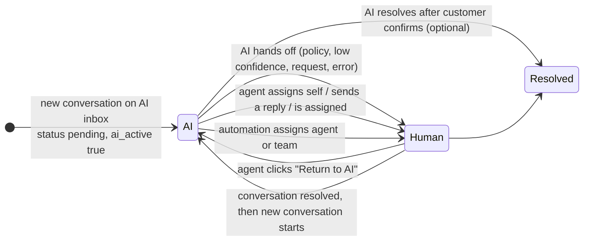

# Human Handoff

How a conversation moves from the AI agent to a human, how humans take over at any time, and how the AI is given the conversation back.

## 1. Chatwoot reference

- Conversations handled by a bot start in `pending` (`Conversation#determine_conversation_status`).
- `Conversation#bot_handoff!` sets the status to `open` and dispatches `conversation.bot_handoff`; reporting records `conversation_bot_handoff`.
- Captain's response job checks the handoff tool result (`handoff_completed?`) and that the conversation is still pending before replying.

## 2. Ownership states



| Field | AI owns | Human owns |
|---|---|---|
| `conversations.ai_active` | `true` | `false` |
| `conversations.status` | `pending` | `open` (or `pending`/`snoozed` set by the agent) |
| `conversations.assignee_id` | `NULL` | user or `NULL` (unassigned queue) |
| `ai_conversation_sessions.status` | `active` | `handed_off` |

## 3. Handoff triggers

`ai_agents.handoff_policy` (validated by `HandoffPolicy`):

```json
{
  "on_customer_request": true,
  "on_intents": ["complaint", "cancel_account", "legal"],
  "on_low_confidence": 0.55,
  "on_no_answer": "handoff",
  "on_negative_sentiment_streak": 2,
  "on_ai_error": "handoff",
  "outside_hours": "ai_continues",
  "assign_team_id": "00000000-0000-0000-0000-00000000f001",
  "handoff_message": { "en": "I'm connecting you with a member of our team. They'll reply here shortly.", "es": "Te conecto con una persona de nuestro equipo. Te responderá aquí en breve." },
  "post_internal_note": true
}
```

| Trigger | Detected in | `handoff_reason` |
|---|---|---|
| Customer asks for a person ("agent", "human", "talk to someone") | `intent_classification` (`human_request`) | `customer_request` |
| Configured intent | router | `intent:<name>` |
| Classifier confidence below threshold | router | `low_confidence` |
| No sufficient knowledge and `on_no_answer = handoff` | `rag` | `no_answer` |
| Negative sentiment N turns in a row | router (uses `facts.negative_streak`) | `negative_sentiment` |
| Turn limit (`max_turns_before_handoff`) | router | `turn_limit` |
| Guardrail block | `guardrails_validation` | `guardrail:<flag>` |
| Model sets `wants_handoff` | `response_generation` | `model_requested` |
| Quota exhausted / agent disabled / outside hours (policy `handoff`) | `tenant_context` | `quota_exhausted` / `agent_disabled` / `outside_hours` |
| LLM unavailable / timeout | runner fallback | `ai_unavailable` / `ai_timeout` |

## 4. What a handoff does

Executed by `response_delivery` → `ConversationService.handoff_to_human()` in one transaction, under a row lock on the conversation:

1. If `handoff_message` is configured: create the outgoing customer message in the customer's language (`sender_kind = ai_agent`).
2. If `post_internal_note`: create a **private note** for agents:
   ```text
   🤖 AI handed off: customer asked for a person.
   Intent: refund_policy (0.82) · Sentiment: negative
   Summary: Casey ordered a hoodie (#1234) 10 days ago and wants a refund because it arrived damaged.
   Sources used: Refund policy › Timelines
   ```
3. Update the conversation: `ai_active = false`, `status = open`, `team_id = assign_team_id` (if set and the conversation has no team), `waiting_since` kept (the customer is still waiting).
4. Session: `status = handed_off`, `handed_off_at = now()`.
5. Insert `conversation_assignments` (`reason = ai_handoff`), an activity message ("Conversation handed to a human by AI"), a `reporting_events` row (`conversation_bot_handoff`), and outbox events `conversation.handoff` + `conversation.updated`.
6. After commit: realtime `conversation.updated` to inbox members; auto-assignment (if enabled) picks an agent from the team/inbox; notifications go to the team.

## 5. Human takeover without a handoff

A human can take over at any time. `ConversationService` switches the AI off when:

| Action | Effect |
|---|---|
| Agent sends a **non-private** reply | `ai_active = false`; session `handed_off` (reason `agent_replied`) |
| Agent assigns the conversation to themselves or someone | `ai_active = false` (reason `agent_assigned`) |
| Automation assigns an agent | same (reason `automation_assigned`) |
| Agent toggles "Pause AI" in the conversation header | `ai_active = false` (reason `agent_paused`) |
| Private notes, labels, priority changes | **No effect**: agents can annotate without taking over |

Race safety: an AI run that started before the takeover re-checks `ai_active` and `assignee_id` under the row lock in `response_delivery` and discards its reply. The customer never gets an AI answer after a human took over.

## 6. Returning the conversation to the AI

- **"Return to AI"** button (requires `conversation.manage`): sets `ai_active = true`, `assignee_id = NULL`, `status = pending`, session `status = active`, adds an activity message. The AI does **not** reply immediately; it answers the customer's next message.
- **New conversation:** when a resolved conversation is followed by a new one on an AI inbox, a new session starts with `ai_active = true`.
- **Reopened conversation** (`lock_to_single_conversation`): stays with humans if it was handed off; the agent can return it to AI.

## 7. Assist-only mode (R2)

With `ai_agent_inboxes.mode = 'assist_only'`, the graph runs the same nodes, but `response_delivery` writes a **suggestion** (delivered to agents over realtime and stored as `content_attributes.ai_suggestion` on a private note) instead of a customer message. Agents edit and send it. Handoff doesn't apply in this mode.

## 8. Metrics

- Handoff rate by reason, by intent, by inbox (`ai_runs.handoff_reason`).
- Time from handoff to first human reply (`reporting_events` `conversation_bot_handoff` → first `reply_time`).
- AI-resolved rate: conversations resolved while `ai_active = true` with no human message.
- Tenants see these in Reports → AI (R1).
