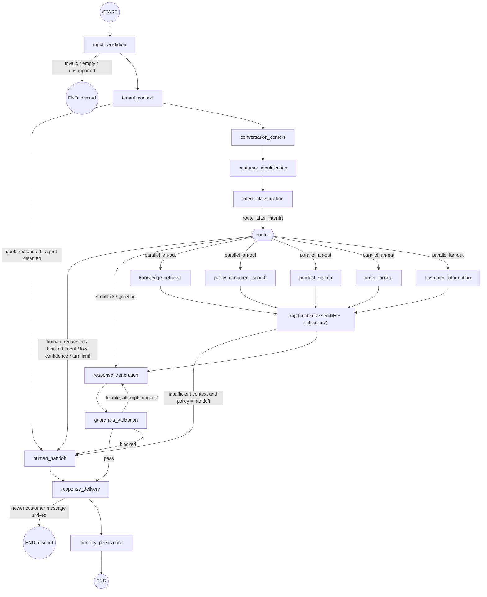

# LangGraph Workflow

The agent is a compiled `StateGraph`. This document defines the state, the graph, the conditional edges, error handling, and how a run starts and ends. Node details are in [LANGGRAPH_NODES.md](LANGGRAPH_NODES.md).

## 1. The graph



**Required nodes** (run on every non-discarded run): `input_validation`, `tenant_context`, `conversation_context`, `customer_identification`, `intent_classification`, `response_generation` *or* `human_handoff`, `guardrails_validation` (when a reply was generated), `response_delivery`, `memory_persistence`.

**Optional nodes** (run only when the router selects them **and** the tool is in `ai_agents.enabled_tools`): `knowledge_retrieval`, `policy_document_search`, `product_search`, `order_lookup`, `customer_information`, and `rag` (runs when at least one retrieval/tool node ran).

## 2. State

```python
# converse/ai/graph/state.py
import operator
from typing import Annotated, Literal, TypedDict
from uuid import UUID

class ToolResult(TypedDict):
    tool: str
    ok: bool
    data: dict | list | None          # structured, validated
    text: str                         # compact rendering for the prompt
    sources: list[dict]               # [{"chunk_id", "document_id", "title", "url"}]
    error: str | None

class Intent(TypedDict):
    name: str                         # e.g. "order_status", "refund_policy", "product_question", "smalltalk", "human_request", "complaint"
    confidence: float                 # 0..1
    language: str                     # BCP-47
    sentiment: Literal["positive", "neutral", "negative"]
    needs: list[str]                  # tools the classifier thinks are needed
    search_query: str | None          # standalone rewritten query

class AgentState(TypedDict, total=False):
    # identity of the run (set by the runner, immutable)
    run_id: UUID
    organization_id: UUID
    workspace_id: UUID
    conversation_id: UUID
    trigger_message_id: UUID
    ai_agent_id: UUID
    deadline_ts: float

    # loaded context
    agent: "AgentConfigView"          # prompt, persona, guardrails, handoff policy, tools, models
    conversation: "ConversationView"  # status, inbox, channel, last_incoming_at, labels, attributes
    customer: "CustomerView"          # name, identity_verified, attributes (PII-minimised)
    history: list["ChatTurn"]         # recent turns, newest last
    summary: str
    facts: dict
    input_text: str

    # decisions
    intent: Intent
    route: list[str]                  # nodes selected by the router
    tool_results: Annotated[list[ToolResult], operator.add]   # reducer: parallel nodes append
    context_block: str
    citations: list[dict]
    context_sufficient: bool

    # output
    draft: str
    guardrail_flags: list[str]
    guardrail_attempts: int
    outcome: Literal["reply", "handoff", "discard", "failed"]
    handoff_reason: str | None
    reply_message_id: UUID | None

    # bookkeeping
    errors: Annotated[list[dict], operator.add]
    usage: Annotated[list[dict], operator.add]                # token usage per node
```

- **Reducers.** `tool_results`, `errors` and `usage` use `operator.add`, so parallel branches each append without overwriting. Every other key is last-writer-wins, and only one node writes each of them.
- **No ORM objects in state.** State holds small immutable "view" dataclasses so it serialises cleanly (needed for checkpointing) and nodes can't lazy-load from the database.
- **Dependencies are not in state.** The LLM provider, retriever, tools and repositories are injected through `config["configurable"]` (LangGraph's runtime config), built per run from the `TenantContext`.

## 3. Building the graph

```python
# converse/ai/graph/build.py
from langgraph.graph import StateGraph, START, END
from langgraph.types import RetryPolicy

from . import nodes
from .edges import after_validation, after_tenant_context, route_after_intent, after_rag, after_guardrails, after_delivery

LLM_RETRY = RetryPolicy(max_attempts=3, initial_interval=1.0, backoff_factor=2.0, jitter=True,
                        retry_on=nodes.is_transient_llm_error)

def build_agent_graph():
    g = StateGraph(AgentState)

    g.add_node("input_validation", nodes.input_validation)
    g.add_node("tenant_context", nodes.tenant_context)
    g.add_node("conversation_context", nodes.conversation_context)
    g.add_node("customer_identification", nodes.customer_identification)
    g.add_node("intent_classification", nodes.intent_classification, retry_policy=LLM_RETRY)
    g.add_node("knowledge_retrieval", nodes.knowledge_retrieval)
    g.add_node("policy_document_search", nodes.policy_document_search)
    g.add_node("product_search", nodes.product_search)
    g.add_node("order_lookup", nodes.order_lookup)
    g.add_node("customer_information", nodes.customer_information)
    g.add_node("rag", nodes.rag, retry_policy=LLM_RETRY)
    g.add_node("response_generation", nodes.response_generation, retry_policy=LLM_RETRY)
    g.add_node("guardrails_validation", nodes.guardrails_validation)
    g.add_node("human_handoff", nodes.human_handoff)
    g.add_node("response_delivery", nodes.response_delivery)
    g.add_node("memory_persistence", nodes.memory_persistence)

    g.add_edge(START, "input_validation")
    g.add_conditional_edges("input_validation", after_validation, {"continue": "tenant_context", "discard": END})
    g.add_conditional_edges("tenant_context", after_tenant_context,
                            {"continue": "conversation_context", "handoff": "human_handoff"})
    g.add_edge("conversation_context", "customer_identification")
    g.add_edge("customer_identification", "intent_classification")
    g.add_conditional_edges("intent_classification", route_after_intent, [
        "human_handoff", "response_generation", "knowledge_retrieval", "policy_document_search",
        "product_search", "order_lookup", "customer_information",
    ])
    for tool_node in ("knowledge_retrieval", "policy_document_search", "product_search", "order_lookup", "customer_information"):
        g.add_edge(tool_node, "rag")            # rag waits for all branches scheduled in the same step
    g.add_conditional_edges("rag", after_rag, {"generate": "response_generation", "handoff": "human_handoff"})
    g.add_edge("response_generation", "guardrails_validation")
    g.add_conditional_edges("guardrails_validation", after_guardrails,
                            {"deliver": "response_delivery", "regenerate": "response_generation", "handoff": "human_handoff"})
    g.add_edge("human_handoff", "response_delivery")
    g.add_conditional_edges("response_delivery", after_delivery, {"persist": "memory_persistence", "discard": END})
    g.add_edge("memory_persistence", END)

    return g.compile()          # checkpointer added in R2, see MEMORY_MANAGEMENT.md
```

## 4. Conditional edges

```python
# converse/ai/graph/edges.py
TOOL_NODE_FOR_NEED = {
    "knowledge": "knowledge_retrieval",
    "policy": "policy_document_search",
    "product": "product_search",
    "order": "order_lookup",
    "customer": "customer_information",
}
TOOL_NAME_FOR_NODE = {
    "knowledge_retrieval": "knowledge_search",
    "policy_document_search": "policy_search",
    "product_search": "product_search",
    "order_lookup": "order_lookup",
    "customer_information": "customer_info",
}

def after_validation(state: AgentState) -> str:
    return "discard" if state.get("outcome") == "discard" else "continue"

def after_tenant_context(state: AgentState) -> str:
    return "handoff" if state.get("handoff_reason") else "continue"

def route_after_intent(state: AgentState) -> list[str] | str:
    intent, agent, policy = state["intent"], state["agent"], state["agent"].handoff_policy
    if intent["name"] == "human_request" and policy.on_customer_request:
        return "human_handoff"
    if intent["name"] in policy.on_intents:
        return "human_handoff"
    if intent["confidence"] < policy.on_low_confidence:
        return "human_handoff"
    if state["conversation"].ai_turn_count >= agent.max_turns_before_handoff:
        return "human_handoff"
    if intent["name"] in ("greeting", "smalltalk", "thanks"):
        return "response_generation"
    nodes = []
    for need in intent["needs"] or ["knowledge"]:
        node = TOOL_NODE_FOR_NEED.get(need)
        if node and TOOL_NAME_FOR_NODE[node] in agent.enabled_tools:
            nodes.append(node)
    return nodes or "response_generation"       # list → LangGraph runs them in parallel

def after_rag(state: AgentState) -> str:
    if not state["context_sufficient"] and state["agent"].handoff_policy.on_no_answer == "handoff":
        return "handoff"
    return "generate"                            # generation will say it doesn't know + offer a human

def after_guardrails(state: AgentState) -> str:
    flags = set(state["guardrail_flags"])
    if flags & {"unsafe", "blocked_topic", "pii_leak", "prompt_leak"}:
        return "handoff"
    if flags & {"too_long", "unsupported_claim", "wrong_language"}:
        return "regenerate" if state.get("guardrail_attempts", 0) < 2 else "handoff"
    return "deliver"

def after_delivery(state: AgentState) -> str:
    return "discard" if state["outcome"] == "discard" else "persist"
```

When `route_after_intent` returns several node names, LangGraph schedules them in the **same superstep**, runs them concurrently and only runs `rag` after all of them finish. Their outputs merge through the `tool_results` reducer.

## 5. Running the graph

```python
# converse/ai/runtime/runner.py
class AgentRunner:
    def run(self, ctx: TenantContext, conversation_id: UUID, trigger_message_id: UUID) -> RunResult:
        run = self.runs.start(ctx, conversation_id, trigger_message_id)   # INSERT ai_runs ON CONFLICT (session_id, trigger_message_id) DO NOTHING
        if run is None:
            return RunResult.duplicate()                                     # event delivered twice
        deps = self.deps_factory.build(ctx, run)                             # provider, retriever, tools, repos
        initial: AgentState = {
            "run_id": run.id, "organization_id": ctx.organization_id, "workspace_id": ctx.workspace_id,
            "conversation_id": conversation_id, "trigger_message_id": trigger_message_id,
            "ai_agent_id": run.ai_agent_id, "deadline_ts": time.time() + 45,
        }
        try:
            final = asyncio.run(asyncio.wait_for(
                GRAPH.ainvoke(initial, config={"configurable": {"deps": deps}, "recursion_limit": 25}),
                timeout=50,
            ))
        except Exception as exc:                                             # timeout or unexpected error
            self.runs.fail(run, exc)
            self.fallback.on_failure(ctx, conversation_id, run, exc)         # maybe handoff, per policy
            raise
        self.runs.finish(run, final)
        return RunResult.from_state(final)
```

- `GRAPH` is compiled once per worker process.
- `recursion_limit = 25` caps loops (the regenerate loop is at most 2).
- The Celery task (`queue = ai`, `acks_late = True`, `max_retries = 0`) never retries a whole run, because a retry could double-reply. The idempotent `ai_runs` row plus `response_delivery`'s checks make a redelivered task a no-op.

## 6. Error handling

| Error | Where | Handling |
|---|---|---|
| Transient LLM error (429, 5xx, timeout) | LLM nodes | `RetryPolicy` (3 attempts, exponential + jitter) |
| Persistent LLM error / provider down | LLM nodes | Node raises → runner `fallback.on_failure`: if `handoff_policy.on_ai_error = "handoff"` (default), hand off with reason `ai_unavailable`; else leave the conversation pending and alert |
| Tool failure (integration down, 4xx) | Tool nodes | Caught **inside** the node → `ToolResult(ok=False, error=...)` + `errors` entry; generation is told the information is unavailable and offers a human |
| Retrieval returns nothing | `knowledge_retrieval` | Not an error; `rag` sets `context_sufficient = False` |
| Invalid structured output | `intent_classification` | One repair attempt (re-ask with the validation error), then default intent `unknown` with confidence 0 → handoff route |
| Guardrail block | `guardrails_validation` | Handoff with reason `guardrail:<flag>` |
| Deadline exceeded | Any node checks `deadline_ts` | Raise `DeadlineExceeded` → fallback handoff `ai_timeout` |
| Conversation changed during run (human assigned, AI disabled, newer message) | `response_delivery` | Re-checks under a row lock: discard silently (status `discarded`) |
| Delivery to channel fails | Outbound pipeline | Not the AI's concern: normal message `failed` state, visible to agents |

## 7. Debounce and concurrency

Customers often send several short messages in a row ("hi", "I ordered last week", "where is it?"). Replying to each is wasteful and confusing.

1. On each incoming message the trigger sets `ai:debounce:{conversation_id} = message_id` (TTL 30 s) and schedules `run_ai_agent` with `countdown = 2.5 s`.
2. When the task starts, it compares its `trigger_message_id` with the Redis value. If a newer message replaced it, the task exits (that newer message has its own scheduled task).
3. A per-conversation Redis lock `ai:lock:{conversation_id}` ensures only one run per conversation at a time. If a run is already active, the new task re-schedules itself with a short countdown; the active run discards its own reply at delivery if a newer customer message arrived (same rule as Chatwoot's `newer_customer_message_arrived?`).
4. `conversation_context` always loads **all** unanswered customer messages since the last outgoing message, so the single reply covers all of them.
