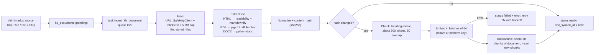

# RAG Architecture

Retrieval-Augmented Generation for the AI agent: tenants upload or link knowledge, we chunk and embed it into `kb_chunks` (pgvector), and the agent retrieves relevant chunks at answer time.

## 1. Chatwoot reference

Captain (Enterprise) crawls documents (`Captain::Documents::CrawlJob`, Firecrawl or a simple page crawler), generates FAQ question/answer pairs from them with an LLM (`Captain::Llm::FaqGeneratorService`), embeds the FAQs (`captain_assistant_responses.embedding vector(1536)`, ivfflat index) and searches them (`Captain::Tools::SearchDocumentationService`). Retrieval is at **FAQ level**.

Converse retrieves at **chunk level** (more faithful to the source, no generation step needed before content is searchable) and optionally adds generated FAQs as extra `source_type = 'faq'` documents.

## 2. Ingestion pipeline



| Step | Detail |
|---|---|
| Sources | `url` (single page; site crawl with sitemap and max pages is R2), `file` (PDF, DOCX, TXT, MD, HTML, ≤ 20 MB), `text` (pasted), `faq` (question + answer pairs) |
| Fetch safety | `SafeHttpClient`: blocks private/loopback/link-local IPs after DNS resolution (SSRF), follows ≤ 3 redirects re-checking each hop, 10 s timeout, 5 MB cap, `text/html` / `application/pdf` only |
| Extraction | Remove nav/footer/script; keep headings for `heading_path` metadata |
| Chunking | Split by headings first, then by paragraphs to ~500 tokens (tiktoken `cl100k_base` as a neutral counter), 50-token overlap; each chunk carries `metadata.heading_path`, `source_url`, `page` |
| Embedding | `knowledge_bases.embedding_model` (default `text-embedding-3-small`, 1536 dims; verify current availability before launch). Batches of 64, retry on 429/5xx |
| Atomic replace | Old chunks of the document are deleted and new ones inserted in one transaction, so retrieval never sees a half-updated document |
| Re-sync | Beat task: URL documents re-fetched weekly (configurable); unchanged `content_hash` skips re-embedding |
| Cost control | Plan limit on KB size (chunks per workspace); embedding usage recorded in `usage_records (metric = ai_tokens)` |

## 3. Retrieval

Hybrid search: vector similarity **plus** keyword search, fused with Reciprocal Rank Fusion. Vectors find paraphrases ("send it back" ≈ "return policy"); keywords find exact terms (SKUs, error codes, product names) that embeddings blur.

```python
# converse/ai/rag/retriever.py (SQLAlchemy Core; shown as SQL for clarity)
VECTOR_SQL = """
SELECT id, document_id, content, metadata, 1 - (embedding <=> :q_embedding) AS score
FROM kb_chunks
WHERE workspace_id = :workspace_id
  AND knowledge_base_id = ANY(:kb_ids)
ORDER BY embedding <=> :q_embedding
LIMIT 20
"""

KEYWORD_SQL = """
SELECT id, document_id, content, metadata, ts_rank_cd(search_vector, q) AS score
FROM kb_chunks, websearch_to_tsquery('simple', :q_text) AS q
WHERE workspace_id = :workspace_id
  AND knowledge_base_id = ANY(:kb_ids)
  AND search_vector @@ q
ORDER BY score DESC
LIMIT 20
"""
```

Both queries run in the tenant transaction (RLS adds `organization_id = current_org_id()`), with:

```sql
SET LOCAL hnsw.ef_search = 100;
SET LOCAL hnsw.iterative_scan = relaxed_order;   -- pgvector >= 0.8: keep scanning when filters remove candidates
```

(These go through the same parameter-safe `set_config()` helper as the tenant binding.)

Fusion and filtering:

```python
def rrf(vector_hits, keyword_hits, k: int = 60, top_n: int = 8):
    scores: dict[UUID, float] = {}
    for rank, hit in enumerate(vector_hits):
        scores[hit.id] = scores.get(hit.id, 0) + 1 / (k + rank + 1)
    for rank, hit in enumerate(keyword_hits):
        scores[hit.id] = scores.get(hit.id, 0) + 1 / (k + rank + 1)
    by_id = {h.id: h for h in [*vector_hits, *keyword_hits]}
    ranked = sorted(scores, key=scores.get, reverse=True)[:top_n]
    return [by_id[i] for i in ranked]
```

- **Sufficiency threshold:** keep vector hits with cosine similarity ≥ 0.30 (tune per embedding model with the eval set); `context_sufficient` requires at least one kept hit or a keyword hit with rank ≥ 0.1.
- **Query rewriting:** the classifier's `search_query` (standalone question) is embedded, not the raw last message, which is often "and for Canada?".
- **Reranking (optional):** above ~5,000 chunks per KB, rerank the fused top 20 with a cross-encoder (e.g. a hosted rerank API) to top 4.
- **Policy search:** same SQL plus `AND document_id IN (SELECT id FROM kb_documents WHERE metadata->>'category' = 'policy' AND knowledge_base_id = ANY(:kb_ids))`, threshold 0.40.

## 4. Context assembly

```text
<context>
[1] Refund policy › Timelines (https://acme.example/refunds)
Refunds are processed within 5–7 business days to the original payment method…

[2] Shipping › International
We ship to Canada and Mexico. Delivery takes 5–10 business days…
</context>
```

- At most ~1,500 tokens of context; chunks are truncated at sentence boundaries if needed.
- Source numbers map to `citations` saved on the reply (`content_attributes.ai.citations`), so agents can see which documents the AI used.
- Channel replies don't show citation markers by default (`[1]` looks odd on WhatsApp); the widget can render "Sources" links (`guardrails.show_sources`).

## 5. Tenant isolation of knowledge

| Layer | Guarantee |
|---|---|
| Storage | `kb_chunks` has `organization_id` + `workspace_id` with composite FKs to its document and KB; RLS on `organization_id` |
| Query | Every retrieval filters `workspace_id = :ctx.workspace_id AND knowledge_base_id = ANY(:agent_kb_ids)`; the KB ids come from `ai_agent_knowledge_bases` loaded in `tenant_context`, not from user input |
| Embeddings | Computed with the tenant's credential when configured; the platform key otherwise. No cross-tenant embedding cache |
| Files | KB files live under `org/{org_id}/ws/{ws_id}/kb/…` in storage |
| Index | One shared HNSW index. RLS + filters make sharing safe; per-tenant indexes are unnecessary until a single tenant's data dominates (then partition `kb_chunks` by `organization_id` hash) |
| Tests | `test_retrieval_isolation`: two tenants with identical documents and a query matching both; each sees only its own chunk ids |

## 6. Evaluation

- An eval set per knowledge base: `[{question, expected_document_ids, must_include: [...], must_not_include: [...]}]`, stored as JSON (internal R1, tenant-facing playground R2).
- Metrics: retrieval recall@8, answer groundedness (LLM judge), refusal correctness on unanswerable questions, handoff rate.
- Run on every change to chunking, embedding model, thresholds or prompts. Thresholds are configuration, not code constants.
