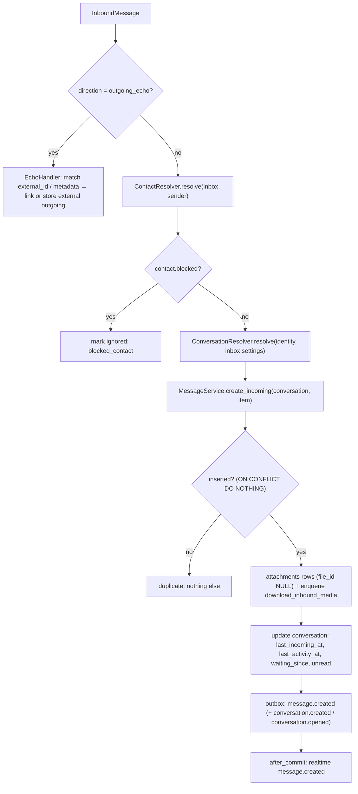
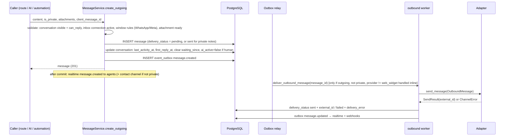

# Message Processing

The path of every message through the system: inbound from a channel, outbound to a channel, and the events in between. Channel-specific parsing is in [../integrations/](../integrations/); this document covers the shared core.

## 1. Inbound: webhook to stored message

### 1.1 Ingress (api process)

```python
# converse/api/webhooks/meta.py
@router.post("/webhooks/meta/{product}", status_code=200)
async def meta_events(product: MetaProduct, request: Request, ingress: Ingress = Depends(get_ingress)) -> Response:
    raw = await read_body_limited(request, max_bytes=1_000_000)          # 413 above 1 MB
    adapter_cls = META_ADAPTERS[product]
    payload = orjson.loads(raw)
    units = adapter_cls.route_keys(payload)                              # pure parsing, no I/O
    secrets = await ingress.candidate_secrets(product, units)            # platform secret + per-connection secrets
    if not adapter_cls.verify_webhook(dict(request.headers), raw, secrets):
        metrics.webhook_signature_invalid.labels(product).inc()
        return Response(status_code=401)
    await ingress.record_and_enqueue(product, units)                     # INSERT … ON CONFLICT DO NOTHING; enqueue new ids
    return Response(status_code=200)
```

- Budget: < 200 ms p99. No provider calls, no contact/conversation work.
- `record_and_enqueue` inserts all units in one statement and enqueues `process_inbound_event` **after commit** for the rows that were actually inserted (`RETURNING id`).
- If Redis (the broker) is down, rows stay `received`; the `inbound_sweeper` beat task (every minute) enqueues `received` rows older than 1 minute. A message is never lost as long as Postgres accepted it.
- If Postgres is down, return `503`; Meta retries the delivery later.

### 1.2 Processing (inbound worker)

```python
# converse/channels/pipeline/inbound.py
class InboundPipeline:
    def process(self, event_id: UUID) -> None:
        event = self.events.claim(event_id)                  # system session: state received|failed → processing; None if done
        if event is None:
            return
        route = self.routes.lookup(event.provider, event.routing_id)
        if route is None or route.connection_status == "disconnected":
            return self.events.mark(event, "ignored", "no_active_route")
        with tenant_session(route.organization_id) as session:
            adapter = adapter_for(route.connection, self.secrets, self.http)
            for item in adapter.parse_incoming(event.payload):
                with self.ordering_lock(route.inbox_id, item):       # lock:inbound:{inbox}:{sender}
                    self.handlers[item.kind].handle(session, route, adapter, item)
            session.commit()
        self.uow.run_after_commit()                                  # realtime publishes
        self.events.mark(event, "processed")
```

`InboundMessageHandler.handle`:



**ContactResolver**

```python
def resolve(self, session, route, sender: SenderProfile, adapter) -> tuple[Contact, ContactIdentity]:
    identity = self.identities.find(session, route.inbox_id, [sender.source_id, *sender.alternate_source_ids])
    if identity:
        if identity.source_id != sender.source_id:            # e.g. wa_id → BSUID upgrade
            identity.source_id = sender.source_id
        return identity.contact, identity
    profile = adapter.fetch_profile(sender.source_id) or sender  # best effort; never fails the pipeline
    contact = self.contacts.find_by_phone_or_email(session, route.workspace_id, profile) \
              or self.contacts.create(session, route, profile)
    identity = self.identities.insert_or_get(session, route, contact, sender.source_id, profile)
    # INSERT … ON CONFLICT (inbox_id, source_id) DO NOTHING RETURNING *; if nothing returned, SELECT the winner
    return identity.contact, identity
```

Contact matching across channels is deliberately conservative: a WhatsApp phone number matches an existing contact with the same E.164 phone; Messenger/Instagram never auto-match (no reliable shared key). Agents merge manually.

**ConversationResolver**

| Situation | Result |
|---|---|
| Identity has a non-resolved conversation | Use it (snoozed → reopen to `open`; pending stays pending if AI active) |
| Latest is resolved and `lock_to_single_conversation` | Reopen it (`resolved → open`, or `pending` if AI) |
| Latest is resolved and `allow_messages_after_resolved = false` | Store the message on the resolved conversation as ignored + activity "Customer wrote after resolution" (no reopen) |
| Otherwise | New conversation: `display_number = next_workspace_counter(ws, 'conversation')`; `status = pending` + `ai_active = true` if the inbox has an autonomous AI agent, else `open`; record `conversation.created` |

All of it runs under the ordering lock, so two concurrent first messages can't both create a conversation (the gap Chatwoot's Instagram job comment describes).

### 1.3 Ordering guarantees

| Guarantee | How |
|---|---|
| One conversation per burst of first messages | Ordering lock around resolve + insert |
| Timeline order equals customer send order | Order by `(created_at, sequence_number)`; `created_at` = provider timestamp when it's earlier than the latest stored message |
| No duplicates under retries | `inbound_webhook_events` unique key → `messages (inbox_id, external_id)` unique → `ON CONFLICT DO NOTHING` |
| Status updates never regress | `apply_delivery_update` only moves forward in rank `pending < sent < delivered < read`; `failed` only from `pending`/`sent` (see §4) |
| Status before message (status webhook arrives first) | If the message isn't found, the delivery task retries 3× over 30 s, then records `ignored: message_not_found` |

## 2. Outbound: reply to channel



- Private notes and activity messages never reach the outbound queue (same rule as Chatwoot's `Base::SendOnChannelService#invalid_message?`).
- Mentions in private notes (`@[Name](user:<id>)`) create `mentions` rows and notifications.
- Attachments: the message is created only after all `file_id`s are `ready` (upload complete + MIME verified), so there's no fixed delay before sending (Chatwoot waits 2 s when attachments exist).
- **Retry:** `RetryableChannelError` → exponential backoff with jitter: 10 s, 30 s, 90 s, 4 min, 10 min, 20 min (6 attempts). The message stays `pending` and the UI shows "Sending…"; after the last attempt it becomes `failed`. Agents can retry manually (`POST …/messages/{id}/retry`).
- **Ordering of outbound messages:** two quick agent replies must arrive in order. `deliver_outbound_message` takes `lock:outbound:{conversation_id}` and sends any older `pending` messages of the conversation first.

## 3. The 24-hour window

| Channel | Free-form allowed | After the window |
|---|---|---|
| WhatsApp | ≤ 24 h after `last_incoming_at` | Template only (`content_type = template`) |
| Messenger | ≤ 24 h; human agent ≤ 7 days with `HUMAN_AGENT` tag | Blocked |
| Instagram | ≤ 24 h; human agent ≤ 7 days with `HUMAN_AGENT` tag | Blocked |
| Web widget | Always | — |

`MessageService.create_outgoing` checks this **before** inserting and returns `422 window_closed`, so agents see the problem immediately rather than as a failed send. The adapter re-checks at send time (the message may have been queued for a while).

## 4. Delivery and read status

`DeliveryUpdate` handling:

```python
STATUS_RANK = {"pending": 0, "sent": 1, "delivered": 2, "read": 3}

def apply(self, session, route, update: DeliveryUpdate):
    if update.external_id:                       # WhatsApp: one message
        targets = self.messages.by_external_id(session, route.inbox_id, update.external_id)
    else:                                        # Messenger/IG watermark: all earlier outgoing to this identity
        targets = self.messages.outgoing_before(session, route.inbox_id, update.recipient_source_id, update.watermark)
    for message in targets:
        if update.status == "failed":
            if message.delivery_status in ("pending", "sent"):
                message.delivery_status, message.delivery_error = "failed", f"{update.error_code}: {update.error_message}"
        elif STATUS_RANK[update.status] > STATUS_RANK.get(message.delivery_status, 0):
            message.delivery_status = update.status
        self.uow.record_event(MessageUpdated(...))
```

Read receipts from the customer also update `conversations.contact_last_seen_at`.

## 5. Messages from agents in the provider app

Messenger and Instagram echo messages that a business sends from Meta's own apps; WhatsApp coexistence sends `smb_message_echoes`. They are stored as `outgoing` with `sender_kind = system`, `content_attributes.external_echo = true`, deduplicated by `external_id`. They are never re-sent. They also switch `ai_active` off (a human replied).

## 6. Edits, deletes, reactions

| Event | Effect |
|---|---|
| Customer unsends (Messenger/IG `is_deleted`) | `deleted_at = now()`, `content = NULL`, `content_attributes.deleted = true`; timeline shows "This message was deleted" |
| Agent deletes own outgoing message | Same locally; provider unsend where supported (Messenger/IG within limits); WhatsApp messages can't be recalled by the API, so we only delete locally |
| Reaction from customer | Stored on the target message's `content_attributes.reactions` (list of `{emoji, by: "contact", at}`); `message.updated` event |
| Agent edits private note | Allowed within 15 minutes by the author; `content_attributes.edited_at` |

## 7. Domain events

Written to `event_outbox` by services; payload schemas in `converse/core/events/schemas.py`.

| Event | Emitted by | Typical consumers |
|---|---|---|
| `conversation.created` | ConversationResolver, `POST /conversations` | realtime, webhooks, automation, reporting, assignment |
| `conversation.updated` | Any change (status, priority, attributes, labels, assignee, team) with `changes` | realtime, webhooks, automation |
| `conversation.status_changed` | `transition()` | webhooks, reporting (resolution time), automation (`conversation.resolved`/`opened`) |
| `conversation.assignee_changed` / `team_changed` | `assign()` | realtime (notification), notifications |
| `conversation.handoff` | `handoff_to_human()` | reporting, assignment, notifications |
| `message.created` | MessageService | realtime, outbound delivery, webhooks, automation, AI trigger, reporting (first response, reply time), notifications (mentions, new message) |
| `message.updated` | delivery status, edits, deletes, media ready | realtime, webhooks |
| `contact.created` / `contact.updated` / `contact.merged` / `contact.deleted` | ContactService | realtime, webhooks |
| `inbox.connection_changed` | InboxService | realtime (admin), notifications |

Consumers are registered in `converse/workers/tasks/events.py`:

```python
HANDLERS: dict[str, list[Handler]] = {
    "message.created": [outbound.handle, webhooks.fanout, automation.on_message_created, ai.on_message_created,
                        analytics.on_message_created, notifications.on_message_created],
    "conversation.created": [webhooks.fanout, automation.on_conversation_created, assignment.on_conversation_created,
                             analytics.on_conversation_created],
    ...
}
```

The relay enqueues **one task per (event, handler)** (`handle_event.apply_async(args=[event_id, handler_name], queue=handler.queue)`), so a slow handler (webhooks) can't delay a fast one (outbound) and each retries independently. Handlers are idempotent: they check their own dedup key (`automation_rule_executions`, `webhook_deliveries`, `ai_runs`, `reporting_events` unique per conversation+name where applicable).

## 8. Outbox relay

```python
# converse/core/events/relay.py — runs as its own process (1–2 replicas)
BATCH = 200

def relay_once(system_session) -> int:
    rows = system_session.execute(
        select(EventOutbox)
        .where(EventOutbox.state == "pending", EventOutbox.available_at <= func.now())
        .order_by(EventOutbox.id)
        .limit(BATCH)
        .with_for_update(skip_locked=True)
    ).scalars().all()
    for row in rows:
        for handler in HANDLERS.get(row.event_name, []):
            handle_event.apply_async(
                kwargs={"event_id": row.id, "handler": handler.name, "organization_id": str(row.organization_id)},
                queue=handler.queue,
            )
        row.state, row.dispatched_at = "dispatched", func.now()
    system_session.commit()
    return len(rows)
```

- Latency: the relay loops with `LISTEN converse_outbox` (services `NOTIFY` after commit) plus a 500 ms poll fallback, so events are dispatched within ~50 ms normally.
- If enqueueing fails mid-batch, the transaction rolls back and the batch is retried; handlers are idempotent, so a duplicate enqueue is harmless.
- Pruning: dispatched rows older than 7 days are deleted in batches of 10,000 by `prune_outbox`.

## 9. Failure handling summary

| Failure | Behaviour | Visible to |
|---|---|---|
| Bad webhook signature | `401`, metric, no storage | Ops (alert on spikes) |
| Unknown route | `ignored` | Platform admin (dead-letter view filter) |
| Parse error (new payload shape) | Task fails → retries 3× → `dead` with error | Platform admin; alert |
| Media download failure | Retries 5×; attachment shows "Media unavailable" with provider link if any | Agent |
| Outbound send failure | Retries; `failed` with reason | Agent (message bubble) |
| Token invalid | Connection `reauthorization_required`; admin notification; sends fail fast with `reauthorization_required` | Admin banner |
| Handler failure (webhook/automation/AI) | Per-handler retries; finally `dead` handler record + log | Admin (webhook delivery log, automation log, AI activity) |
