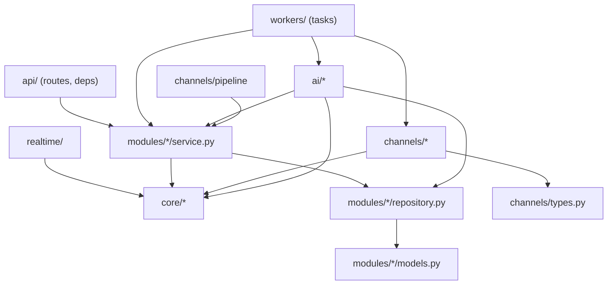

# Backend Project Structure

A modular monolith organised **by domain module**, with infrastructure in `core/`, provider code in `channels/`, AI in `ai/`, and entry points (`api/`, `realtime/`, `workers/`) that wire everything together.

## 1. Repository layout

```text
converse/                                   # repository root
├── pyproject.toml                          # uv-managed; ruff, mypy, pytest, import-linter config
├── uv.lock
├── alembic.ini
├── Dockerfile
├── docker-compose.yml                      # dev stack
├── docker-compose.prod.yml
├── .env.example
├── config/
│   ├── llm_models.yaml                     # allow-listed AI models
│   └── logging.yaml
├── nginx/
│   └── converse.conf
├── src/
│   └── converse/
│       ├── __init__.py
│       ├── settings.py                     # pydantic-settings: one Settings object
│       ├── core/                           # infrastructure, no business rules
│       │   ├── db/
│       │   │   ├── engine.py               # async + sync engines, pools
│       │   │   ├── session.py              # session factories, transaction helpers
│       │   │   ├── tenant.py               # bind_tenant(), tenant_session()
│       │   │   ├── system.py               # system_session() (BYPASSRLS) — restricted import
│       │   │   ├── base.py                 # DeclarativeBase, naming conventions, mixins
│       │   │   └── types.py                # custom column types (EncryptedBytes, Vector)
│       │   ├── tenancy/
│       │   │   └── context.py              # TenantContext, Principal
│       │   ├── events/
│       │   │   ├── outbox.py               # record_event(session, event)
│       │   │   ├── schemas.py              # domain event Pydantic models
│       │   │   └── relay.py                # outbox relay loop
│       │   ├── realtime/
│       │   │   └── publisher.py            # RealtimePublisher (Redis PUBLISH after commit)
│       │   ├── crypto/
│       │   │   ├── encryptor.py            # AES-GCM envelope encryption, key versions
│       │   │   └── tokens.py               # random tokens, hashing, HMAC helpers
│       │   ├── storage/
│       │   │   ├── base.py                 # StorageBackend protocol
│       │   │   ├── local.py
│       │   │   └── s3.py
│       │   ├── http/
│       │   │   ├── client.py               # httpx clients with timeouts, retries
│       │   │   └── safe.py                 # SafeHttpClient (SSRF-safe) for user-supplied URLs
│       │   ├── cache.py                    # tenant-aware Redis key builder, cache helpers
│       │   ├── locks.py                    # Redis locks
│       │   ├── ratelimit.py                # token buckets
│       │   ├── errors.py                   # DomainError hierarchy → HTTP mapping
│       │   ├── logging.py                  # structlog config, context binding
│       │   ├── telemetry.py                # OpenTelemetry setup
│       │   └── clock.py                    # now() (patchable in tests)
│       ├── modules/                        # business domains
│       │   ├── auth/
│       │   │   ├── models.py               # User, UserSession, ApiAccessToken, PlatformAdmin
│       │   │   ├── repository.py
│       │   │   ├── service.py              # login, refresh, logout, MFA, password reset
│       │   │   ├── passwords.py            # argon2 hashing
│       │   │   ├── jwt.py                  # issue/verify access tokens
│       │   │   └── schemas.py              # request/response models
│       │   ├── tenancy/                    # organizations, workspaces, memberships, invitations
│       │   ├── access/                     # roles, permissions, visibility filters
│       │   ├── teams/
│       │   ├── inboxes/                    # inboxes, channel_connections, channel_routes (lifecycle)
│       │   ├── contacts/                   # contacts, identities, resolver, merge, notes
│       │   ├── conversations/              # conversations, resolver, transitions, assignment history
│       │   ├── messaging/                  # messages, attachments, delivery status
│       │   ├── files/                      # stored_files: upload presign/complete, verification, download authorization
│       │   ├── assignment/                 # round robin, capacity
│       │   ├── labels/
│       │   ├── attributes/                 # custom attribute definitions + validation
│       │   ├── canned_responses/
│       │   ├── automation/                 # rules, conditions, actions, executor, macros
│       │   ├── webhooks/                   # subscriptions, deliveries, signer
│       │   ├── knowledge/                  # knowledge bases, documents, ingestion service
│       │   ├── ai_config/                  # ai_agents, provider credentials, inbox/KB links (CRUD only; runtime lives in ai/)
│       │   ├── notifications/
│       │   ├── analytics/                  # reporting events, report queries
│       │   ├── billing/                    # plans, subscriptions, limits, usage, Stripe adapter
│       │   ├── audit/
│       │   └── platform/                   # platform admin services
│       ├── channels/                       # provider adapters (no business rules)
│       │   ├── base.py                     # BaseChannelAdapter, ChannelError classes
│       │   ├── types.py                    # InboundMessage, OutboundMessage, DeliveryUpdate, ...
│       │   ├── registry.py
│       │   ├── pipeline/
│       │   │   ├── ingress.py              # record + enqueue (used by webhook routes)
│       │   │   ├── inbound.py              # InboundPipeline: route → parse → handlers
│       │   │   └── outbound.py             # OutboundDispatcher
│       │   ├── web_widget/
│       │   │   └── adapter.py
│       │   └── meta/
│       │       ├── common/                 # graph client, signature, errors, oauth helpers
│       │       ├── messenger/              # adapter.py, parser.py, client.py, oauth.py, schemas.py
│       │       ├── instagram/
│       │       └── whatsapp/               # + templates.py, media.py, embedded_signup.py
│       ├── ai/
│       │   ├── handlers.py                 # outbox handler: should_run + debounce + enqueue
│       │   ├── runtime/                    # AgentRunner, deps factory, fallback
│       │   ├── graph/
│       │   │   ├── state.py
│       │   │   ├── build.py
│       │   │   ├── edges.py
│       │   │   └── nodes/                  # one file per node
│       │   ├── providers/                  # LLMProvider implementations, model allow-list
│       │   ├── rag/                        # retriever, chunker, extractors, embedder
│       │   ├── tools/                      # product/order/customer tools + IntegrationClient
│       │   ├── memory/                     # session store, summariser
│       │   ├── guardrails/
│       │   └── prompts/                    # versioned prompt templates
│       ├── api/                            # HTTP entry point
│       │   ├── app.py                      # create_app(): routers, middleware, exception handlers
│       │   ├── deps/                       # get_session, get_principal, get_tenant_context, require_permission
│       │   ├── middleware/                 # request id, logging, CORS, body size, rate limit
│       │   ├── routes/
│       │   │   ├── auth.py
│       │   │   ├── organizations.py
│       │   │   ├── workspaces.py
│       │   │   ├── members.py
│       │   │   ├── teams.py
│       │   │   ├── inboxes.py
│       │   │   ├── channels/               # messenger.py, instagram.py, whatsapp.py, widget_settings.py
│       │   │   ├── contacts.py
│       │   │   ├── conversations.py
│       │   │   ├── messages.py
│       │   │   ├── uploads.py
│       │   │   ├── labels.py
│       │   │   ├── canned_responses.py
│       │   │   ├── attributes.py
│       │   │   ├── automation.py
│       │   │   ├── ai.py
│       │   │   ├── knowledge.py
│       │   │   ├── webhooks.py
│       │   │   ├── analytics.py
│       │   │   ├── billing.py
│       │   │   ├── audit.py
│       │   │   ├── platform.py
│       │   │   └── widget/                 # public widget API
│       │   └── webhooks/                   # inbound provider webhooks
│       │       ├── meta.py
│       │       └── stripe.py
│       ├── realtime/                       # WebSocket gateway entry point
│       │   ├── app.py
│       │   ├── gateway.py                  # connection manager, auth, subscriptions
│       │   ├── protocol.py                 # frame schemas
│       │   └── presence.py
│       ├── workers/                        # Celery entry point
│       │   ├── celery_app.py               # app, queues, routes, beat schedule
│       │   ├── base.py                     # TenantTask, SystemTask
│       │   └── tasks/                      # thin task functions calling services
│       │       ├── inbound.py
│       │       ├── outbound.py
│       │       ├── events.py               # outbox handler dispatch
│       │       ├── webhooks.py
│       │       ├── ai.py
│       │       ├── media.py
│       │       ├── knowledge.py
│       │       ├── conversations.py        # snooze wake-up, auto-resolve
│       │       ├── channels.py             # token refresh, health checks, template sync
│       │       ├── billing.py
│       │       └── maintenance.py          # purges, outbox pruning, re-encryption
│       ├── db/
│       │   └── migrations/                 # Alembic env + versions + sql/ (baseline SQL files)
│       └── cli.py                          # typer CLI: seed-demo, create-platform-admin, hash-password
├── tests/
│   ├── conftest.py                         # testcontainers Postgres(pgvector)+Redis, factories
│   ├── factories/                          # factory-boy / polyfactory builders
│   ├── fixtures/channels/                  # recorded provider payloads (scrubbed)
│   ├── unit/                               # pure functions, parsers, graph nodes with fakes
│   ├── integration/                        # services + repositories against real Postgres
│   ├── api/                                # HTTP tests via httpx.AsyncClient
│   ├── contract/                           # adapter contract suite, event schema tests
│   ├── security/                           # tenant isolation, auth, RLS tests
│   └── e2e/                                # full flow: webhook → worker → realtime → reply
└── widget-sdk/                             # TypeScript SDK (separate build)
```

## 2. Inside a domain module

Every module under `modules/` uses the same files. Not every module needs all of them; create a file only when there is something to put in it.

| File | Responsibility | May import | Must not import |
|---|---|---|---|
| `models.py` | SQLAlchemy ORM models (tables of this module) | `core.db` | services, schemas, other modules' services |
| `repository.py` | Queries. Every method takes `TenantContext` (or is explicitly system-level). Returns ORM objects or views | `models`, `core.db`, other modules' **models** for joins | services, FastAPI, Celery |
| `service.py` | Business rules, transactions, event recording, audit calls | own `repository`, other modules' **services** (public methods), `core.*` | FastAPI (`Request`, `Depends`), Celery, `channels.*`, `ai.*` |
| `schemas.py` | Pydantic request/response models and service DTOs | Pydantic, `core.tenancy` | ORM models (use `model_validate(..., from_attributes=True)` at the edge) |
| `events.py` | Event payload models emitted by this module | `core.events.schemas` | — |
| `handlers.py` | Outbox event handlers this module reacts to | own `service` | FastAPI |
| `errors.py` | Domain errors (`ConversationNotFound`, `InvalidTransition`) | `core.errors` | — |
| `policies.py` | Permission/visibility helpers specific to the module | `access` | — |

Example: `modules/conversations/`

```text
conversations/
├── models.py          # Conversation, ConversationAssignment, ConversationParticipant
├── repository.py      # list_for_inbox_view(), get(), lock_for_update(), find_open_for_identity()
├── service.py         # ConversationService: transition(), assign(), handoff_to_human(), resume_ai()
├── resolver.py        # ConversationResolver for the inbound pipeline
├── schemas.py         # ConversationRead, ConversationListQuery, ConversationUpdate, ...
├── events.py          # ConversationCreated, ConversationStatusChanged, ...
├── handlers.py        # on contact.merged → move conversations
└── errors.py
```

## 3. Layer rules



Enforced with `import-linter` contracts in `pyproject.toml`:

```toml
[tool.importlinter]
root_package = "converse"

[[tool.importlinter.contracts]]
name = "Modules don't depend on channels, ai or entry points"
type = "forbidden"
source_modules = ["converse.modules"]
forbidden_modules = ["converse.channels", "converse.ai", "converse.api", "converse.workers", "converse.realtime"]

[[tool.importlinter.contracts]]
name = "Adapters only see core and channel types"
type = "forbidden"
source_modules = ["converse.channels.meta", "converse.channels.web_widget"]
forbidden_modules = ["converse.modules", "converse.ai", "converse.api", "converse.workers"]

[[tool.importlinter.contracts]]
name = "Core has no business dependencies"
type = "forbidden"
source_modules = ["converse.core"]
forbidden_modules = ["converse.modules", "converse.channels", "converse.ai", "converse.api", "converse.workers"]

[[tool.importlinter.contracts]]
name = "System (BYPASSRLS) sessions are restricted"
type = "forbidden"
source_modules = ["converse.modules", "converse.ai", "converse.api.routes"]
forbidden_modules = ["converse.core.db.system"]
ignore_imports = [
    "converse.modules.platform.* -> converse.core.db.system",
    "converse.modules.auth.service -> converse.core.db.system",
]
```

`channels/pipeline/` is the one place that connects adapters (`channels.*`) to services (`modules.*`). It's excluded from the "adapters" contract on purpose.

## 4. Route handler pattern

```python
# converse/api/routes/conversations.py
router = APIRouter(prefix="/workspaces/{workspace_id}/conversations", tags=["conversations"])

@router.patch("/{conversation_id}", response_model=ConversationRead)
async def update_conversation(
    conversation_id: UUID,
    body: ConversationUpdate,
    ctx: TenantContext = Depends(require_permission("conversation.manage")),
    service: ConversationService = Depends(get_conversation_service),
) -> ConversationRead:
    conversation = await service.update(ctx, conversation_id, body)
    return ConversationRead.model_validate(conversation, from_attributes=True)
```

The handler: parses input (Pydantic), resolves context (dependencies), calls **one** service method, serialises. No queries, no `if` on business rules, no commits. The session dependency commits on success and rolls back on exception, and then publishes realtime events queued by the service (`after_commit` hook on the unit of work).

## 5. Service pattern

```python
# converse/modules/conversations/service.py
class ConversationService:
    def __init__(self, repo: ConversationRepository, uow: UnitOfWork, audit: AuditService,
                 messages: "MessageActivityWriter"):
        ...

    async def update(self, ctx: TenantContext, conversation_id: UUID, body: ConversationUpdate) -> Conversation:
        conversation = await self.repo.lock_for_update(ctx, conversation_id)   # 404 if not visible
        changes = {}
        if body.status is not None and body.status != conversation.status:
            self._transition(conversation, body.status, snoozed_until=body.snoozed_until)
            changes["status"] = [conversation.previous_status, conversation.status]
        if body.priority is not UNSET:
            changes["priority"] = [conversation.priority, body.priority]
            conversation.priority = body.priority
        if not changes:
            return conversation
        await self.messages.add_activity(ctx, conversation, ActivityKind.from_changes(changes))
        self.uow.record_event(ConversationUpdated(conversation_id=conversation.id, changes=changes, actor=ctx.principal.ref))
        self.uow.after_commit(realtime.conversation_updated(conversation))
        return conversation
```

- `UnitOfWork.record_event` inserts into `event_outbox` in the same transaction.
- `UnitOfWork.after_commit` queues realtime publishes, run only if the commit succeeds.
- Services raise domain errors; `core.errors` maps them to HTTP (`ConversationNotFound` → 404, `InvalidTransition` → 422, `PlanLimitReached` → 402).

## 6. What we deliberately don't have

- No generic `BaseRepository[T]` with magic CRUD. Explicit methods read better and keep tenant filters visible.
- No service locator or DI container. FastAPI `Depends` factories in `api/deps/` and plain constructors in workers.
- No separate "controllers" layer between routes and services. Routes are the controllers.
- No per-module Celery apps. One Celery app, tasks grouped by queue.
