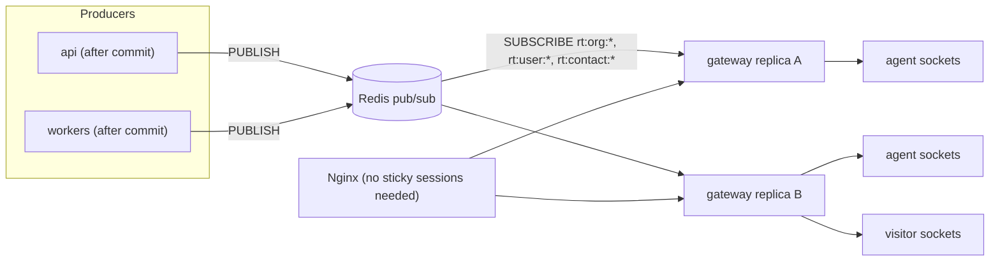

# Real-time Communication

A WebSocket gateway pushes events to agent dashboards and widget visitors. Redis pub/sub fans events out across gateway replicas. Realtime is a **speed layer**: every event can be recovered by refetching over REST.

## 1. Chatwoot reference

- ActionCable `RoomChannel` (`app/channels/room_channel.rb`): clients subscribe with a `pubsub_token` (`users.pubsub_token` for agents with `user_id` + `account_id`; `contact_inboxes.pubsub_token` for widget visitors). Agents also stream `account_<id>`.
- `ActionCableListener` (sync dispatcher) computes recipients: inbox members' tokens + the contact's token for non-private messages; `ActionCableBroadcastJob` (queue `critical`) broadcasts.
- Presence via `OnlineStatusTracker` (Redis) → `presence.update` events.
- Dashboard client maps event names to store updates (`app/javascript/dashboard/helper/actionCable.js`).

## 2. Topology



The gateway (`converse.realtime.app:app`, Uvicorn) is a separate deployment from the REST API, so WebSocket connection counts don't affect API capacity. Each replica keeps an in-memory map `channel → set[Connection]` and holds **one** Redis subscription per channel it currently needs (subscribe on the first local listener, unsubscribe when the last one leaves).

## 3. Channels

| Redis channel | Who listens | Contents |
|---|---|---|
| `rt:org:{organization_id}` | Gateways with at least one agent of that org connected | Workspace events (conversations, messages, contacts, inbox status), filtered per socket by visibility |
| `rt:user:{user_id}` | That user's sockets | Notifications, mentions, own availability, AI suggestions, forced logout, permission changes |
| `rt:contact:{realtime_token}` | Widget sockets of that contact identity | Non-private messages, agent typing, conversation status |
| `rt:presence:{organization_id}` | Gateways | Presence changes |

For very large organizations (thousands of agents), split `rt:org` into `rt:ws:{workspace_id}`. The event envelope already carries `workspace_id`, so this is a publisher-side change only.

## 4. Protocol

JSON text frames. Client → server:

```json
{ "type": "auth", "token": "<access JWT or visitor token>" }
{ "type": "subscribe", "workspace_id": "00000000-0000-0000-0000-00000000e001" }
{ "type": "unsubscribe", "workspace_id": "00000000-0000-0000-0000-00000000e001" }
{ "type": "typing", "conversation_id": "00000000-0000-0000-0000-000000030001", "state": "on" }
{ "type": "presence", "availability": "online" }
{ "type": "ping" }
```

Server → client:

```json
{ "type": "ready", "connection_id": "c_01JC8Z4X7S3QK2", "heartbeat_seconds": 25 }
{ "type": "event", "event": "message.created", "id": "evt_01JC8Z4X9F", "ts": "2026-11-08T10:16:44.120Z",
  "workspace_id": "00000000-0000-0000-0000-00000000e001",
  "data": { "message": { "id": "a8d7…", "direction": "outgoing", "content": "…" },
            "conversation": { "id": "00000000-0000-0000-0000-000000030001", "status": "open", "last_activity_at": "2026-11-08T10:16:44.120Z" } } }
{ "type": "pong" }
{ "type": "error", "code": "unauthorized" }
```

Event names (aligned with what Chatwoot's dashboard consumes, so a familiar client model works):

| Event | Recipients | Data |
|---|---|---|
| `message.created` / `message.updated` | Agents who can see the conversation; contact channel if not private | Message + minimal conversation |
| `conversation.created` / `conversation.updated` | Agents who can see it | Conversation summary (list item shape) + `changes` |
| `conversation.status_changed`, `conversation.assignee_changed`, `conversation.team_changed` | Same | Conversation summary |
| `conversation.handoff` | Same | Conversation summary + reason |
| `conversation.typing` | Agents viewing (and the contact, for agent typing) | `{conversation_id, actor: {kind, id, name}, state}` |
| `conversation.read` | Agents | `{conversation_id, agent_last_seen_at}` |
| `contact.updated` / `contact.merged` / `contact.deleted` | Agents | Contact summary |
| `inbox.connection_changed` | Admins | `{inbox_id, status, last_error}` |
| `notification.created` / `notification.updated` | User | Notification + unread count |
| `presence.update` | Agents of the org | `{users: [{id, availability, online}]}` |
| `account.cache_invalidated` | Agents | `{keys: ["labels", "inboxes", "teams", "canned_responses"]}`: the client refetches those lists |

## 5. Authentication and authorization

1. The socket opens (`/ws` for agents, `/ws/widget` for visitors). The `Origin` header is checked (dashboard origins; for the widget, the inbox's `allowed_origins`).
2. The first frame must be `auth` within 5 s, otherwise the socket is closed with `4401`. Tokens are not accepted in query strings, because they would end up in logs.
3. Agents: verify the access JWT and load memberships + permissions + member inbox/team ids into the connection (refreshed every 60 s, and immediately on a `permissions_changed` message on `rt:user:{id}`).
4. `subscribe` with a workspace id → the gateway checks membership, then listens to `rt:org:{org}` for that socket and **filters** each event:
   ```python
   def visible(conn: AgentConnection, envelope: Envelope) -> bool:
       if envelope.workspace_id not in conn.workspace_ids:
           return False
       if envelope.audience == "admins":
           return conn.is_admin
       if envelope.conversation is None:
           return True
       c = envelope.conversation
       return ("conversation.view_all" in conn.permissions
               or c.inbox_id in conn.inbox_ids
               or (c.team_id is not None and c.team_id in conn.team_ids)
               or c.assignee_id == conn.user_id)
   ```
   Publishers include `inbox_id`, `team_id` and `assignee_id` in every conversation-related envelope, so the gateway can filter without database calls.
5. Visitors: verify the visitor JWT and subscribe only to `rt:contact:{realtime_token}` of their own identity.
6. Access-token expiry: the gateway closes the socket with `4401` when the token expires; the client refreshes and reconnects. Tokens are never extended over the socket.

## 6. Publishing

```python
# converse/core/realtime/publisher.py
class RealtimePublisher:
    def publish(self, channel: str, event: str, data: dict, *, workspace_id: UUID | None,
                conversation: ConvRef | None = None, audience: str = "members") -> None:
        envelope = {
            "id": new_event_id(),
            "event": event,
            "ts": now_iso(),
            "workspace_id": str(workspace_id) if workspace_id else None,
            "audience": audience,
            "conversation": conversation.as_dict() if conversation else None,
            "data": data,
        }
        self.redis.publish(channel, orjson.dumps(envelope))
```

- Called only from `UnitOfWork.after_commit` callbacks, so clients never see uncommitted data.
- A failed publish is logged and dropped; it never fails the request.
- Payloads are small (list-item shapes, not full objects). Clients fetch details over REST if they need them.

## 7. Delivery guarantees and recovery

- **At-most-once** over pub/sub: an event published while a gateway is restarting is lost for that gateway's sockets.
- Recovery: the client remembers the last event `ts` per workspace. After reconnecting it calls `GET /conversations?updated_since=<ts>` and refetches open timelines with `after_seq=<last sequence_number>`. After a gap of more than 10 minutes it reloads the lists.
- Ordering: events on one Redis channel arrive in publish order. Message order within a conversation is decided by `sequence_number`, not by arrival order.

## 8. Presence

- On socket auth: `HINCRBY presence:org:{org} {user_id} 1` and `ZADD presence:seen:{org} <now> {user_id}`; on close, decrement. A heartbeat every 25 s refreshes the `seen` score.
- A user is **online** when they have at least one connection and their chosen availability is `online` or `busy`. Stale entries (no heartbeat for 90 s, e.g. after a gateway crash) are swept every 30 s.
- With `auto_offline = true`, availability switches to `offline` 5 minutes after the last socket closes (a delayed task, cancelled on reconnect).
- Presence changes publish `presence.update`, debounced to one per organization every 2 s.
- Visitors: `presence:contact:{org}` (for "online" dots on contacts) with the same scheme.

## 9. Typing indicators

- Agent typing → `POST /conversations/{id}/typing` or the `typing` socket frame → published to agents (`conversation.typing`) and to the contact channel (widget) or the provider (`sender_action = typing_on` for Messenger/Instagram, best effort).
- Visitor typing → widget frame → agents.
- Typing turns off automatically after 6 s without a refresh.

## 10. Scaling targets

| Metric | Target per gateway replica (2 vCPU) |
|---|---|
| Concurrent sockets | 10,000 |
| Events fanned out | 5,000/s |
| p95 publish → client latency | < 150 ms |

Load-test with `k6` WebSocket scenarios before launch. Nginx needs `proxy_read_timeout 75s` (longer than the 25 s heartbeat) and the `Upgrade`/`Connection` headers (see [../deployment/PRODUCTION_DEPLOYMENT.md](../deployment/PRODUCTION_DEPLOYMENT.md)).
