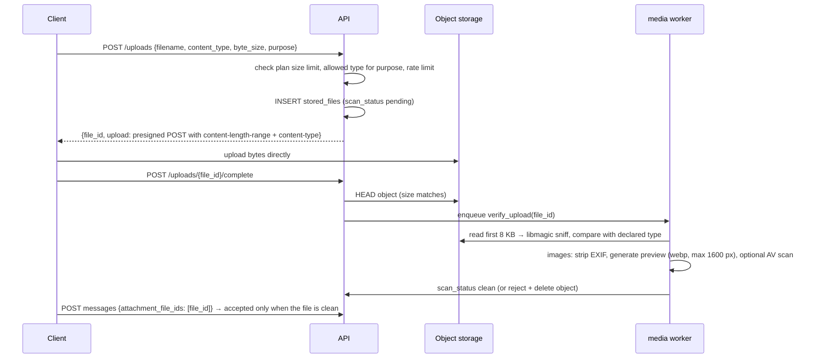

# Storage Architecture

Binary files (message attachments, avatars, knowledge-base files, exports) live in object storage. The database stores metadata in `stored_files`; everything else references a file by `stored_files.id`.

## 1. Chatwoot reference

ActiveStorage with S3/GCS/Azure/local backends; blobs attached to `attachments`, avatars on contacts/users; direct uploads (`resource :direct_uploads` for conversations and the widget); inbound media downloaded with `Down`/`SafeFetch`.

## 2. Backend interface

```python
# converse/core/storage/base.py
class StorageBackend(Protocol):
    name: str                                            # "local" | "s3"

    def presign_upload(self, key: str, content_type: str, max_bytes: int, expires_s: int = 900) -> PresignedUpload: ...
    def presign_download(self, key: str, filename: str, inline: bool, expires_s: int = 300) -> str: ...
    def put_stream(self, key: str, stream: BinaryIO, content_type: str) -> PutResult: ...   # server-side writes (inbound media)
    def head(self, key: str) -> ObjectInfo | None: ...
    def open(self, key: str) -> BinaryIO: ...                                              # reading for MIME sniffing / KB extraction
    def delete(self, key: str) -> None: ...
```

| Backend | Use | Notes |
|---|---|---|
| `LocalStorage` | Development, tests | Files under `./var/storage/`; presigned URLs are HMAC-signed links served by the API at `/files/local/{token}` |
| `S3Storage` | Production | AWS S3, Cloudflare R2, MinIO, Backblaze B2, GCS (S3 interop). Uses `boto3` presigned POST (enforces `content-length-range`) for uploads and presigned GET for downloads |

Selected by `STORAGE_BACKEND`. Only the factory knows which one is active.

## 3. Key layout

```text
org/{organization_id}/ws/{workspace_id}/attachments/{yyyy}/{mm}/{file_id}/{sanitised_filename}
org/{organization_id}/ws/{workspace_id}/kb/{knowledge_base_id}/{file_id}/{sanitised_filename}
org/{organization_id}/avatars/contacts/{file_id}.webp
users/{user_id}/avatar/{file_id}.webp
org/{organization_id}/exports/{export_id}.zip
```

- Tenant prefix on every key makes per-tenant export and deletion (`delete_prefix`) possible and keeps bucket policies simple.
- Filenames are sanitised (Unicode NFKC, strip path separators and control characters, max 120 chars); the original name is kept in `stored_files.filename`.

## 4. Upload flow (agents and widget visitors)



## 5. Inbound media (from providers)

`download_inbound_media(attachment_id)`:

1. `adapter.download_media()` returns a stream (WhatsApp: authenticated Graph URL; Messenger/Instagram: CDN URL, fetched through `SafeHttpClient`).
2. Stream to storage with a size cap (plan limit, default 40 MB; WhatsApp documents up to 100 MB are allowed by Meta, so the platform maximum is configurable).
3. Verify `sha256` when the provider supplies one (WhatsApp).
4. Sniff MIME, create `stored_files`, set `attachments.file_id`, publish `message.updated`.

## 6. Outbound media (to providers)

- Meta fetches media from a URL we provide or from an upload. For non-public storage, we generate a presigned GET valid for 15 minutes (`OutboundAttachment.signed_url`).
- WhatsApp: prefer `POST /{phone_number_id}/media` (upload) for documents, so files aren't exposed by URL; images/video may use a link.
- Provider limits are checked before sending (e.g. WhatsApp image 5 MB, video 16 MB, document 100 MB; Messenger 25 MB). An oversize file fails fast with a clear error in the composer.

## 7. Download authorization

`GET /api/v1/workspaces/{ws}/files/{file_id}`:

1. Find the owning resource (attachment → message → conversation; avatar → contact; KB → document).
2. Apply the same visibility rules as the owner (conversation visibility for attachments).
3. Return `302` to a presigned URL (5 minutes) with `Content-Disposition: attachment` for everything except images/audio/video previews, and `X-Content-Type-Options: nosniff`.

Widget visitors get attachment URLs only for messages in their own conversations.

## 8. Validation rules

| Purpose | Allowed types | Max size (default) |
|---|---|---|
| Message attachment | Images (jpeg, png, gif, webp, heic), audio (mpeg, ogg, aac, mp4, webm), video (mp4, 3gpp, webm), documents (pdf, doc(x), xls(x), ppt(x), txt, csv, zip) | 40 MB |
| Avatar | jpeg, png, webp | 5 MB (re-encoded to webp 512 px) |
| KB file | pdf, docx, txt, md, html | 20 MB |
| Import | csv | 20 MB |

Executables and HTML are never served inline. SVG uploads are rejected (they can contain scripts).

## 9. Lifecycle

- Deleting a message/attachment leaves the object; a daily `gc_orphan_files` job deletes objects whose `stored_files` row has no references for 7 days.
- Organization purge deletes the `org/{id}/` prefix.
- Bucket: versioning on, lifecycle rule to expire non-current versions after 30 days, server-side encryption (SSE-S3 or SSE-KMS), public access blocked.
- CDN (CloudFront/Cloudflare) can sit in front of presigned downloads for avatars only; attachments stay presigned and private.
