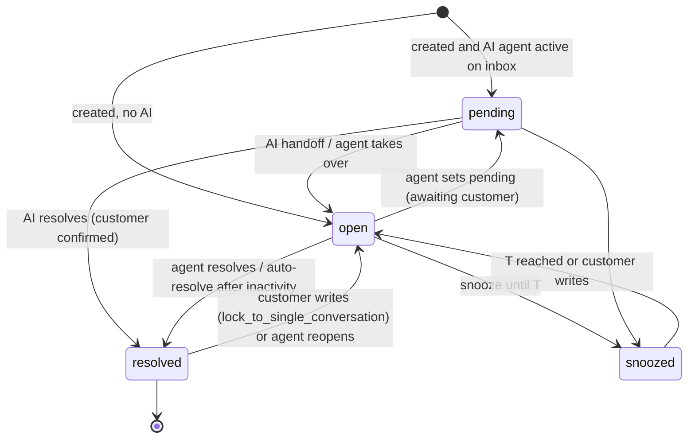

# Table Documentation

Column-level meaning for the tables developers touch most, plus the JSONB document shapes. Purpose and references for **all 66 tables** are in [../07_DATABASE_SCHEMA.md](../07_DATABASE_SCHEMA.md) next to their DDL.

Conventions used by every table:

| Column | Meaning |
|---|---|
| `id` | UUID primary key (or bigint identity on append-only logs) |
| `organization_id` | Tenant. RLS filters on it |
| `workspace_id` | Workspace inside the tenant; present on all workspace-scoped rows, including deep children |
| `created_at`, `updated_at` | `timestamptz`, set by default / by the `set_updated_at()` trigger |
| `deleted_at` | Soft delete marker (only on tables listed in [../06_DATABASE_ARCHITECTURE.md](../06_DATABASE_ARCHITECTURE.md#6-soft-deletion)) |
| `*_ciphertext` + `*_key_version` | Encrypted secret and the key version used ([../06](../06_DATABASE_ARCHITECTURE.md#5-secrets-and-credentials)) |

---

## `organizations`

| Column | Notes |
|---|---|
| `slug` | URL-safe, unique among non-deleted orgs |
| `status` | `active` → normal; `suspended` → API blocked, inbound recorded but not processed; `pending_deletion` → purge scheduled |
| `feature_flags` | Extra features beyond the plan (`text[]`), e.g. `{beta_copilot}` |
| `settings` | `{ "require_mfa": false, "default_locale": "en", "data_retention_days": null }` |
| `limits_override` | Same keys as `subscription_plans.limits`; overrides per tenant |
| `external_customer_id` | Stripe customer id |
| `deletion_scheduled_at` | Set when the owner deletes the organization (`pending_deletion`); restorable until then, purged after |

## `organization_memberships`

| Column | Notes |
|---|---|
| `role` | `owner` (exactly one per org: unique index `org_memberships_one_owner_uniq`, plus `app/services/tenancy.py`), `administrator`, `agent` |
| `custom_role_id` | Only for `agent` (check `org_memberships_custom_role_agent_chk`); replaces the default agent permissions |
| `availability` | `online` / `busy` / `offline`: the agent's chosen status. Live presence (connected or not) is in Redis |
| `auto_offline` | Set `offline` automatically when all sockets disconnect |
| `accepts_conversations` | Excluded from auto-assignment when `false` |

## `inboxes`

| Column | Notes |
|---|---|
| `provider` | Copy of `channel_connections.provider`, so lists don't need a join |
| `enable_auto_assignment`, `auto_assignment_config` | `{ "strategy": "round_robin" \| "least_busy", "max_open_per_agent": 10 }` |
| `greeting_enabled`, `greeting_message` | Sent as an outgoing `system` message on the first incoming message of a new conversation (web widget, Messenger, Instagram; for WhatsApp only inside the 24 h window) |
| `working_hours_enabled`, `working_hours`, `timezone`, `out_of_office_message` | `working_hours`: `[{"day": 0-6, "open": "09:00", "close": "17:00", "closed": false}]` |
| `allow_messages_after_resolved` | When `false`, a message to a resolved conversation is dropped with an activity note (widget: input disabled) |
| `lock_to_single_conversation` | When `true`, a resolved conversation is **reopened** instead of creating a new one |
| `settings` | `{ "csat_enabled": false, "sender_name_type": "friendly" \| "professional", "business_name": null }` |

## `channel_connections`

| Column | Notes |
|---|---|
| `status` | `pending` (OAuth started) → `active` → `reauthorization_required` (token invalid/expired) / `error` (repeated send failures) / `disconnected` |
| `credentials_ciphertext` | Encrypted JSON. Messenger: `{"page_access_token": "...", "user_access_token": "..."}`; Instagram: `{"access_token": "..."}`; WhatsApp: `{"access_token": "..."}` when not on the WABA row; widget: none |
| `token_expires_at` | For tokens that expire (Instagram 60 days). Indexed for the refresh scan |
| `config` | Non-secret: `{ "graph_api_version": "v21.0", "subscribed_fields": [...], "app_id": "..." }` |
| `last_error`, `last_error_at` | Shown to admins on the inbox settings page |

## `contacts`

| Column | Notes |
|---|---|
| `email` | `citext`; unique per workspace among non-deleted |
| `phone_number` | E.164 (`+15551234567`); **not unique** (shared family phones, WhatsApp vs SMS formats) |
| `identifier` | Customer's own user id (from widget `identify` or API); unique per workspace |
| `contact_type` | `visitor` (anonymous), `lead` (has email/phone or wrote to us), `customer` (set by integration/automation) |
| `blocked` | Incoming messages from blocked contacts are stored as ignored events and not shown (like Chatwoot `contacts.blocked`) |
| `additional_attributes` | `{ "company_name": "...", "city": "...", "country": "...", "browser": {...}, "social_profiles": {"instagram": "handle"} }` |
| `custom_attributes` | Keys from `custom_attribute_definitions` where `scope = 'contact'` |

## `contact_identities`

| Column | Notes |
|---|---|
| `source_id` | Messenger PSID; Instagram IGSID; WhatsApp `wa_id` (phone digits) or BSUID when Meta supplies it; widget random UUID |
| `realtime_token` | Secret used by the widget WebSocket to subscribe (`rt:contact:{token}`) |
| `identity_verified` | HMAC identity verification passed (widget) |
| `profile` | Provider profile cache: `{ "name": "...", "profile_pic_url": "...", "username": "...", "fetched_at": "..." }` |

## `conversations`

| Column | Notes |
|---|---|
| `display_number` | Per-workspace sequential number from `next_workspace_counter()` |
| `status` | `open` (needs humans), `pending` (AI handling or awaiting customer), `snoozed` (until `snoozed_until`), `resolved` |
| `priority` | `NULL` = none, else `low` / `medium` / `high` / `urgent` |
| `assignee_id`, `team_id` | Current owner. History in `conversation_assignments` |
| `ai_agent_id`, `ai_active` | Which AI agent and whether it may reply now. `ai_active = false` after handoff or when a human is assigned |
| `waiting_since` | Set on the first unanswered incoming message; cleared on the first outgoing reply (non-private, non-activity). Drives "waiting longest" sort and SLA later |
| `first_reply_at` | First human or AI reply; used for first-response-time reports |
| `last_activity_at` | Any non-activity message; list sort key |
| `last_incoming_at` | Last customer message; used for Meta 24 h window checks |
| `contact_last_seen_at`, `agent_last_seen_at` | Read markers for unread counts |
| `external_thread_id` | Email thread / provider thread id (future channels) |
| `additional_attributes` | `{ "referer_url": "...", "browser_language": "en", "initiated_at": {...}, "meta_referral": {"source": "ADS", "ad_id": "..."} }` |

Status transitions (enforced in `ConversationService.transition`):



## `messages`

| Column | Notes |
|---|---|
| `direction` | `incoming` (customer), `outgoing` (agent/AI/automation/system replies + notes), `activity` (timeline system entries, never sent), `template` (WhatsApp template sends) |
| `content_type` | `text`, `input_select`, `cards`, `form`, `article` (widget rich content), `interactive` (WhatsApp buttons/lists), `template`, `location`, `contact_card`, `unsupported` |
| `is_private` | Internal note; never delivered; hidden from widget and webhooks to the contact |
| `sender_kind` + sender columns | Who wrote it. `system` = platform (greetings, activity); `automation` = automation rule |
| `delivery_status` | `pending` (queued) → `sent` (provider accepted) → `delivered` → `read`; or `failed` with `delivery_error`. Incoming messages are `sent`. Never moves backwards |
| `external_id` | Provider message id. Unique per inbox |
| `client_message_id` | Id from our client for retries. Unique per conversation |
| `in_reply_to_id` | Quoted message (WhatsApp context, Messenger reply_to) |
| `sequence_number` | Global identity; stable tie-breaker for ordering within a conversation |
| `content_attributes` | Discriminated by `content_type`: see below |
| `deleted_at` | Set when unsent/deleted; `content` is cleared and `content_attributes.deleted = true` |

`content_attributes` examples:

```json
{ "template": { "name": "order_update", "language": "en_US", "parameters": { "body": ["Casey", "#1234"] } } }
{ "interactive": { "type": "button", "body": "Was this helpful?", "buttons": [{ "id": "yes", "title": "Yes" }, { "id": "no", "title": "No" }] } }
{ "interactive_reply": { "id": "yes", "title": "Yes" } }
{ "reaction": { "emoji": "👍", "target_external_id": "wamid.HBg..." } }
{ "story": { "type": "reply", "url": "https://...", "story_id": "..." } }
{ "external_echo": true }
{ "automation_rule_id": "3f2c..." }
{ "ai": { "run_id": "…", "citations": [{ "document_id": "…", "title": "Refund policy" }] } }
```

## `attachments`

| Column | Notes |
|---|---|
| `kind` | `image`, `audio` (voice notes with `meta.voice = true`), `video`, `file`, `location`, `sticker`, `fallback` (provider link without file, e.g. shared post) |
| `file_id` | Set once the media is downloaded/uploaded to our storage. `NULL` while `download_inbound_media` is pending |
| `external_url` | Provider URL (temporary for WhatsApp; requires the access token to fetch) |
| `meta` | `{ "provider_media_id": "...", "mime_type": "image/jpeg", "width": 1080, "height": 1920, "duration_s": 12.4, "voice": true }` |

## `channel_routes`

Global table. Exactly the ids Meta (or the widget) puts in webhook payloads:

| provider | external_id |
|---|---|
| `facebook_messenger` | `entry[].id` = Facebook Page id |
| `instagram` | `entry[].id` = Instagram professional account id |
| `whatsapp_cloud` | `entry[].changes[].value.metadata.phone_number_id` |
| `web_widget` | `website_token` |

Rows are created/removed by `InboxService` together with the connection. A route row is the only thing ingress needs to identify a tenant.

## `inbound_webhook_events`

| Column | Notes |
|---|---|
| `dedup_key` | Messenger/Instagram: `mid` for messages, `{sender}:{watermark}:{type}` for delivery/read; WhatsApp: `wamid` for messages, `{wamid}:{status}` for statuses; fallback: SHA-256 of the entry JSON |
| `signature_valid` | Always `true` for stored rows today (invalid signatures are rejected before insert); kept so we can store-and-quarantine later |
| `state` | `received` → `processing` → `processed` / `ignored` (unknown route, blocked contact, unsupported) / `failed` (will retry) / `dead` (retries exhausted: shows in the admin dead-letter view) |

## `event_outbox`

| Column | Notes |
|---|---|
| `event_name` | `conversation.created`, `conversation.updated`, `conversation.status_changed`, `conversation.assignee_changed`, `conversation.handoff`, `message.created`, `message.updated`, `contact.created`, `contact.updated`, `contact.merged`, … (full list in [../backend/MESSAGE_PROCESSING.md](../backend/MESSAGE_PROCESSING.md#7-domain-events)) |
| `aggregate_type`, `aggregate_id` | The entity the event is about |
| `payload` | Event body as defined by the event schema. Contains ids and the changed fields, not full objects. Handlers load current state |
| `state`, `attempts`, `available_at` | Relay bookkeeping |

## `automation_rules`

```json
{
  "conditions": [
    { "attribute": "message.content", "operator": "contains", "values": ["refund"], "query_operator": "and" },
    { "attribute": "conversation.inbox_id", "operator": "equal_to", "values": ["00000000-0000-0000-0000-000000010001"], "query_operator": null }
  ],
  "actions": [
    { "action": "add_label", "params": { "labels": ["billing"] } },
    { "action": "assign_team", "params": { "team_id": "00000000-0000-0000-0000-00000000f001" } },
    { "action": "send_message", "params": { "content": "Thanks! A billing specialist will reply shortly." } }
  ]
}
```

`query_operator` joins a condition to the **next** one (`and`/`or`; `null` on the last), like Chatwoot. Operators: `equal_to`, `not_equal_to`, `contains`, `does_not_contain`, `is_present`, `is_not_present`, `is_greater_than`, `is_less_than`, `starts_with`. Full list in [../implementation/PHASE_07_AUTOMATION.md](../implementation/PHASE_07_AUTOMATION.md).

## `ai_agents`

| Column | Notes |
|---|---|
| `provider_credential_id` | Tenant's own key; `NULL` = platform-managed key (counts against plan quota) |
| `chat_model`, `classifier_model`, `embedding_model` | Must be in the platform allow-list (`config/llm_models.yaml`) |
| `system_prompt` | Tenant's instructions; wrapped by the platform system prompt (never replaces safety rules) |
| `persona` | `{ "name": "Ava", "tone": "friendly", "language_policy": "match_customer" }` |
| `guardrails` | `{ "blocked_topics": ["legal advice"], "max_reply_chars": 1200, "require_citations": true, "pii_redaction": true }` |
| `handoff_policy` | `{ "on_intents": ["complaint", "cancel_account"], "on_low_confidence": 0.55, "on_customer_request": true, "outside_hours": "handoff", "assign_team_id": null }` |
| `enabled_tools` | Subset of `knowledge_search`, `policy_search`, `order_lookup`, `product_search`, `customer_info`, `create_ticket_note` |
| `allowed_actions` | What the AI may change: `reply`, `handoff` (mandatory), `add_label`, `set_priority`, `resolve`, `snooze`, `update_contact`, `add_private_note`. Enforced by `ai_agents_actions_chk` and the service layer ([../ai/AI_ROLES_AND_PERMISSIONS.md](../ai/AI_ROLES_AND_PERMISSIONS.md#33-actions)) |
| `tool_settings` | Per-tool policy tightening: `{ "customer_info": { "min_verification": "verified" }, "add_label": { "allowed_labels": ["billing"] } }`. Can never relax platform defaults |

`custom_attribute_definitions.ai_visible` decides whether an attribute's values may be sent to the LLM (default `false`). `ai_conversation_sessions.customer_verification_level` (`none` / `channel` / `verified`) and `customer_verified_until` hold the customer's verification for the AI session. `ai_tool_calls.policy_decision` records `allowed` / `denied` / `needs_verification` / `needs_approval` for every tool call.

## `kb_chunks`

| Column | Notes |
|---|---|
| `embedding` | `vector(1536)`. The dimension is fixed by the HNSW index. `knowledge_bases.embedding_dimensions` is constrained to 1536 for now; supporting other dimensions means another column/table with its own index |
| `search_vector` | Generated `tsvector` (`simple` config, language-neutral) for keyword search |
| `metadata` | `{ "heading_path": ["Billing", "Refunds"], "source_url": "...", "page": 3 }` |

## `ai_conversation_sessions`

| Column | Notes |
|---|---|
| `thread_id` | LangGraph checkpoint thread id: `conv:{conversation_id}:agent:{ai_agent_id}` |
| `summary`, `summarized_through_seq` | Rolling summary of messages up to that `sequence_number` |
| `facts` | Extracted structured memory (language, order ids, product of interest) |
| `status` | `active`, `handed_off` (AI stays silent until reactivated), `closed` |

## Billing tables

- `subscriptions.state` mirrors Stripe's subscription status. `seats` = number of agent memberships billed.
- `billing_records` mirrors invoices (idempotent upsert by `external_invoice_id`).
- `usage_records` is the metering ledger; `source_id` = AI run id, conversation id, etc. Monthly usage is `SUM(quantity) WHERE period_start = date_trunc('month', now())`.
