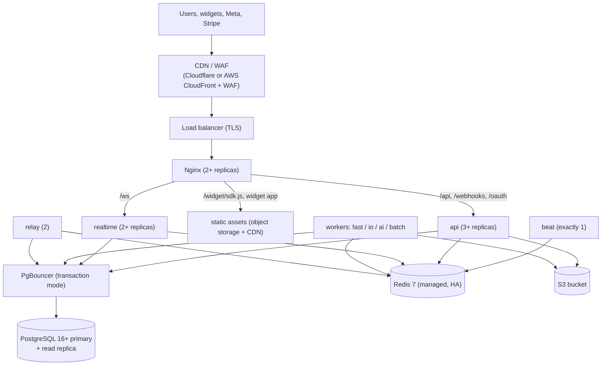

# Production Deployment

## 1. Target topology



Recommended platform: Kubernetes (EKS/GKE/AKS) or a container PaaS (ECS Fargate, Cloud Run for api/realtime + GKE/ECS for workers). A single VM with Docker Compose is acceptable for early pilots (≤ ~50 agents) using `docker-compose.prod.yml`.

## 2. Sizing (starting point)

| Component | Replicas | Size | Scale on |
|---|---|---|---|
| api | 3 | 1 vCPU / 1 GB, 4 Uvicorn workers | CPU > 60%, p95 latency |
| realtime | 2 | 2 vCPU / 2 GB | Connections > 7,000/replica |
| worker-fast | 2 | 1 vCPU / 1 GB | `inbound`/`outbound` wait time |
| worker-io | 2 | 1 vCPU / 1 GB | `webhooks`/`media` depth |
| worker-ai | 2 | 1 vCPU / 2 GB | `ai` depth |
| worker-batch | 1 | 1 vCPU / 2 GB | `low` depth |
| relay | 2 | 0.25 vCPU | outbox lag |
| beat | 1 | 0.25 vCPU | — |
| PostgreSQL | primary + 1 replica | 4 vCPU / 16 GB, gp3/pd-ssd | CPU, IOPS, connections |
| Redis | HA pair | 2 GB | memory, ops/s |

Autoscale workers with KEDA (Redis list length) on Kubernetes.

## 3. Database operations

- Managed PostgreSQL 16+ with `vector`, `pg_trgm`, `pgcrypto`, `citext` enabled; PITR on; deletion protection.
- PgBouncer in **transaction** mode (`SET LOCAL` is safe; prepared statements disabled in asyncpg: `statement_cache_size=0`, or use PgBouncer ≥ 1.21 with `max_prepared_statements`).
- Parameters to review: `max_connections` (≈ 200 behind PgBouncer), `shared_buffers` 25% RAM, `work_mem` 16–32 MB, `maintenance_work_mem` ≥ 1 GB (HNSW builds), `random_page_cost` 1.1 on SSD, `statement_timeout` per role (`ALTER ROLE converse_api SET statement_timeout = '5s'`), `idle_in_transaction_session_timeout = '30s'`.
- Read replica: analytics queries (`reports/*`) and exports use the replica (`DATABASE_REPLICA_URL`); tolerate a few seconds of lag.

## 4. Release process

1. CI on the merge commit: ruff, mypy, import-linter, unit + integration + security tests, `alembic upgrade head` + `alembic check` on an empty DB, build image tagged with the git SHA, Trivy scan.
2. Deploy to staging automatically; run smoke tests (login, create widget conversation, webhook replay of recorded Meta fixtures through a staging route, AI playground).
3. Production: run the `migrate` job (`alembic upgrade head`, owner credentials, `lock_timeout=5s`). Migrations must be backward compatible with the currently running code (expand/contract, [../06_DATABASE_ARCHITECTURE.md](../06_DATABASE_ARCHITECTURE.md#9-migration-strategy)).
4. Rolling update: api and realtime (readiness probe `/health/ready`; realtime drains: stop accepting, send `{"type":"reconnect"}`, close after 30 s), workers (`SIGTERM`, warm shutdown up to the task time limit), relay, beat (`Recreate`).
5. Monitor error rate and queue latency for 15 minutes; roll back by redeploying the previous image (migrations are additive, so the old code still works).

## 5. Nginx

```nginx
upstream converse_api      { server api:8000;      keepalive 64; }
upstream converse_realtime { server realtime:8001; keepalive 64; }

map $http_upgrade $connection_upgrade { default upgrade; '' close; }

limit_req_zone $binary_remote_addr zone=per_ip:20m rate=50r/s;

server {
    listen 443 ssl http2;
    server_name app.converse.example;

    ssl_certificate     /etc/ssl/converse/fullchain.pem;
    ssl_certificate_key /etc/ssl/converse/privkey.pem;
    ssl_protocols TLSv1.2 TLSv1.3;

    client_max_body_size 2m;                    # uploads go directly to S3
    add_header Strict-Transport-Security "max-age=63072000; includeSubDomains" always;
    add_header X-Content-Type-Options nosniff always;
    add_header Referrer-Policy strict-origin-when-cross-origin always;

    location /ws {
        proxy_pass http://converse_realtime;
        proxy_http_version 1.1;
        proxy_set_header Upgrade $http_upgrade;
        proxy_set_header Connection $connection_upgrade;
        proxy_set_header Host $host;
        proxy_set_header X-Forwarded-For $proxy_add_x_forwarded_for;
        proxy_set_header X-Forwarded-Proto $scheme;
        proxy_read_timeout 75s;
        proxy_send_timeout 75s;
    }

    location /webhooks/ {
        proxy_pass http://converse_api;
        proxy_request_buffering on;             # full raw body reaches the app for signature checks
        client_max_body_size 1m;
        proxy_set_header Host $host;
        proxy_set_header X-Forwarded-For $proxy_add_x_forwarded_for;
        proxy_set_header X-Forwarded-Proto $scheme;
        proxy_read_timeout 10s;
    }

    location / {
        limit_req zone=per_ip burst=100 nodelay;
        proxy_pass http://converse_api;
        proxy_http_version 1.1;
        proxy_set_header Connection "";
        proxy_set_header Host $host;
        proxy_set_header X-Forwarded-For $proxy_add_x_forwarded_for;
        proxy_set_header X-Forwarded-Proto $scheme;
        proxy_read_timeout 30s;
    }

    location = /metrics { deny all; }
}

server {
    listen 80;
    server_name app.converse.example;
    return 301 https://$host$request_uri;
}
```

Never apply `limit_req` to `/webhooks/` per IP: Meta sends from a small set of IPs and would be throttled. Webhook protection is the signature check plus body limits.

## 6. Network and access

- Postgres and Redis in private subnets; only workloads can reach them. TLS required (`sslmode=verify-full`, `rediss://`).
- `/metrics`, Flower and the platform admin UI only on the internal network / VPN.
- Egress: workers need outbound HTTPS to Meta, LLM providers, Stripe and customer webhook URLs. Route customer webhooks and KB fetches through an egress proxy with a deny list for internal ranges, as a second SSRF layer.
- IAM: workloads use cloud IAM roles for S3/KMS/secret manager (no static keys).

## 7. Meta production readiness

- Business verification of the platform's Meta Business account.
- App Review for: `pages_messaging`, `pages_manage_metadata`, `pages_show_list`, `business_management` (Messenger); `instagram_business_basic`, `instagram_business_manage_messages` (Instagram); `whatsapp_business_messaging`, `whatsapp_business_management` (WhatsApp); Human Agent feature. Start this in Phase 4; it can take weeks.
- Webhook callback URLs set to the production domain, with the verify tokens from the secret manager.
- Privacy policy, terms and data-deletion URLs published.

## 8. Go-live checklist

- [ ] Backups + PITR verified with a restore drill
- [ ] Secrets in the secret manager; no defaults from `.env.example`
- [ ] `ENCRYPTION_KEYS`/KMS configured; re-encryption job tested
- [ ] RLS test suite green against production-like schema; app connects as `converse_api` (not the owner)
- [ ] Rate limits configured; Nginx limits exclude webhooks
- [ ] Alerts wired ([MONITORING_AND_LOGGING.md](MONITORING_AND_LOGGING.md))
- [ ] Load test: 200 inbound msgs/s for 10 min with p95 webhook → agent screen < 2 s; 10k WebSocket connections
- [ ] Meta App Review approved; test numbers/pages removed
- [ ] Runbooks: Meta outage, provider token mass-expiry, Redis loss, DB failover, stuck queue, dead-letter replay
- [ ] On-call rotation and status page
