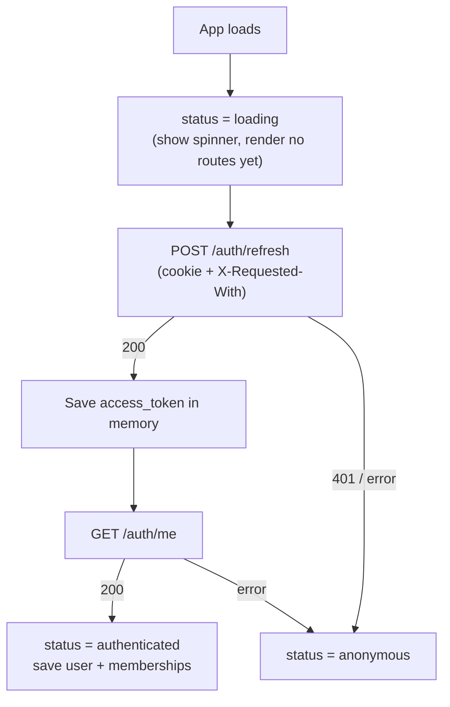
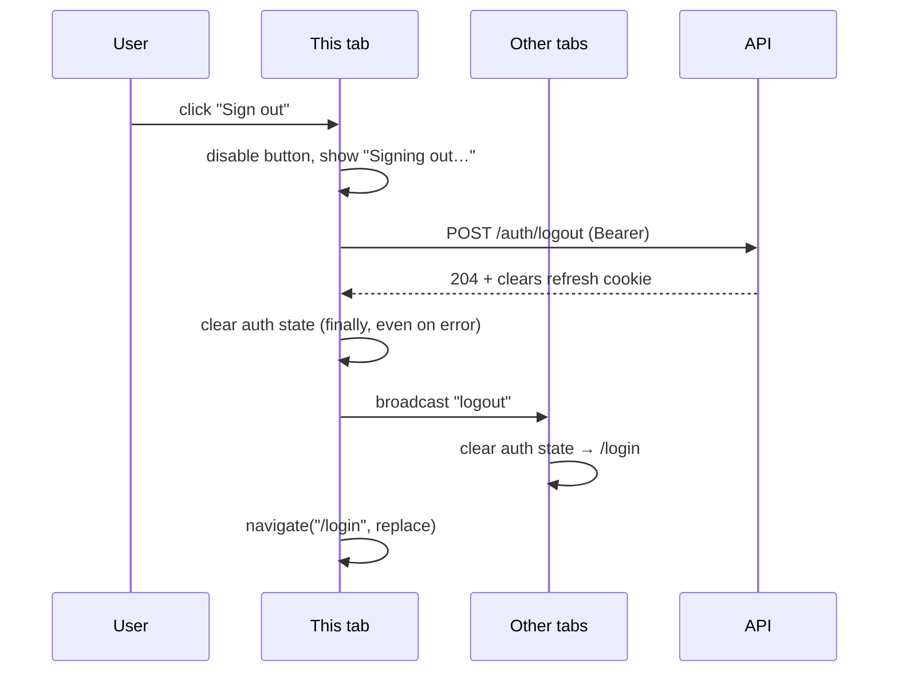

# 01 — Authentication (Frontend Implementation)

What the frontend must build for the **Auth** API: register, login (with remember me), keeping the session alive, logout, logout everywhere, forgot password, reset password, and loading the current user.

Backend rules behind this document: [../10_AUTHENTICATION_AND_RBAC.md](../10_AUTHENTICATION_AND_RBAC.md). Live schema: `http://localhost:8000/docs`.

## 1. Scope

| # | Endpoint | Used by |
|---|---|---|
| 1 | `POST /api/v1/auth/signup` | Sign up page |
| 2 | `POST /api/v1/auth/login` | Login page |
| 3 | `POST /api/v1/auth/refresh` | App start + automatic token renewal (no page) |
| 4 | `POST /api/v1/auth/logout` | "Sign out" button |
| 5 | `POST /api/v1/auth/logout-all` | "Sign out everywhere" button |
| 6 | `POST /api/v1/auth/password/forgot` | Forgot password page |
| 7 | `POST /api/v1/auth/password/reset` | Reset password page (opened from email) |
| 8 | `GET /api/v1/auth/me` | App start, after login state changes |

**Pages to build:** `/login`, `/signup`, `/forgot-password`, `/reset-password`.
**UI to build:** "Sign out" and "Sign out everywhere" buttons in the logged-in layout (§6.5).
**Logic to build:** token storage, session restore on page load, automatic refresh, logout (including other open tabs), route protection (logged-in vs logged-out pages).

Out of scope for this document (separate docs later): organizations, workspaces, members, invitations pages. Signup's `invitation_token` field is described here but the invitation pages are not.

## 2. Ground rules

### 2.1 Same origin (required)

The refresh token is an **HttpOnly cookie** with `Path=/api/v1/auth` and `SameSite=Strict`. It only works if the browser sees the frontend and the API on **one origin**:

| Environment | Setup |
|---|---|
| Development | The frontend dev server (port **3000**) proxies `/api/*` to `http://127.0.0.1:8000`. The frontend calls relative URLs: `fetch("/api/v1/auth/login")` |
| Production | One domain; the reverse proxy (e.g. nginx) serves the frontend at `/` and forwards `/api/*` to the backend |

Do **not** call `http://localhost:8000` directly from the browser.

The backend's emails link to `http://localhost:3000` (its `FRONTEND_URL` setting), so the dev server must run on port 3000.

### 2.2 Headers on every request

| Header | Value | Why |
|---|---|---|
| `X-Client-Type` | `web` | The backend then **never** puts the refresh token in response bodies (it's `null`); it lives only in the HttpOnly cookie |
| `Content-Type` | `application/json` | When sending a body |
| `Authorization` | `Bearer <access_token>` | On protected endpoints (logout, logout-all, me) |
| `X-Requested-With` | `XMLHttpRequest` | **Only on `/auth/refresh`**: required when refreshing with the cookie (CSRF protection), otherwise `401` |

Send cookies: `fetch(url, { credentials: "same-origin" })` (the default for same-origin requests).

### 2.3 Token storage

| Token | Lifetime | Store it | Never |
|---|---|---|---|
| `access_token` (JWT) | 15 minutes (`expires_in: 900`) | **In memory only** (a JS variable / in-memory store) | `localStorage`, `sessionStorage`, non-HttpOnly cookies |
| Refresh token | 24 h or 30 days (remember me) | Nothing to store: the browser keeps the HttpOnly cookie automatically | Reading it from JS (impossible by design) |

Because the access token is only in memory, a page reload loses it. The app gets a new one from the cookie on startup (§5.1).

### 2.4 Error format

Every error has the same shape:

```json
{
  "error": {
    "code": "invalid_credentials",
    "message": "Invalid email or password",
    "request_id": "3f2c9a1e-…"
  }
}
```

Validation errors (`422`) add `details`:

```json
{
  "error": {
    "code": "validation_error",
    "message": "Request validation failed",
    "details": [{ "field": "password", "issue": "Value error, must be at least 10 characters" }],
    "request_id": "…"
  }
}
```

Show `details[].issue` under the input whose name matches `field`; otherwise show `message`. Rate-limit responses are `429` with `code: "rate_limited"`. Show "Too many attempts. Please wait a few minutes and try again."

### 2.5 Shared response objects

**`User`**

```json
{
  "id": "6f1c…",
  "name": "Olivia Owner",
  "display_name": null,
  "email": "owner@example.com",
  "email_verified_at": null
}
```

**`Membership`** (one per organization the user belongs to)

```json
{
  "organization_id": "0b7e…",
  "organization_name": "Shree Traders",
  "organization_slug": "shree-traders",
  "membership_id": "a41d…",
  "role": "owner",
  "custom_role_id": null,
  "permissions": ["audit_log.view", "billing.manage", "member.manage", "organization.manage", "…"],
  "workspaces": [{ "id": "9c2a…", "name": "Main", "slug": "main" }]
}
```

`role` is `owner` | `administrator` | `agent`. Keep `memberships` in the auth state: later pages use `permissions` to show/hide actions.

**`TokenResponse`** (signup, login)

```json
{
  "access_token": "eyJhbGciOiJIUzI1NiIs…",
  "token_type": "Bearer",
  "expires_in": 900,
  "refresh_token": null,
  "refresh_expires_at": "2026-12-12T10:15:02.412Z",
  "remember_me": true,
  "user": { "…": "User" },
  "memberships": [{ "…": "Membership" }]
}
```

`refresh_token` is `null` because of `X-Client-Type: web`.

TypeScript types:

```ts
export type MembershipRole = "owner" | "administrator" | "agent";

export interface User {
  id: string; name: string; display_name: string | null;
  email: string; email_verified_at: string | null;
}
export interface WorkspaceSummary { id: string; name: string; slug: string }
export interface Membership {
  organization_id: string; organization_name: string; organization_slug: string;
  membership_id: string; role: MembershipRole; custom_role_id: string | null;
  permissions: string[]; workspaces: WorkspaceSummary[];
}
export interface MeResponse { user: User; memberships: Membership[] }
export interface RefreshResponse {
  access_token: string; token_type: string; expires_in: number;
  refresh_token: string | null; refresh_expires_at: string; remember_me: boolean;
}
export type TokenResponse = RefreshResponse & MeResponse;
export interface ApiErrorBody {
  error: { code: string; message: string; details?: { field: string; issue: string }[]; request_id?: string | null };
}
```

### 2.6 Test accounts (development)

Ask the backend developer to run `make seed` (after `make migrate`). It creates the demo organization **"Demo Org"** with workspace **"Customer Support"** and these accounts, password **`Password123!`** for all:

| Email | Role | Use it to test |
|---|---|---|
| `owner@demo.example.com` | owner | Everything (all 25 permissions) |
| `admin@demo.example.com` | administrator | Everything except billing |
| `agent@demo.example.com` | agent (custom role "Support Lead") | Restricted UI: no member management, no org settings |

Running it again is safe (no duplicates). For signup tests, use any new email.

## 3. Endpoints

### 3.1 `POST /auth/signup`: register

Two modes: create a **new organization**, or **join** an organization with an invitation token.

| | New organization | Join with invitation |
|---|---|---|
| Body | `{ name, email, password, organization_name, remember_me }` | `{ name, email, password, invitation_token, remember_me }` |
| Backend creates | User, organization, **owner** membership, workspace **"Main"**, 14-day trial | User + membership with the invited role |

| Field | Rules |
|---|---|
| `name` | Required, 1–255 chars |
| `email` | Valid email; case-insensitive; for invitations must equal the invited email |
| `password` | **Min 10 chars**, max 128, no leading/trailing spaces |
| `organization_name` | Required when there is no `invitation_token`; 1–255 chars |
| `remember_me` | Boolean, default `false` (see §4) |

**Response `201`:** `TokenResponse` + refresh cookie.

| Status | `code` | When | Show |
|---|---|---|---|
| 409 | `duplicate` | Email already registered | "An account with this email already exists." + link to login |
| 422 | `validation_error` | Field rules, missing organization name, invitation sent to another email | Field errors / message |
| 404 | `not_found` | Invitation invalid, expired or already used | "This invitation is invalid or has expired." |
| 429 | `rate_limited` | More than 10 signups per hour per IP | Rate-limit text |

### 3.2 `POST /auth/login`

```json
{ "email": "owner@example.com", "password": "Sup3r-secret-pw", "remember_me": true }
```

**Response `200`:** `TokenResponse` + refresh cookie.

| Status | `code` | When |
|---|---|---|
| 401 | `invalid_credentials` | Wrong password **or** unknown email: same message on purpose, don't try to tell them apart |
| 422 | `validation_error` | Malformed email |
| 429 | `rate_limited` | More than **5 attempts per 5 minutes** per IP |

### 3.3 `POST /auth/refresh`: renew the access token

Browser usage: **no body**, the cookie is sent automatically.

```http
POST /api/v1/auth/refresh
X-Client-Type: web
X-Requested-With: XMLHttpRequest
```

**Response `200`:** `RefreshResponse` (no `user`/`memberships`) + a **new** refresh cookie. Every call rotates the cookie.

| Status | `code` | Meaning | Frontend action |
|---|---|---|---|
| 401 | `unauthenticated` | No cookie, invalid token, or missing `X-Requested-With` | Treat as logged out |
| 401 | `token_expired` | Refresh window ended | Logged out |
| 401 | `session_revoked` | Old token reused (theft signal) → backend revoked the whole session | Logged out |
| 429 | `rate_limited` | More than 30 per minute | Logged out for now; retry later |

> ⚠️ **Never send two refreshes at the same time.** Each refresh invalidates the previous cookie; a second parallel request arrives with the old one, the backend sees "reuse" and **logs the user out everywhere**. See §5.3.

### 3.4 `POST /auth/logout`

Headers: `Authorization: Bearer <access_token>`. No body. **Response `204`**; the backend revokes this session (the access token stops working immediately) and clears the cookie.

Always clear local auth state afterwards, **even if the request fails**, then go to `/login`.

### 3.5 `POST /auth/logout-all`

Same as logout, but revokes **every session on every device**. Response `204`. Then clear state and go to `/login`.

### 3.6 `POST /auth/password/forgot`

```json
{ "email": "owner@example.com" }
```

**Response: always `202`**, whether or not the account exists:

```json
{ "message": "If an account exists for this email, a reset link has been sent." }
```

The email contains: `http://localhost:3000/reset-password?token=<token>` (valid **60 minutes**, **single use**). Errors: `422` invalid email, `429` (5 per 15 minutes).

> Local development without SMTP: the backend prints the email (with the link) in its terminal log.

### 3.7 `POST /auth/password/reset`

```json
{ "token": "<token from the URL>", "new_password": "Brand-new-pw-22" }
```

**Response `200`:**

```json
{ "message": "Password updated. All sessions were signed out; please log in again." }
```

| Status | `code` | When |
|---|---|---|
| 401 | `unauthenticated` | "Reset link is invalid or has expired": bad, expired, or **already used** token |
| 422 | `validation_error` | Password shorter than 10 chars |
| 429 | `rate_limited` | More than 10 per 15 minutes |

After success **all sessions are revoked**, including any open tab. Send the user to `/login`.

### 3.8 `GET /auth/me`

Headers: `Authorization: Bearer <access_token>`. **Response `200`:** `{ user, memberships }` (`MeResponse`).

Call it after the startup refresh (§5.1) and whenever the user's organizations may have changed.

| Status | `code` | Meaning |
|---|---|---|
| 401 | `token_expired` | Access token older than 15 min → refresh and retry (§5.2) |
| 401 | `session_revoked` | Logged out elsewhere / password reset → logged out |
| 401 | `unauthenticated` | Missing or invalid token → logged out |

## 4. Remember me

Login and signup have a checkbox **"Remember me for 30 days"** (recommended: checked by default) sent as `remember_me`.

| | `remember_me: true` | `remember_me: false` |
|---|---|---|
| Session on the server | 30 days, extended on each refresh | 24 hours, extended on each refresh |
| Cookie | Persistent: survives closing the browser | Session cookie: gone when the browser closes |
| Response | `"remember_me": true`, `refresh_expires_at` ≈ now + 30 d | `false`, ≈ now + 24 h |
| Hard limit | 90 days after login, then the user must log in again | same |

The choice is kept across refreshes. The frontend doesn't need to store it.

## 5. Session logic

### 5.1 App start (restore session)



In React `StrictMode` (development) effects run twice. Guard the startup refresh so it only runs once (e.g. a `useRef` flag), or you'll trigger the parallel-refresh problem in §5.3.

### 5.2 Expired access token during use

Wrap every API call in one client function:

1. Send the request with `Authorization: Bearer <token>`.
2. If the response is `401` with `code === "token_expired"` (or there's no token in memory): call refresh (§5.3) **once**, then retry the original request **once**.
3. If refresh fails, or any other `401` (`session_revoked`, `unauthenticated`) arrives on a protected call: clear the auth state and redirect to `/login`.
4. Public calls (login, signup, forgot, reset) must **not** trigger refresh or logout on `401` (a wrong password is not a session problem).

### 5.3 One refresh at a time

| Case | Fix |
|---|---|
| Several requests in one tab expire together | Keep one shared in-flight refresh promise; all callers await it |
| Several browser tabs refresh together | Wrap the refresh in the Web Locks API: `navigator.locks.request("auth-refresh", doRefresh)`. The second tab waits and then sends the already-rotated cookie |

```ts
let refreshInFlight: Promise<RefreshResponse | null> | null = null;

async function doRefresh(): Promise<RefreshResponse | null> {
  const res = await fetch("/api/v1/auth/refresh", {
    method: "POST",
    credentials: "same-origin",
    headers: { "X-Client-Type": "web", "X-Requested-With": "XMLHttpRequest" },
  });
  if (!res.ok) { accessToken = null; return null; }
  const data: RefreshResponse = await res.json();
  accessToken = data.access_token;
  return data;
}

export function refreshSession(): Promise<RefreshResponse | null> {
  if (!refreshInFlight) {
    refreshInFlight = ("locks" in navigator
      ? navigator.locks.request("auth-refresh", doRefresh)
      : doRefresh()
    ).finally(() => { refreshInFlight = null; });
  }
  return refreshInFlight;
}
```

### 5.4 Auth state to expose to the app

| Field / action | Description |
|---|---|
| `status` | `"loading"` · `"authenticated"` · `"anonymous"` |
| `user` | `User` or `null` |
| `memberships` | `Membership[]` |
| `login(email, password, rememberMe)` | §3.2 → save token, user, memberships |
| `signup(input)` | §3.1 → same |
| `logout()` / `logoutAll()` | §3.4 / §3.5 → clear state in `finally` |
| `reloadMe()` | §3.8 |

### 5.5 Route protection

| Route type | `loading` | `anonymous` | `authenticated` |
|---|---|---|---|
| Logged-in pages | Spinner | Redirect to `/login?next=<current path>` | Show page |
| `/login`, `/signup`, `/forgot-password` | Spinner | Show page | Redirect to `next` or `/` |
| `/reset-password` | Always show (opened from email, works in both states) | | |

**`next` must be a local path**: accept it only if it starts with `/` and not with `//`; otherwise use `/`. This prevents open redirects.

## 6. Pages

### 6.1 Login: `/login`

| Element | Detail |
|---|---|
| Fields | Email, Password (`autocomplete="current-password"`) |
| Checkbox | "Remember me for 30 days" |
| Links | "Forgot password?" → `/forgot-password` · "Create an account" → `/signup` |
| Submit | §3.2; button disabled + spinner while sending |
| Success | Go to `next` or `/` |
| `?reset=1` in URL | Green message: "Password updated. Sign in with your new password." |
| Errors | `invalid_credentials` → "Invalid email or password" · `rate_limited` → rate-limit text |

### 6.2 Sign up: `/signup`

| Element | Detail |
|---|---|
| Fields | Your name, Work email, Password (hint "At least 10 characters"; `autocomplete="new-password"`), Organization name |
| Invitation mode | If the URL has `?invitation=<token>`: hide Organization name, send `invitation_token`, title "Join your team" |
| Checkbox | "Remember me for 30 days" |
| Client validation | Password ≥ 10 chars before submit |
| Submit | §3.1 |
| Success | Go to `/` |
| Errors | `duplicate` → message + "Sign in" link; `422` → field errors |

### 6.3 Forgot password: `/forgot-password`

| Element | Detail |
|---|---|
| Field | Email |
| Submit | §3.6 |
| After submit | Replace the form with: "If an account exists for **{email}**, a reset link is on its way. It expires in 60 minutes and can be used once." Don't reveal whether the account exists |
| Link | "Back to sign in" → `/login` |

### 6.4 Reset password: `/reset-password?token=…`

| Element | Detail |
|---|---|
| No `token` in URL | Error: "This link is missing its token." + link to `/forgot-password` |
| Fields | New password, Confirm new password (must match; ≥ 10 chars) |
| Note | "After saving, every device will be signed out." |
| Submit | §3.7 |
| Success | Go to `/login?reset=1` |
| `401` | "Reset link is invalid or has expired." + link "Request a new one" → `/forgot-password` |

### 6.5 Logout

#### Where the buttons go

| Button | Location | Calls | Confirmation |
|---|---|---|---|
| **Sign out** | Logged-in layout: user menu / sidebar footer (always visible on every logged-in page) | `POST /auth/logout` (§3.4) | None |
| **Sign out everywhere** | Account / profile page, "Sessions" section, red (danger) style | `POST /auth/logout-all` (§3.5) | Yes: "Sign out of every browser and device, including this one?" |

Text under "Sign out everywhere": *"Ends your sessions on every browser and device, including this one. Use it if you lost a device or think someone else is signed in."*

#### Steps (both buttons)



1. Disable the button and show "Signing out…" (prevents double clicks).
2. Call the endpoint with the current access token.
3. In a `finally` block, so it happens **even if the request fails** (offline, expired token, 500):
   - set the in-memory access token to `null`;
   - set `user = null`, `memberships = []`, `status = "anonymous"`;
   - drop any cached page data (lists, selected organization) so the next user on this browser sees nothing.
4. Tell other open tabs (see below).
5. Navigate to `/login` with **replace**, so the browser's Back button doesn't return to a logged-in page.

```ts
async function logout(everywhere = false): Promise<void> {
  try {
    await api(everywhere ? "/auth/logout-all" : "/auth/logout", { method: "POST" });
  } catch {
    // ignore: the local session ends regardless
  } finally {
    clearAuthState();                       // token, user, memberships, cached data
    authChannel.postMessage("logout");      // other tabs
    navigate("/login", { replace: true });
  }
}
```

Don't call refresh as part of logout. If the logout request gets `401 token_expired`, skip the retry; the backend session is still cleared by the cookie, and the local state is cleared anyway.

#### Other open tabs

The refresh cookie is shared by all tabs, so after logout the other tabs are logged out on the server too. Without sync they keep showing data until their next API call fails. Sync them right away:

```ts
const authChannel = new BroadcastChannel("auth");

authChannel.onmessage = (e) => {
  if (e.data === "logout") {
    clearAuthState();
    navigate("/login", { replace: true });
  }
};
```

Also broadcast `"logout"` after a successful password reset. If `BroadcastChannel` isn't available, the other tabs still log out on their next API call (§5.2).

#### Forced logout (not clicked by the user)

| Cause | How the app notices | What to show on `/login` |
|---|---|---|
| "Sign out everywhere" on another device | Next API call returns `401 session_revoked` | "You were signed out. Please sign in again." |
| Password was reset | Same | Same |
| Refresh token expired (24 h / 30 d idle, or 90-day limit) | Refresh returns `401` | "Your session expired. Please sign in again." |

Handle it in the API client (§5.2): clear the auth state, then redirect to `/login?next=<current path>` so the user returns to the same page after signing in. Pass a flag (e.g. `?expired=1`) to choose the message. Don't show a message after a normal, user-clicked sign out.

#### What must not happen after logout

- Back button shows a logged-in page with data → prevented by `replace` navigation and cleared state.
- Reload logs the user back in → the cookie is cleared by the backend; startup refresh (§5.1) returns `401`.
- Any token remains in `localStorage` / `sessionStorage` → there should never have been one (§2.3).

## 7. Acceptance checklist

| # | Scenario | Expected |
|---|---|---|
| 1 | Sign up with a new organization | Lands in the app; `memberships[0].role = "owner"`, workspace "Main" |
| 2 | Sign up with an existing email | `409`, message shown, no redirect |
| 3 | Sign up with a 9-char password | Blocked client-side; backend would return `422` |
| 4 | Login with wrong password / unknown email | Same "Invalid email or password" message |
| 5 | 6 wrong logins in 5 minutes | 6th shows the rate-limit message |
| 6 | Login, reload the page | Still logged in (restored from cookie), no login screen flash after the spinner |
| 7 | Response bodies of login/signup/refresh | `refresh_token` is `null`; token not visible in JS, `localStorage` or `sessionStorage` |
| 8 | Login **with** remember me, close and reopen the browser | Still logged in |
| 9 | Login **without** remember me, close and reopen the browser | Logged out |
| 10 | Wait 15+ minutes, click something | Request succeeds after a silent refresh |
| 11 | Two tabs open, both idle 15+ minutes, use both | Both keep working (no forced logout) |
| 12 | Sign out | Back to `/login`; reload stays logged out |
| 12a | Sign out, then press the browser Back button | Stays on `/login` (or redirects back to it); no logged-in data visible |
| 12b | Sign out while offline / with the API down | Still lands on `/login` with state cleared |
| 12c | Double-click "Sign out" | One request; button disabled while signing out |
| 13 | Two tabs open, sign out in tab A | Tab B goes to `/login` immediately (no click needed) |
| 13a | "Sign out everywhere" on device A | Asks for confirmation first; device B's next action goes to `/login` with "You were signed out" |
| 14 | Forgot password for unknown email | Same confirmation message as for a real account |
| 15 | Reset with the link | Redirect to `/login?reset=1`; old password fails; new one works |
| 16 | Use the same reset link again | "Reset link is invalid or has expired." |
| 17 | Open a protected URL while logged out | `/login?next=…`; after login, back on that URL |
| 18 | `/login?next=https://evil.com` | After login, goes to `/`, not the external site |
