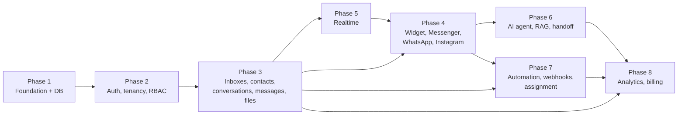

# Implementation Roadmap

Build order, dependencies and milestones. Each phase has its own guide with objective, features, files, tables, APIs, dependencies, steps, tests, expected output and completion criteria.

> **Status:** documentation complete. **Implementation has not started and waits for approval.**

## 1. The 21 steps and how they group into phases

| Step | Topic | Phase guide | Release |
|---|---|---|---|
| 1 | Project foundation | [PHASE_01_FOUNDATION.md](PHASE_01_FOUNDATION.md) | MVP |
| 2 | PostgreSQL and database architecture | PHASE_01 | MVP |
| 3 | Authentication | [PHASE_02_AUTHENTICATION.md](PHASE_02_AUTHENTICATION.md) | MVP |
| 4 | Organizations and multi-tenancy | PHASE_02 | MVP |
| 5 | Users, roles, teams, permissions | PHASE_02 | MVP (teams R1) |
| 6 | Inboxes and channel connections | [PHASE_03_INBOX_AND_CONVERSATIONS.md](PHASE_03_INBOX_AND_CONVERSATIONS.md) | MVP |
| 7 | Contacts | PHASE_03 | MVP |
| 8 | Conversations and messages | PHASE_03 | MVP |
| 9 | WebSocket real-time messaging | [PHASE_05_REALTIME_MESSAGING.md](PHASE_05_REALTIME_MESSAGING.md) | MVP |
| 10 | Facebook Messenger | [PHASE_04_CHANNEL_INTEGRATIONS.md](PHASE_04_CHANNEL_INTEGRATIONS.md) | MVP |
| 11 | Instagram | PHASE_04 | R1 |
| 12 | WhatsApp | PHASE_04 | MVP |
| 13 | Website live chat | PHASE_04 (+ PHASE_05 for sockets) | MVP |
| 14 | Attachments | PHASE_03 (storage) + PHASE_04 (provider media) | MVP |
| 15 | LangGraph AI chatbot | [PHASE_06_AI_INTEGRATION.md](PHASE_06_AI_INTEGRATION.md) | R1 |
| 16 | RAG and knowledge bases | PHASE_06 | R1 |
| 17 | Human handoff | PHASE_06 | R1 |
| 18 | Automation | [PHASE_07_AUTOMATION.md](PHASE_07_AUTOMATION.md) | R1 |
| 19 | Analytics | [PHASE_08_ANALYTICS_AND_BILLING.md](PHASE_08_ANALYTICS_AND_BILLING.md) | R1 |
| 20 | Subscription and billing | PHASE_08 | R2 |
| 21 | Production deployment | [../deployment/PRODUCTION_DEPLOYMENT.md](../deployment/PRODUCTION_DEPLOYMENT.md) + every phase's CI | MVP (staging) → R1 (prod) |

Realtime (Phase 5) is built **before** channels (Phase 4) are finished: the widget needs sockets and agents need live updates to test channels sensibly. In practice: Phase 3 → Phase 5 (core realtime) → Phase 4 (channels) → Phase 5 widget part.

## 2. Dependency graph

| Phase | Depends on | Why |
|---|---|---|
| 2 | 1 | Needs settings, DB session, migrations, error handling, test harness |
| 3 | 2 | Every endpoint needs `TenantContext`, permissions and RLS binding |
| 5 | 3 | Publishes events produced by conversation/message services |
| 4 | 3, 5 | Adapters feed `ContactResolver`/`ConversationResolver`/`MessageService`; widget needs sockets |
| 6 | 4 | AI reacts to real inbound messages and replies through channels; needs `MessageService.create_outgoing` and handoff transitions |
| 7 | 3, 4 | Automation consumes outbox events and calls conversation/message services; webhooks deliver those events |
| 8 | 3, 6, 7 | Reports aggregate events from conversations, AI and assignment; billing meters AI usage and enforces limits across modules |

## 3. Milestones

| Milestone | After | Demo |
|---|---|---|
| **M1 — Skeleton** | Phase 1 | `docker compose up`; `/health/ready` green; migrations create 66 tables; CI green |
| **M2 — Secure tenant API** | Phase 2 | Sign up, log in, invite an agent, create a workspace; cross-tenant tests green |
| **M3 — Inbox core** | Phase 3 + 5 (core) | Create conversations/messages through the API; agent sees updates live in two browser tabs |
| **M4 — MVP** | Phase 4 (widget, Messenger, WhatsApp) | Real customer messages from website, Messenger, WhatsApp land in the inbox; agents reply; delivery/read status shows; no lost or duplicate messages in a 1-hour soak test with replayed webhooks |
| **M5 — R1** | Phases 6, 7, 8 (analytics), Instagram | AI answers from the knowledge base and hands off; automation rules; outgoing webhooks; reports |
| **M6 — R2** | Billing, custom roles, macros, assist mode | Self-serve paid signup |

## 4. Team plan (indicative)

With 3 backend engineers + 1 frontend engineer (dashboard/widget, in parallel against the API spec):

| Weeks | Work |
|---|---|
| 1–2 | Phase 1 |
| 3–4 | Phase 2 |
| 5–7 | Phase 3 + realtime core |
| 8–11 | Phase 4: widget (wk 8–9), WhatsApp (wk 8–10), Messenger (wk 10–11); start Meta App Review in week 8 |
| 12 | MVP hardening, load tests, staging soak → **M4** |
| 13–16 | Phase 6 (AI) in parallel with Phase 7 (automation, webhooks, assignment) and Instagram |
| 17–18 | Phase 8 analytics, audit, production launch → **M5** |
| 19–22 | Billing, custom roles, macros, assist mode → **M6** |

## 5. Definition of done (every phase)

- Code follows [../backend/PROJECT_STRUCTURE.md](../backend/PROJECT_STRUCTURE.md); import-linter contracts pass.
- Ruff + mypy (strict for `src/`) clean.
- Tests listed in the phase guide pass, plus the tenant-isolation suite for every new endpoint ([TESTING_STRATEGY.md](TESTING_STRATEGY.md)).
- New tables have RLS + composite FKs in the same migration; `alembic check` clean.
- OpenAPI updated; examples in docs still valid.
- Metrics/logs for new flows; alerts for new failure modes.
- Docs in `docs/python-platform/` updated where behaviour differs from the design.
