# Testing Strategy

## 1. Principles

1. **Real infrastructure for integration tests.** PostgreSQL with pgvector and Redis via testcontainers. RLS, JSONB, `ON CONFLICT`, HNSW and trigram behaviour can't be faked with SQLite or mocks.
2. **Mock only external providers**, at the HTTP boundary (`respx` for httpx), with recorded real payloads.
3. **Every bug fix gets a regression test** that fails before the fix.
4. **Tenant isolation is tested on every endpoint**, automatically.
5. **Deterministic AI tests**: graph nodes are tested with fake LLM providers; model quality is measured separately by the eval harness.

## 2. Test pyramid

| Layer | Folder | Scope | Speed | Runs |
|---|---|---|---|---|
| Unit | `tests/unit/` | Pure functions: parsers, condition evaluator, business hours, crypto, edges, nodes with fakes | ms | every commit |
| Integration | `tests/integration/` | Services + repositories against real Postgres/Redis in a rolled-back transaction | 10–100 ms | every commit |
| API | `tests/api/` | FastAPI app via `httpx.AsyncClient`, real DB, dependencies overridden only for clock/providers | 50–200 ms | every commit |
| Contract | `tests/contract/` | Adapter contract suite, event schemas, webhook payload schemas, OpenAPI snapshot | fast | every commit |
| Security | `tests/security/` | RLS coverage, cross-tenant access, auth abuse, SSRF, signature checks | medium | every commit |
| Realtime | `tests/realtime/` | Gateway with real Redis, multiple replicas in-process | medium | every commit |
| E2E | `tests/e2e/` | api + workers (eager=False, real Celery worker in a thread) + gateway: webhook → reply → status | seconds | every commit (small set), nightly (full) |
| Load / soak | `load/` (k6, Locust) | Webhook throughput, WebSocket connections, conversation list queries | minutes | before releases |
| AI eval | `tests/eval/` | Groundedness, retrieval recall, handoff precision on datasets | minutes | nightly + on prompt/model changes |

## 3. Fixtures and factories

- `conftest.py` starts containers once per session, runs `alembic upgrade head`, and provides:
  - `db_session` (sync/async) wrapped in a SAVEPOINT rolled back after each test.
  - `tenant` factory: organization + workspace + owner + agent + inbox (per provider) with fixed-shape data.
  - `as_user(user, workspace)` → authenticated API client.
  - `frozen_clock` fixture patching `core.clock.now`.
  - `fake_llm` provider with scripted responses and a recorder of received prompts.
  - `meta_api` respx router preloaded with Graph API endpoints and helpers (`meta_api.expect_send(...)`).
- `polyfactory` factories for models and Pydantic schemas.
- Payload fixtures: `tests/fixtures/channels/<provider>/<type>.json`, scrubbed by a script that replaces ids, names, phone numbers.

## 4. Tenant isolation suite (automatic)

```python
# tests/security/test_cross_tenant_access.py
@pytest.mark.parametrize("route", tenant_routes(app), ids=lambda r: f"{r.method} {r.path}")
async def test_route_rejects_foreign_ids(route, two_tenants, client_for):
    a, b = two_tenants                                  # each with every resource type created
    client = client_for(a.agent_admin)
    path = route.path_with(workspace_id=a.workspace.id, **b.resource_ids_for(route))  # foreign ids in A's workspace
    response = await client.request(route.method, path, json=route.sample_body(b))
    assert response.status_code == 404
```

Plus: every table with `organization_id` has forced RLS; unbound sessions see 0 rows; `SET LOCAL` doesn't leak across pooled connections; realtime events of tenant B never reach tenant A sockets; retrieval never returns B's chunks.

## 5. Channel tests

- Parser tests for every fixture (golden files: input payload → expected normalised events JSON).
- Adapter contract suite (shared, parametrised over adapters): `parse_incoming` is pure and idempotent; unknown event types give `unsupported`; `send_message` maps provider errors to the right `ChannelError` classes; `verify_webhook` rejects modified bodies.
- Concurrency tests with real workers: duplicate deliveries, album bursts, echo races, out-of-order statuses.

## 6. AI tests

- Node unit tests with `fake_llm` (structured outputs scripted), fake retriever and fake tools.
- Graph tests: full `ainvoke` with fakes for each route (smalltalk, knowledge answer, handoff by request, low confidence, guardrail regenerate, guardrail block, tool failure, deadline).
- Safety tests: prompt-injection corpus in documents and messages; assert no prompt leak, no tool misuse, private notes absent from prompts.
- Eval harness (real models, nightly): thresholds in [PHASE_06_AI_INTEGRATION.md](PHASE_06_AI_INTEGRATION.md#8-testing-requirements). Failing thresholds block prompt/model changes.

## 7. Performance tests

| Scenario | Target |
|---|---|
| Webhook ingress | 500 req/s per api replica, p99 < 200 ms |
| Inbound end-to-end (webhook → realtime) | p95 < 1 s at 200 msg/s |
| Conversation list (large tenant: 100k conversations, 10M messages) | p95 < 100 ms |
| Message timeline page | p95 < 50 ms |
| WebSocket | 10k connections/replica, p95 publish→deliver < 150 ms |
| Retrieval (1M chunks shared index, filtered to one KB) | p95 < 120 ms, recall@8 within 5% of exact search |

Record `EXPLAIN (ANALYZE, BUFFERS)` output for the main queries in PRs that change them.

## 8. CI pipeline

```mermaid
flowchart LR
    A["push / PR"] --> B["ruff + mypy + import-linter"]
    B --> C["unit + contract"]
    C --> D["integration + api + security + realtime (testcontainers)"]
    D --> E["alembic upgrade head + alembic check on empty DB"]
    E --> F["e2e smoke"]
    F --> G["docker build + Trivy + pip-audit"]
    G --> H["deploy staging (main only)"]
    H --> I["staging smoke + nightly e2e/eval/load"]
```



Coverage target: 85% lines on `src/converse/modules`, `channels`, `ai/graph` (measured, not gamed; untested branches listed in PRs).

## 9. What not to test

- Framework behaviour (FastAPI validation of simple types, SQLAlchemy column defaults).
- Migration declarations themselves (covered by `alembic check` and RLS coverage), except data migrations, which get tests.
- Third-party SDK internals.
