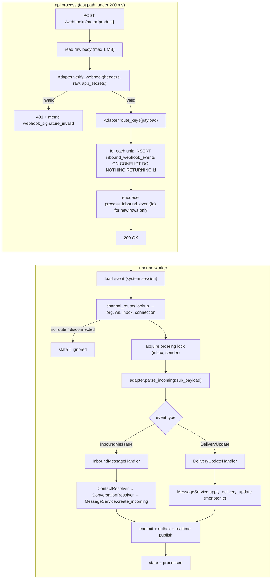
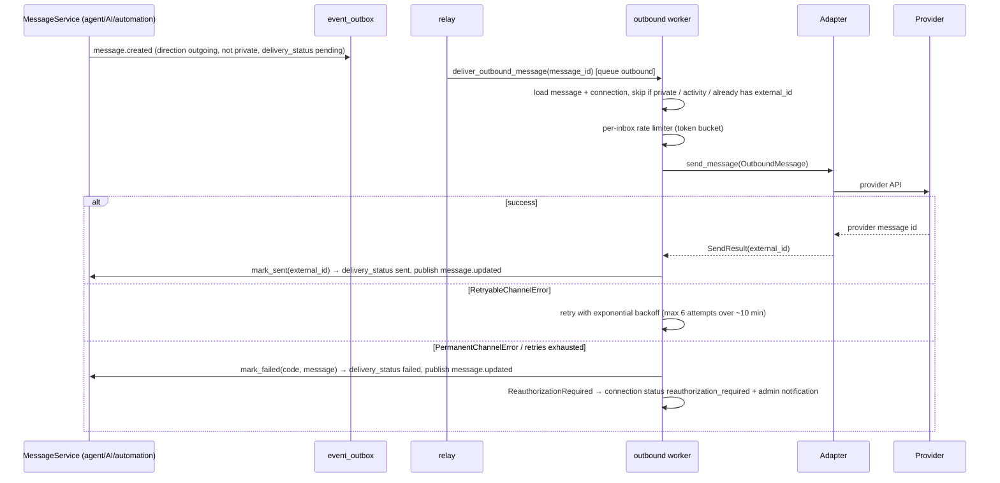
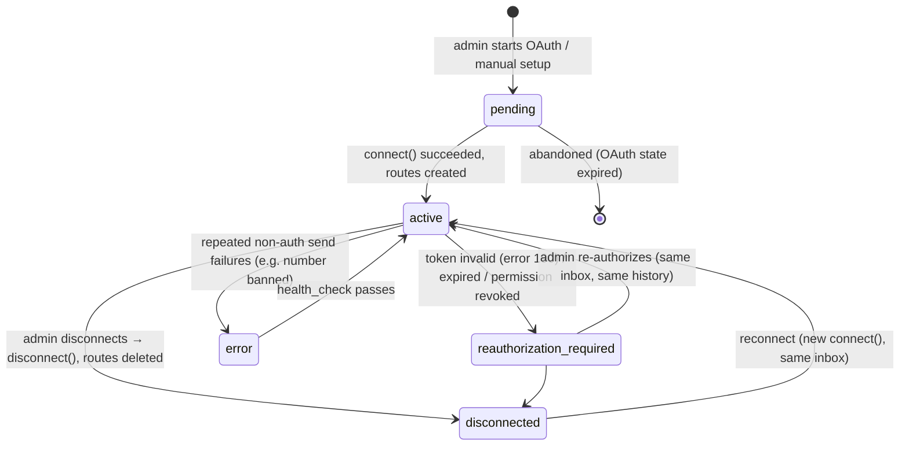

# Channel Adapter Architecture

Every channel (website widget, Facebook Messenger, Instagram, WhatsApp, and later email, SMS, Telegram…) is implemented as an **adapter** behind one contract. The conversation core never imports provider code and never sees provider payloads.

In Chatwoot, outbound sending shares a base class (`Base::SendOnChannelService`), but inbound handling is a separate controller + job + service chain for every provider (see [../01_CHATWOOT_ANALYSIS.md](../01_CHATWOOT_ANALYSIS.md#11-social-media-integrations)). Converse makes **both directions** go through one pipeline.

## 1. What is shared and what is provider-specific

| Concern | Platform-independent (core) | Provider-specific (adapter) |
|---|---|---|
| Webhook HTTP endpoint | Rate limiting, body size limit, recording, enqueueing | Path, verification handshake, which secret signs the body |
| Signature check | Constant-time compare helper | Algorithm, header name, secret lookup |
| Tenant identification | `channel_routes` lookup | Which payload field is the routing id |
| Dedup | `inbound_webhook_events` unique key, `messages (inbox_id, external_id)` unique | How to compute the `dedup_key` |
| Ordering | Per-identity ordering lock | Which field identifies the sender |
| Parsing | — | Payload → `InboundMessage` / `DeliveryUpdate` / `ProfileUpdate` |
| Contacts & identities | `ContactResolver` | Profile fetch (name, avatar) |
| Conversations | `ConversationResolver` (open/reopen/new) | — |
| Persistence & events | `MessageService`, outbox | — |
| Media | Storage, size limits, MIME sniffing | Media download (URLs, auth), upload for outbound |
| Outbound trigger | `message.created` (outgoing, not private) → `deliver_outbound_message` | — |
| Sending | Retry policy, rate limiting per inbox, status updates | API call, payload format, 24 h window rules, error mapping |
| Connection lifecycle | `channel_connections` state machine, encryption, admin UI | OAuth flow, webhook subscription, token refresh, disconnect |

## 2. Normalised types

All adapters translate to and from these Pydantic models (`converse/channels/types.py`):

```python
from datetime import datetime
from enum import StrEnum
from typing import Literal
from pydantic import BaseModel, Field, HttpUrl


class AttachmentKind(StrEnum):
    IMAGE = "image"
    AUDIO = "audio"
    VIDEO = "video"
    FILE = "file"
    LOCATION = "location"
    STICKER = "sticker"
    FALLBACK = "fallback"


class InboundAttachment(BaseModel):
    kind: AttachmentKind
    provider_media_id: str | None = None      # WhatsApp media id
    url: HttpUrl | None = None                # Messenger/Instagram CDN url
    mime_type: str | None = None
    filename: str | None = None
    is_voice: bool = False
    latitude: float | None = None
    longitude: float | None = None
    title: str | None = None


class SenderProfile(BaseModel):
    source_id: str                            # PSID / IGSID / wa_id or BSUID / visitor id
    name: str | None = None
    phone_number: str | None = None           # E.164, WhatsApp only
    username: str | None = None               # Instagram
    alternate_source_ids: list[str] = []      # e.g. wa_id when source_id is a BSUID


class InboundMessage(BaseModel):
    kind: Literal["message"] = "message"
    external_id: str                          # provider message id (dedup key)
    sender: SenderProfile
    direction: Literal["incoming", "outgoing_echo"] = "incoming"
    sent_at: datetime                         # provider timestamp, used for ordering
    text: str | None = None
    content_type: str = "text"                # text | interactive | location | contact_card | unsupported
    attachments: list[InboundAttachment] = []
    in_reply_to_external_id: str | None = None
    content_attributes: dict = Field(default_factory=dict)  # reaction, interactive_reply, story, referral


class DeliveryUpdate(BaseModel):
    kind: Literal["delivery"] = "delivery"
    status: Literal["sent", "delivered", "read", "failed"]
    external_id: str | None = None            # WhatsApp: per message id
    watermark: datetime | None = None         # Messenger/Instagram: all messages up to this time
    recipient_source_id: str
    error_code: str | None = None
    error_message: str | None = None
    occurred_at: datetime


class OutboundMessage(BaseModel):
    message_id: str                           # our messages.id
    recipient_source_id: str
    text: str | None = None
    content_type: str = "text"
    content_attributes: dict = Field(default_factory=dict)  # template / interactive payloads
    attachments: list["OutboundAttachment"] = []
    in_reply_to_external_id: str | None = None
    last_incoming_at: datetime | None = None  # for 24 h window decisions


class OutboundAttachment(BaseModel):
    kind: AttachmentKind
    file_id: str
    filename: str
    mime_type: str
    signed_url: HttpUrl                       # short-lived URL providers can fetch


class SendResult(BaseModel):
    external_id: str
    status: Literal["sent", "pending"] = "sent"


InboundEvent = InboundMessage | DeliveryUpdate
```

## 3. The `BaseChannelAdapter` contract

```python
# converse/channels/base.py
from abc import ABC, abstractmethod
from typing import ClassVar


class ChannelError(Exception):
    """Base for adapter errors. `retryable` decides the worker's behaviour."""
    retryable: bool = False
    code: str = "channel_error"


class RetryableChannelError(ChannelError):
    retryable = True          # timeouts, 5xx, provider rate limits


class PermanentChannelError(ChannelError):
    retryable = False         # invalid recipient, window closed, policy block


class ReauthorizationRequired(PermanentChannelError):
    code = "reauthorization_required"   # invalid/expired token: connection → reauthorization_required


class WindowClosed(PermanentChannelError):
    code = "window_closed"              # 24 h window expired and no template/tag available


class BaseChannelAdapter(ABC):
    provider: ClassVar[str]             # matches channel_provider enum
    capabilities: ClassVar[frozenset[str]]  # {"attachments", "templates", "reactions", "read_receipts", "typing"}

    def __init__(self, connection: "ChannelConnectionView", secrets: "DecryptedSecrets", http: "HttpClient"):
        self.connection = connection    # ids + config, no ORM object
        self.secrets = secrets          # decrypted on demand, never logged
        self.http = http

    # ---- connection lifecycle -------------------------------------------
    @abstractmethod
    def connect(self, request: "ConnectRequest") -> "ConnectResult":
        """Finish OAuth/manual setup: validate credentials, subscribe webhooks, return
        detail rows and route ids to persist. Called by InboxService inside a task."""

    @abstractmethod
    def disconnect(self) -> None:
        """Unsubscribe webhooks / revoke tokens at the provider. Must be safe to call twice."""

    def refresh_credentials(self) -> "RefreshResult | None":
        """Renew expiring tokens. Default: nothing to refresh."""
        return None

    def health_check(self) -> "HealthResult":
        """Cheap call proving the token works (e.g. GET /me). Used by the admin UI and beat."""
        raise NotImplementedError

    # ---- inbound -----------------------------------------------------------
    @classmethod
    @abstractmethod
    def verify_webhook(cls, headers: dict[str, str], raw_body: bytes, secrets: list[bytes]) -> bool:
        """Signature check on the raw body. Classmethod: runs before the tenant is known."""

    @classmethod
    @abstractmethod
    def route_keys(cls, payload: dict) -> list["RouteKey"]:
        """Split a webhook payload into per-channel units: (external routing id, dedup_key,
        ordering key, sub-payload). One HTTP delivery can contain several entries."""

    @abstractmethod
    def parse_incoming(self, payload: dict) -> list[InboundEvent]:
        """Pure translation of one routed sub-payload into normalised events. No DB access."""

    @abstractmethod
    def fetch_profile(self, source_id: str) -> SenderProfile | None:
        """Optional provider profile lookup (name, avatar). Cached by ContactResolver."""

    @abstractmethod
    def download_media(self, attachment: InboundAttachment) -> "MediaStream":
        """Fetch inbound media bytes (with auth where required)."""

    # ---- outbound ------------------------------------------------------------
    @abstractmethod
    def send_message(self, message: OutboundMessage) -> SendResult:
        """Send text/interactive/template content. Raise ChannelError subclasses on failure."""

    def send_attachment(self, message: OutboundMessage, attachment: OutboundAttachment) -> SendResult:
        """Default: providers that send one attachment per API call override this.
        send_message calls it for each attachment when needed."""
        raise NotImplementedError

    def mark_read(self, external_id: str) -> None:
        """Send a read receipt to the provider if supported."""
        return None

    def get_delivery_status(self, external_id: str) -> DeliveryUpdate | None:
        """Pull-based status for providers without status webhooks. Meta pushes statuses,
        so Meta adapters return None and rely on webhooks."""
        return None
```

Adapters are **synchronous** (they run in Celery workers) and **stateless** apart from the injected connection. They do no database access. Everything they need comes in, and everything they produce goes out as return values. That makes them easy to unit-test with recorded payloads.

### Registry

```python
# converse/channels/registry.py
ADAPTERS: dict[str, type[BaseChannelAdapter]] = {
    "web_widget": WebWidgetAdapter,
    "facebook_messenger": MessengerAdapter,
    "instagram": InstagramAdapter,
    "whatsapp_cloud": WhatsAppCloudAdapter,
}

def adapter_for(connection: ChannelConnectionView, secrets_loader: SecretsLoader, http: HttpClient) -> BaseChannelAdapter:
    cls = ADAPTERS[connection.provider]          # KeyError = misconfiguration → fail loudly
    return cls(connection, secrets_loader.for_connection(connection), http)
```

## 4. Inbound pipeline (shared)



**Ordering.** Two webhooks from the same customer can be processed by two workers at the same time. Without care, the second could create a second conversation, or messages could land out of order. Converse:

1. Takes a Redis lock `lock:inbound:{inbox_id}:{sender_source_id}` (TTL 30 s, like Chatwoot's WhatsApp mutex) around contact + conversation resolution and message insert. If the lock is busy, the task re-queues itself with a 1–2 s countdown (bounded: 20 attempts) rather than blocking a worker.
2. Stores the provider timestamp (`sent_at`) in `content_attributes.provider_sent_at` and orders the timeline by `(created_at, sequence_number)`. When a late message has an earlier provider timestamp than the latest stored one, its `created_at` is set to the provider timestamp so the timeline stays in customer order.
3. Never drops an event because the lock is busy. After exhausting retries, it processes without the lock (as Chatwoot's Instagram job does); the unique indexes still prevent duplicates, and the worst case is a misplaced timeline entry, which is logged.

**Idempotency.** Three layers: `inbound_webhook_events (provider, dedup_key)` stops repeated deliveries before enqueueing; `messages (inbox_id, external_id)` stops duplicates if two different payloads describe the same message (e.g. a retried batch); `ContactResolver` uses `INSERT … ON CONFLICT (inbox_id, source_id) DO NOTHING RETURNING` to survive identity races.

## 5. Outbound pipeline (shared)



Rules copied from Chatwoot's `Base::SendOnChannelService#invalid_message?` and kept: private notes and activity messages are never sent; messages that originated from the channel (echoes) are not sent back.

## 6. Webhook endpoints

| Provider | Verify (GET) | Events (POST) | Secret |
|---|---|---|---|
| Messenger | `/webhooks/meta/messenger` | `/webhooks/meta/messenger` | Meta App Secret (`META_APP_SECRET`) |
| Instagram | `/webhooks/meta/instagram` | `/webhooks/meta/instagram` | Instagram app secret (`META_INSTAGRAM_APP_SECRET`, may equal the Meta App Secret) |
| WhatsApp | `/webhooks/meta/whatsapp` | `/webhooks/meta/whatsapp` | Meta App Secret |
| Web widget | — | — (REST API, not a webhook) | Visitor JWT |

One platform-level Meta app serves all tenants (the SaaS model). Tenants who bring their own Meta app (rare, Enterprise) get a per-connection secret in `channel_connections.credentials_ciphertext` (`app_secret`), and `verify_webhook` is given the candidate secrets for the routed connection, as Chatwoot does (`MetaTokenVerifyConcern#channel_meta_app_secrets`). Because the route isn't known until the payload is parsed, the ingress parses JSON first, extracts the routing id, loads candidate secrets, and only then verifies. **Nothing is stored or enqueued before verification succeeds.**

Verification handshake (identical for all three Meta products):

```python
@router.get("/webhooks/meta/{product}")
async def meta_verify(product: MetaProduct, mode: str = Query(alias="hub.mode"),
                      token: str = Query(alias="hub.verify_token"),
                      challenge: str = Query(alias="hub.challenge")) -> PlainTextResponse:
    if mode != "subscribe" or not hmac.compare_digest(token, settings.meta_verify_token(product)):
        raise HTTPException(status_code=403)
    return PlainTextResponse(challenge)
```

Signature validation:

```python
def verify_meta_signature(headers: Mapping[str, str], raw_body: bytes, secrets: Iterable[bytes]) -> bool:
    header = headers.get("x-hub-signature-256", "")
    if not header.startswith("sha256="):
        return False
    received = header.removeprefix("sha256=")
    for secret in secrets:
        expected = hmac.new(secret, raw_body, hashlib.sha256).hexdigest()
        if hmac.compare_digest(expected, received):
            return True
    return False
```

Always compute over the **exact raw bytes**. Re-serialising parsed JSON changes whitespace and breaks the signature.

## 7. Connection lifecycle



- **Reconnecting keeps history.** The inbox and its conversations remain; only the connection's credentials and routes are replaced.
- **Moving a page/number between workspaces or tenants.** `channel_routes` has primary key `(provider, external_id)`, so a Page or number can be active in only one inbox at a time. Connecting an already-routed id returns `409 channel_already_connected` with the owning organization's name withheld.
- **Webhook loss during reauthorization.** Events for a connection in `reauthorization_required` are still recorded (`inbound_webhook_events`) and processed: incoming messages need no token, except media download and profile fetch, which are retried after reauthorization.

## 8. Adding a new channel (checklist)

1. Add the provider to the `channel_provider` enum (migration) and to `ADAPTERS`.
2. Create `converse/channels/<provider>/` with `adapter.py`, `client.py` (HTTP calls), `parser.py` (pure functions), `schemas.py` (provider payload models), `oauth.py` if needed.
3. Add a detail table if the provider needs queryable fields (with `channel_connection_id` FK and tenant FKs + RLS).
4. Add ingress route(s) under `converse/api/webhooks/`.
5. Record real payload fixtures (scrubbed) in `tests/fixtures/channels/<provider>/` and write parser tests for every message type.
6. Contract tests: the shared `AdapterContractTests` suite must pass (idempotent parse, echo handling, error mapping).
7. Document the provider in `docs/python-platform/integrations/`.

No change to `modules/*` should be needed. If one is, the normalised types are missing something; extend them deliberately.
