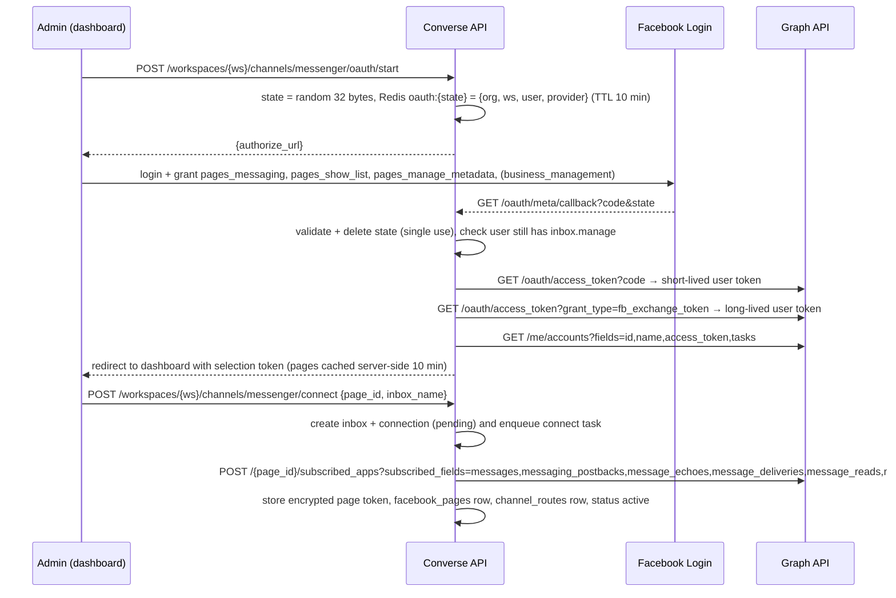

# Facebook Messenger Integration

Package: `converse/channels/meta/messenger/`. Implements [`BaseChannelAdapter`](CHANNEL_ADAPTER_ARCHITECTURE.md). Shares `converse/channels/meta/common/` (Graph client, signature check, error mapping, OAuth helpers) with Instagram and WhatsApp.

> **Version note.** Meta changes Graph API versions roughly twice a year and deprecates older ones. The version is configuration (`META_GRAPH_API_VERSION`). Before implementing, confirm required permissions, webhook fields and messaging policy on Meta's current Messenger Platform docs. The flows below match Meta's documented model at the time of writing.

## 1. Chatwoot reference

- Webhooks via the `facebook-messenger` gem mounted at `/bot`; `ChatwootFbProvider` returns the verify token, per-page app secret, page token (`config/initializers/facebook_messenger.rb`).
- `:message`, `:postback` → `Webhooks::FacebookEventsJob` (lock on sender+recipient); `:message_echo` → same job delayed 2 s; `:delivery`/`:read` → `FacebookDeliveryJob`.
- `Integrations::Facebook::MessageCreator` drops echoes of Chatwoot-sent messages and stores echoes of replies made in Meta Business Suite as outgoing messages.
- Outbound `Facebook::SendOnFacebookService` adds the `HUMAN_AGENT` tag outside 24 h.
- Data: `channel_facebook_pages (page_id, user_access_token, page_access_token, instagram_id)`; tokens stored without encryption.

## 2. Data

| Table | Use |
|---|---|
| `channel_connections` | `provider = facebook_messenger`; encrypted `{page_access_token, user_access_token}`; `config.subscribed_fields` |
| `facebook_pages` | `page_id`, `page_name`, `linked_instagram_id` (informational) |
| `channel_routes` | `(facebook_messenger, page_id)` |
| `contact_identities.source_id` | PSID |

## 3. Connecting a Page (OAuth)



- Page tokens obtained from a long-lived user token do not expire on a schedule, but **they are invalidated** when the user changes their password, loses the Page role, or removes the app. Those show up as error code `190` → `ReauthorizationRequired`.
- The user token is kept (encrypted) only to re-list Pages during reauthorization; it is never used to send.
- `state` prevents CSRF and binds the callback to the user and workspace that started it.

## 4. Inbound events

Webhook body (abbreviated):

```json
{
  "object": "page",
  "entry": [{
    "id": "PAGE_ID",
    "time": 1762560000000,
    "messaging": [{
      "sender": { "id": "PSID" },
      "recipient": { "id": "PAGE_ID" },
      "timestamp": 1762560000000,
      "message": {
        "mid": "m_abc",
        "text": "Hi, do you ship to Canada?",
        "attachments": [{ "type": "image", "payload": { "url": "https://scontent..." } }],
        "reply_to": { "mid": "m_prev" }
      }
    }]
  }]
}
```

`route_keys()` emits one unit per `entry[].messaging[]` item:

| Field | Value |
|---|---|
| routing id | `entry.id` (Page id). For echoes `sender.id` is the Page; still use `entry.id` |
| dedup key | `message.mid`; postbacks `postback.mid`; `delivery`: `{sender}:{watermark}:delivery`; `read`: `{sender}:{watermark}:read`; `referral`: SHA-256 of the item |
| ordering key | customer PSID (`sender.id`, or `recipient.id` for echoes) |

`parse_incoming()` mapping:

| Messenger event | Normalised | Notes |
|---|---|---|
| `message.text` | `InboundMessage(text)` | |
| `message.attachments[type=image/video/audio/file]` | attachments with `url` | CDN URLs expire; download promptly (`download_inbound_media` on `low` queue, priority high within it) |
| `message.attachments[type=location]` (legacy) | `location` | |
| `message.attachments[type=fallback]` (shared links) | `fallback` with title/url | |
| `message.sticker_id` | `sticker` | |
| `message.quick_reply.payload` | `content_attributes.interactive_reply` | |
| `postback` (button click, Get Started) | `InboundMessage(text = postback.title, content_attributes.postback = payload)` | |
| `message.is_echo = true` | `direction = outgoing_echo` | See echo handling |
| `delivery.watermark` | `DeliveryUpdate(delivered, watermark)` | All our outgoing messages to this PSID with `created_at ≤ watermark` |
| `read.watermark` | `DeliveryUpdate(read, watermark)` | |
| `referral` (m.me link, ad click) | stored on conversation `additional_attributes.meta_referral` | |
| `message.is_deleted` / unsend | marks message deleted | |
| `reaction` | `content_attributes.reaction` on the target message | |

### Echo handling (replaces Chatwoot's 2-second delay)

When we send, Meta returns `message_id` and later delivers an echo webhook with the same `mid`. The echo can arrive **before** our send call returns.

1. `deliver_outbound_message` stores `external_id` immediately after the API returns.
2. An echo is processed under the same per-PSID ordering lock as everything else. The handler inserts with `ON CONFLICT (inbox_id, external_id) DO NOTHING`.
3. If the echo wins the race (our `external_id` not yet stored), the echo also carries `metadata` = our `messages.id`. We set the Messenger `metadata` field to our message id on every send, so the handler matches by `metadata` and attaches `external_id` to the existing message instead of creating a new one.
4. Echoes without our metadata are replies made in Meta Business Suite / the Page inbox. They are stored as `outgoing` messages with `sender_kind = system` and `content_attributes.external_echo = true`.

### Profile

`fetch_profile(psid)` → `GET /{psid}?fields=first_name,last_name,profile_pic` with the page token. Called only when creating a new identity; the result is cached in `contact_identities.profile`. Failures (privacy settings, error `2018218`) are non-fatal: the contact is named "Messenger user <last 4 of PSID>".

## 5. Outbound

`POST https://graph.facebook.com/{version}/me/messages` with the page access token:

```json
{
  "recipient": { "id": "PSID" },
  "messaging_type": "RESPONSE",
  "message": { "text": "Yes, we ship to Canada!", "metadata": "msg_8f3c...our-message-id" }
}
```

| Case | Request |
|---|---|
| Within 24 h of last customer message | `messaging_type = RESPONSE` |
| 24 h – 7 days, human agent reply | `messaging_type = MESSAGE_TAG`, `tag = HUMAN_AGENT` (requires the app's Human Agent permission approval) |
| AI/automation reply outside 24 h | Not allowed: raise `WindowClosed`; agent UI shows "Outside the messaging window" |
| > 7 days | `WindowClosed` |
| Attachment | `message.attachment = {type: image|video|audio|file, payload: {url: <signed_url>, is_reusable: false}}`, **one attachment per call**, text sent as a separate call first |
| Quick replies / buttons (from `content_type = input_select`) | `message.quick_replies` / button template |
| Typing indicator | `sender_action = typing_on` (best effort, not retried) |
| Mark seen | `sender_action = mark_seen` when an agent opens the conversation |

Signed URLs for attachments must be fetchable by Meta (public HTTPS, valid ≥ 15 min). Alternatively upload via the Attachment Upload API and send by `attachment_id`.

### Error mapping

| Graph error | Meaning | Adapter error |
|---|---|---|
| `190` (any subcode) | Token invalid/expired | `ReauthorizationRequired` |
| `10` / `200` permission errors | Missing permission or app not approved | `ReauthorizationRequired` |
| `551` / `1545041` | Person not available / blocked the Page | `PermanentChannelError("recipient_unavailable")` |
| `10` subcode `2018278` | Outside allowed window | `WindowClosed` |
| `4`, `32`, `613` | Rate limits | `RetryableChannelError` (backoff, honour `Retry-After`) |
| `2`, `1200`, HTTP 5xx, timeouts | Temporary | `RetryableChannelError` |
| other | Unknown | `PermanentChannelError` with the Graph message stored in `delivery_error` |

## 6. Disconnect / reconnect

- **Disconnect:** `DELETE /{page_id}/subscribed_apps` (page token; ignore `190`), delete `channel_routes` row, wipe encrypted credentials, `status = disconnected`. History stays.
- **Reconnect:** run OAuth again and choose the same Page: the existing inbox is reused (`connect` with `inbox_id`), `status = active`.
- **Deauthorize callback:** register Meta's *Deauthorize Callback URL* → `/webhooks/meta/deauthorize` (signed request) → mark all connections of that Facebook user as `reauthorization_required`.
- **Data deletion callback:** `/webhooks/meta/data-deletion` (signed request) → enqueue `ContactErasureService` for identities with that app-scoped user id, return the confirmation code and status URL Meta requires.

## 7. Tests

- Parser tests for every row of the mapping table using scrubbed real payloads.
- Echo race: send result stored after the echo arrives → exactly one message, with `external_id` set.
- Watermark delivery marks only earlier outgoing messages; never downgrades `read` → `delivered`.
- Error mapping table → adapter error class (parametrised).
- OAuth: invalid/replayed `state` rejected; callback for a user who lost `inbox.manage` rejected.
