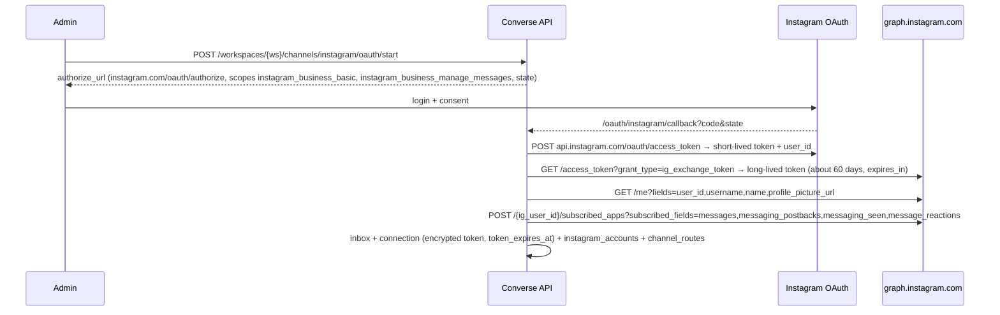

# Instagram Messaging Integration

Package: `converse/channels/meta/instagram/`. Implements [`BaseChannelAdapter`](CHANNEL_ADAPTER_ARCHITECTURE.md).

> **Version note.** Confirm the current *Instagram API with Instagram Login* permissions and webhook fields on Meta's docs before implementing. Graph version is `META_GRAPH_API_VERSION`.

## 1. Chatwoot reference

Chatwoot supports two connection methods:

1. **Via a Facebook Page** (legacy): `channel_facebook_pages.instagram_id`; conversations flagged `additional_attributes.type = 'instagram_direct_message'`; sending through `Instagram::Messenger::SendOnInstagramService`.
2. **Instagram Login** (current): `Channel::Instagram` with an encrypted long-lived `access_token` + `expires_at`; `Instagram::RefreshOauthTokenService`; webhooks at `/webhooks/instagram` → `Webhooks::InstagramEventsJob` (3 s lock per sender, process-without-lock on exhaustion, echo events delayed 2 s).

**Converse supports Instagram Login only** for new connections. It works for Instagram professional accounts without a linked Facebook Page. The Page-based path is listed as Future.

## 2. Data

| Table | Use |
|---|---|
| `channel_connections` | `provider = instagram`; encrypted `{access_token}`; `token_expires_at` |
| `instagram_accounts` | `instagram_user_id`, `username`, `connection_method = 'instagram_login'` |
| `channel_routes` | `(instagram, instagram_user_id)` |
| `contact_identities.source_id` | IGSID (Instagram-scoped user id) |

## 3. Connecting an account



### Token refresh

- Long-lived Instagram tokens last about 60 days. They can be refreshed once they are at least 24 hours old and still valid: `GET graph.instagram.com/refresh_access_token?grant_type=ig_refresh_token&access_token=...`.
- Beat task `refresh_expiring_tokens` (daily) finds `channel_connections WHERE status = 'active' AND token_expires_at < now() + interval '10 days'` (system session), then enqueues one tenant-scoped `refresh_connection_token` per connection.
- Failure → retry daily; at 3 days before expiry, notify admins; on expiry or `190` → `reauthorization_required`.

## 4. Inbound events

```json
{
  "object": "instagram",
  "entry": [{
    "id": "IG_USER_ID",
    "time": 1762560000,
    "messaging": [{
      "sender": { "id": "IGSID" },
      "recipient": { "id": "IG_USER_ID" },
      "timestamp": 1762560000000,
      "message": { "mid": "aWdf...", "text": "Is this in stock?" }
    }]
  }]
}
```

| Item | Normalised |
|---|---|
| `message.text` | text |
| `message.attachments[type=image/video/audio/file]` | attachment with `url` |
| `message.attachments[type=share]` (post share) | `fallback` + `content_attributes.share` |
| `message.attachments[type=story_mention]` | `fallback` + `content_attributes.story = {type: mention, url}` (story URLs expire after 24 h, so download immediately) |
| `message.reply_to.story` | text + `content_attributes.story = {type: reply, url, id}` |
| `message.reply_to.mid` | `in_reply_to_external_id` |
| `message.is_echo` | outgoing echo, matched by `external_id` (see echo handling below; Instagram echoes don't carry our `metadata`) |
| `message.is_deleted` | mark deleted |
| `message.is_unsupported` | `unsupported` |
| `postback` | interactive reply |
| `read` (`messaging_seen`) | `DeliveryUpdate(read, external_id = read.mid)` |
| `reaction` | reaction on target |

Routing id: `entry.id`. Dedup: `mid`, or `{sender}:{read.mid}:read`. Ordering key: IGSID.

**Echo handling detail.** Instagram echoes don't carry our metadata. The echo task checks for a message with `external_id = mid`; if none exists, it re-queues itself once with a 3 s countdown (our send call will have stored `external_id` by then). If it's still unknown, it stores the echo as an external outgoing message (sent from the Instagram app). This is idempotent: if our send result lands later, the unique index on `external_id` prevents a duplicate, and the send path detects the conflict and links the rows.

## 5. Outbound

`POST https://graph.instagram.com/{version}/{ig_user_id}/messages` with the Instagram user access token:

```json
{ "recipient": { "id": "IGSID" }, "message": { "text": "Yes, it's in stock in sizes S–L." } }
```

| Case | Behaviour |
|---|---|
| Within 24 h | Send normally |
| 24 h – 7 days, human agent | `"tag": "HUMAN_AGENT"` (requires approval) |
| Otherwise | `WindowClosed` |
| Attachment | `message.attachment = {type: image|video|audio|file, payload: {url}}`, one per call |
| Reactions | `sender_action = react`, `payload.message_id`, `payload.reaction = love` (optional R2) |

Error mapping is shared with Messenger (`meta/common/errors.py`). Instagram-specific: `2534022` (outside window) → `WindowClosed`; `2534014` (user not found) → permanent.

## 6. Disconnect / reconnect

Same as Messenger: unsubscribe (`DELETE /{ig_user_id}/subscribed_apps`), delete route, wipe credentials; reconnect via OAuth keeps the inbox.

## 7. Future: Instagram via Facebook Page

If needed for accounts managed through Business Manager with Page-based permissions: the connection holds the Page token, routes on the Instagram account id delivered under `object = instagram` events, and sends through `graph.facebook.com/{version}/me/messages` with the Page token. It is the same adapter with a different `connection_method` and client.
