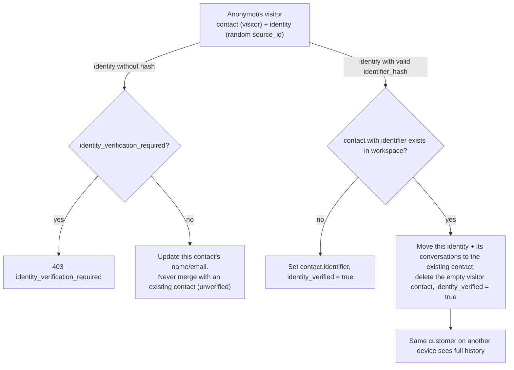

# Website Live Chat

Two parts:

1. **Server**: `converse/channels/web_widget/` (adapter) + `converse/api/routes/widget/` (REST) + the realtime gateway's visitor endpoint.
2. **Client**: `widget-sdk/` (TypeScript loader, ~10 KB gzipped) and `widget-app/` (the chat UI rendered in an iframe). These are separate frontend packages; this document specifies their contract.

## Implementation status

The server side is built. The `converse/...` paths below are the original design layout; the code lives in `app/`. Tests: `tests/test_web_widget.py` (14 tests: admin, origins, sessions, conversations, idempotency, private notes, identify/merge, pre-chat, attributes, labels, relay delivery, WebSocket). The client packages are specified for the frontend in [../frontend-implamentation/08_WEBSITE_WIDGET.md](../frontend-implamentation/08_WEBSITE_WIDGET.md).

| Section | Part | Status | Code |
|---|---|---|---|
| §3 | Visitor REST API, `website_token` (query or body) + `X-Visitor-Token`, 64 KB body cap | ✅ |
| §3, §8 | Origin check. The iframe runs on our own origin (`WIDGET_APP_URL` / `FRONTEND_URL`), so for requests from it the server checks the **embedding page's** origin, which the iframe sends as `X-Parent-Origin` (REST) or `parent_origin` (socket auth frame), taken from the browser-verified `event.origin` of the SDK's `postMessage` | ✅ | `origin_allowed` in `app/services/widget.py` | `app/api/v1/endpoints/widget.py`, `app/services/widget.py`, body cap in `app/main.py` |
| §3 | Additions: `DELETE /sessions` (`reset()`: revokes the token), `DELETE /contact/custom-attributes/{key}`, `PATCH /conversations/{id}` (conversation attributes), `POST/DELETE /conversations/{id}/labels` (labels with `labels.widget_settable`) | ✅ | same |
| §3 | `POST /uploads` | 🔜 answers `503 uploads_unavailable` until the storage module exists; `attachment_file_ids` → `422 attachments_not_supported` | same |
| §3 | `POST /events` | ✅ recorded as `widget.event` in the outbox (automation consumes it in Phase 7) | same |
| §4 | `/ws/widget`: auth frame within 5 s, Origin check, `rt:contact:{realtime_token}`, `typing` / `ping` frames, close `4401` / `4403` / `4404`, closes when the token expires | ✅ | `app/api/widget_ws.py` |
| §4 | Events to visitors: `message.created` / `message.updated` (non-private), `conversation.status_changed`, `conversation.typing` | ✅ via the outbox relay (`make outbox-relay`) | `app/services/outbox_relay.py`, `app/core/realtime.py` |
| §4 | `agent.presence` | 🔜 needs the agent gateway (Phase 5); `config.agents_online` already reads `presence:org:{org}` | — |
| §5 | Identify: unverified never merges (someone else's email is kept as `unverified_email`), HMAC-verified merges into the contact with that identifier, token rotated (`contact_identities.token_version`), `identity_verification_required`, `409 reset_required` for a second identifier | ✅ | `app/services/widget.py` (`identify`, `_merge_into`) |
| §5 | Email continuity | 🔜 R2, needs the email module | — |
| §6 | Conversation on first message, pre-chat (`require_name` / `require_email` / `require_phone`), `additional_attributes` (referer, browser, language, initiated_at), AI inbox → `pending` + `ai_active`, greeting, out-of-office once, `lock_to_single_conversation`, `allow_messages_after_resolved` | ✅ | `app/services/widget.py` |
| §6 | Auto-assignment when no AI agent | 🔜 R1, the assignment service isn't built yet; conversations start `open` and unassigned | — |
| §6 | AI reply: the visitor's message is queued on the `ai` queue (debounced) after commit | ✅ | `_wake_ai` in `app/api/v1/endpoints/widget.py` |
| §7 | `WebWidgetAdapter`: `send_message` publishes to every identity of the contact in the inbox; `connect` (token, encrypted identity secret, route); `disconnect` (route deleted) | ✅ | `app/channels/web_widget.py`, `app/channels/base.py` |
| §7 | Delivery status `read` when the visitor's `seen` covers the message | ✅ | `mark_seen` |
| §8 | Rate limits: 5 sessions/min/IP, 20 messages/min/visitor (configurable), 10 identify/min, 60 events/min | ✅ | `WIDGET_*_RATE_LIMIT` |
| §8 | hCaptcha/Turnstile after a threshold, MIME sniffing / image re-encoding | 🔜 with uploads | — |
| Admin | Create / read / update / disconnect, rotate identity secret, embed code, plan limit `inboxes` | ✅ | `app/api/v1/endpoints/web_widgets.py`, `app/services/web_widgets.py` ([API_DESIGN §12](../backend/API_DESIGN.md#12-website-widget-settings)) |

Run `make outbox-relay` (and `make ai-worker` for AI inboxes) next to the API. Demo widget after `make seed`: `website_token` `demo_website_token_0001`, identity secret `demo_widget_identity_secret_0001`, origin `http://localhost:5173`.

## 1. Chatwoot reference

- `Channel::WebWidget`: `website_token`, `hmac_token`, `hmac_mandatory`, `allowed_domains`, `pre_chat_form_enabled/options`, `continuity_via_email`, `feature_flags`, `reply_time`, `widget_color`, `welcome_title/tagline`.
- SDK `app/javascript/sdk/` (`IFrameHelper.js`, `bubbleHelpers.js`, `cookieHelpers.js`) injects the iframe and exposes `window.$chatwoot` (`setUser`, `setCustomAttributes`, `setLabel`, `toggle`, …).
- REST: `/api/v1/widget/{config,conversations,messages,contact,direct_uploads,labels,events,campaigns}`, authenticated with `website_token` + `X-Auth-Token` JWT (`Widget::TokenService`, 180-day default expiry).
- `WebsiteTokenHelper#set_contact` resolves `contact_inboxes.source_id` from the JWT; HMAC identity via `hmac_token` sets `contact_inboxes.hmac_verified`.
- Realtime: ActionCable `RoomChannel` with the contact inbox's `pubsub_token`.
- Rate limits on widget endpoints in `rack_attack.rb`.

## 2. Embedding

```html
<script>
  (function (d, s) {
    var js = d.createElement(s); js.async = true;
    js.src = "https://app.converse.example/widget/sdk.js";
    js.onload = function () {
      window.converse.init({ websiteToken: "demo_website_token_0001", locale: "en" });
    };
    d.head.appendChild(js);
  })(document, "script");
</script>
```

SDK public API:

| Method | Purpose |
|---|---|
| `converse.init({websiteToken, locale?, position?, launcherTitle?, hideLauncher?})` | Load config, render the launcher, create or resume the visitor session |
| `converse.identify({identifier, email?, name?, phone?, avatarUrl?, identifierHash?})` | Attach the visitor to a known customer (HMAC-verified when `identifierHash` is given) |
| `converse.setCustomAttributes({...})` / `deleteCustomAttribute(key)` | Contact custom attributes (validated against definitions) |
| `converse.setConversationAttributes({...})` | Conversation custom attributes |
| `converse.setLabel(label)` / `removeLabel(label)` | Conversation labels (only labels marked widget-settable) |
| `converse.open()` / `close()` / `toggle()` | UI |
| `converse.reset()` | Log out the visitor (clear token, new anonymous session) |
| `converse.on(event, cb)` | `ready`, `message`, `open`, `close`, `unread` |

The SDK stores the visitor token in a first-party cookie `cv_session_<websiteToken>` (`SameSite=Lax; Secure`, 30 days). The iframe receives it with `postMessage` (origin-checked both ways), because third-party cookies are blocked in modern browsers.

## 3. Server API (`/api/v1/widget`)

All endpoints require `website_token` (query or body). All except `config` and `sessions` require `X-Visitor-Token`. CORS allows only `web_widgets.allowed_origins` (or any origin when empty). Request bodies are capped at 64 KB (uploads use presigned URLs).

| Method & path | Purpose |
|---|---|
| `GET /config?website_token=` | Public widget settings (colours, welcome text, pre-chat form, business hours, online agents count, feature flags) |
| `POST /sessions` | Create an anonymous visitor (contact `visitor` + identity with random `source_id`) or resume with an existing token. Returns `visitor_token`, `realtime_token`, `contact` |
| `POST /identify` | Identify/verify the visitor; may merge into an existing contact (see §5) |
| `PATCH /contact` | Update name/email/phone (pre-chat form) |
| `GET /conversations` | Visitor's conversations in this inbox (latest first) |
| `POST /conversations` | Create a conversation with the first message (and pre-chat data) |
| `GET /conversations/{id}/messages?before=` | Message history (non-private only), keyset by `sequence_number` |
| `POST /conversations/{id}/messages` | Send `{content, client_message_id, attachment_file_ids?}` |
| `POST /conversations/{id}/typing` | `{state: on/off}` → realtime `conversation.typing` to agents |
| `POST /conversations/{id}/seen` | Update `contact_last_seen_at` |
| `POST /conversations/{id}/resolve` | Visitor ends the chat (if `end_conversation` feature flag on) |
| `POST /uploads` | Presigned upload `{filename, content_type, byte_size}` → `{file_id, upload_url, fields}` |
| `POST /events` | Page view / custom event `{name, url}` for automation triggers (R2) |

Example: send a message

```http
POST /api/v1/widget/conversations/2b1f.../messages?website_token=demo_website_token_0001
X-Visitor-Token: eyJhbGciOi...
Content-Type: application/json

{ "content": "Do you have this in blue?", "client_message_id": "c1f7e2b4-6b0a-4c9e-9d1f-2a7c9d0e1a11" }
```

```json
{
  "id": "6f0c1d7e-...",
  "conversation_id": "2b1f...",
  "direction": "incoming",
  "content": "Do you have this in blue?",
  "client_message_id": "c1f7e2b4-6b0a-4c9e-9d1f-2a7c9d0e1a11",
  "created_at": "2026-11-08T10:15:02.412Z",
  "attachments": []
}
```

A retry with the same `client_message_id` returns the same message (`200`, not `201`).

## 4. Realtime for visitors

- Visitor connects to `wss://app.converse.example/ws/widget?website_token=…` and sends `{"type": "auth", "token": "<visitor_token>"}` as the first frame (tokens are not put in URLs, so they don't end up in access logs).
- The gateway validates the token, checks the `Origin` header against `allowed_origins`, and subscribes the socket to `rt:contact:{realtime_token}`.
- Events received: `message.created` / `message.updated` (non-private), `conversation.status_changed`, `conversation.typing` (agent typing), `agent.presence` (any agent online for the inbox).
- Visitors can send `typing` and `ping` frames over the socket; messages are sent over REST (so they get validation, idempotency and rate limiting in one place).
- Reconnect: exponential backoff (1 s → 30 s). After reconnect the widget fetches messages after its last `sequence_number`.

## 5. Visitor identification and continuity



- **Unverified identify never merges.** Otherwise anyone could type someone else's email into the pre-chat form and read their history. Chatwoot has the same rule; continuity there only applies to `hmac_verified` contact inboxes.
- `identifier_hash = hex(HMAC_SHA256(widget_identity_secret, identifier))`. The secret is shown once in the inbox settings and stored encrypted (`web_widgets.identity_hmac_secret_ciphertext`).
- **Email continuity (R2):** if an anonymous visitor leaves an email and an agent replies while the visitor is offline, send the reply by email (like Chatwoot's `continuity_via_email`). Requires the email module.

## 6. Conversation creation and assignment

- A conversation is created by `POST /conversations` (first message), never by just opening the widget. That avoids empty conversations.
- Pre-chat form data → `contacts` fields + `conversations.custom_attributes`.
- `conversations.additional_attributes`: `referer_url`, `browser` (name, version, platform, from the User-Agent), `browser_language`, `initiated_at`.
- If an AI agent serves the inbox, the conversation starts `pending` + `ai_active = true`; otherwise `open` and auto-assignment runs (R1).
- Greeting: if `greeting_enabled`, a `system` outgoing message with `greeting_message` is added right after the first incoming message.
- Outside working hours, `out_of_office_message` is sent once per conversation.

## 7. `WebWidgetAdapter`

The widget has no external provider, so the adapter is thin:

| Method | Behaviour |
|---|---|
| `verify_webhook` / `route_keys` / `parse_incoming` | Not used (REST API instead); raise `NotImplementedError` |
| `send_message` | Publish `message.created` to `rt:contact:{realtime_token}` and return `SendResult(external_id = message_id)`. The visitor fetches by REST on reconnect if missed |
| `send_attachment` | Same; the payload includes a short-lived signed download URL |
| `fetch_profile` | `None` |
| `download_media` | Not needed (visitor uploads go straight to our storage) |
| `connect` | Generate `website_token`, identity secret, create route |
| `disconnect` | Delete route; widget `config` returns 404 |

Delivery status for widget messages: `sent` on publish, `read` when the visitor's `seen` call covers the message.

## 8. Security

| Threat | Control |
|---|---|
| Widget embedded on a phishing site | `allowed_origins` check on REST (CORS + explicit `Origin` check) and WebSocket |
| Visitor token theft | Token scoped to one inbox + identity; 30-day expiry, rotated on `identify`; no access to other identities |
| Spam / flooding | Per-IP and per-visitor rate limits (e.g. 20 messages/min/visitor, 5 sessions/min/IP); optional hCaptcha/Turnstile on `sessions` after a threshold |
| XSS via message content | Content stored as plain text/Markdown; rendered with a sanitiser in both apps; no HTML accepted from visitors |
| Malicious uploads | Presigned upload with size + MIME limits; server-side MIME sniffing before the file is attached; images re-encoded for previews; downloads served with `Content-Disposition: attachment` for non-images |
| Impersonation via `identify` | HMAC verification; unverified identify never merges |
