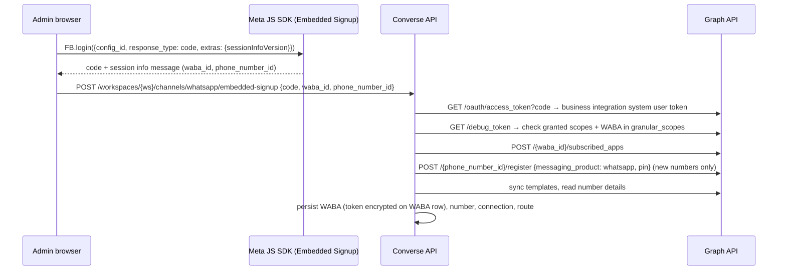

# WhatsApp Business Cloud API Integration

Package: `converse/channels/meta/whatsapp/`. Implements [`BaseChannelAdapter`](CHANNEL_ADAPTER_ARCHITECTURE.md). Cloud API only (Meta-hosted). On-premises API is retired by Meta; BSP-specific APIs such as 360dialog are Future adapters.

> **Version note.** Confirm current Cloud API endpoints, webhook fields, error codes, pricing/conversation rules and identity changes (BSUID) on Meta's WhatsApp docs before implementing.

## 1. Chatwoot reference

- `GET/POST /webhooks/whatsapp/:phone_number` → `Webhooks::WhatsappController` (verify token per channel in `provider_config`, `X-Hub-Signature-256` check, inactive-number list, ignores `tracking_events`-only payloads).
- Channel resolved from `metadata.phone_number_id` / `display_phone_number` (`Whatsapp::WebhookChannelFinderService`).
- `Webhooks::WhatsappEventsJob`: 30 s Redis mutex per `(inbox, sender)` (album uploads arrive as concurrent webhooks); retries 20 × 2 s; coexistence echoes (`smb_message_echoes`); BSUID preference (`from_parent_user_id` > `user_id` > `from`).
- `Whatsapp::IncomingMessageBaseService`: statuses → `Messages::StatusUpdateService`; dedup with `source_id` lookup + Redis `SET NX` (`Whatsapp::MessageDedupLock`, 1 day); blocked contacts skipped; reactions/ephemeral skipped.
- Templates in `channel_whatsapp.message_templates` jsonb; Embedded Signup (`EmbeddedSignupService`, `TokenExchangeService`, `WebhookSetupService`); `HealthService`; `ReauthorizationService`; country phone normalisers (Brazil, Mexico, Argentina).

## 2. Data

| Table | Use |
|---|---|
| `whatsapp_business_accounts` | `waba_id`, `business_id`, encrypted system-user/business token (shared by its numbers), `templates_synced_at` |
| `whatsapp_phone_numbers` | `phone_number_id`, `display_phone_number`, `verified_name`, `quality_rating`, `messaging_limit_tier`, `health` |
| `whatsapp_message_templates` | One row per `(waba, name, language)` with `components`, `status`, `category` |
| `channel_connections` | `provider = whatsapp_cloud`; credentials only if the number uses a token different from its WABA's |
| `channel_routes` | `(whatsapp_cloud, phone_number_id)` |
| `contact_identities.source_id` | `wa_id` (digits, no `+`), or BSUID when Meta provides one; `wa_id` kept in `profile.wa_id` |

## 3. Connecting a number

### 3.1 Manual setup (MVP)

For businesses that already have a WABA and a permanent **System User access token** with `whatsapp_business_messaging` and `whatsapp_business_management`.

1. Admin enters `waba_id`, `phone_number_id`, access token.
2. `connect()` validates:
   - `GET /{phone_number_id}?fields=display_phone_number,verified_name,quality_rating,code_verification_status,messaging_limit_tier` succeeds with the token.
   - `GET /{waba_id}/phone_numbers` contains that `phone_number_id` (the number belongs to the WABA).
3. Subscribe the app to the WABA: `POST /{waba_id}/subscribed_apps`.
4. Sync templates (`GET /{waba_id}/message_templates?limit=100`, paginated).
5. Persist WABA (upsert by `(organization_id, waba_id)`), number, connection, route; `status = active`.

### 3.2 Embedded Signup (R1)



The PIN for two-step verification is generated server-side, stored encrypted on the connection, and shown once to the admin.

## 4. Inbound webhooks

Endpoint `POST /webhooks/meta/whatsapp` (one URL for all tenants; the routing id is in the payload, unlike Chatwoot's per-number URL).

```json
{
  "object": "whatsapp_business_account",
  "entry": [{
    "id": "WABA_ID",
    "changes": [{
      "field": "messages",
      "value": {
        "messaging_product": "whatsapp",
        "metadata": { "display_phone_number": "15551234567", "phone_number_id": "PNID" },
        "contacts": [{ "profile": { "name": "Casey" }, "wa_id": "15557654321" }],
        "messages": [{
          "from": "15557654321",
          "id": "wamid.HBgL...",
          "timestamp": "1762560000",
          "type": "text",
          "text": { "body": "Where is my order?" }
        }]
      }
    }]
  }]
}
```

`route_keys()`: one unit per `messages[]` item and per `statuses[]` item (Meta usually sends one, but batches are allowed). Routing id = `value.metadata.phone_number_id`. Ignore `field` values other than `messages` (and, if coexistence is enabled, `smb_message_echoes`), e.g. `tracking_events` and `message_template_status_update`, which is handled by a separate template-status handler (updates `whatsapp_message_templates.status`).

| Unit | dedup_key | ordering key |
|---|---|---|
| message | `wamid` | sender BSUID or `wa_id` |
| status | `{wamid}:{status}` (`failed` statuses include the error code) | recipient id |
| template status | `{template_id}:{event}:{timestamp}` | — |

### Message types → normalised

| WhatsApp `type` | Normalised | Notes |
|---|---|---|
| `text` | text | |
| `image`, `video`, `document`, `sticker` | attachment with `provider_media_id`, `mime_type`, caption → text, document `filename` | |
| `audio` | `audio`, `is_voice = audio.voice` | Voice notes are OGG/Opus |
| `location` | `location` (lat/long, name, address) | |
| `contacts` | `contact_card` with vCard data in `content_attributes.contacts` | Chatwoot creates one message per shared contact; we keep one message with a list |
| `interactive` (`button_reply` / `list_reply`) | text = title, `content_attributes.interactive_reply = {id, title}` | |
| `button` (template quick-reply) | text = `button.text`, `content_attributes.interactive_reply.payload` | |
| `reaction` | `content_attributes.reaction` applied to `reaction.message_id`; empty emoji = remove | Not a new timeline message |
| `order`, `system`, `request_welcome` | `unsupported` / system handling | `system` identity changes update `contact_identities` |
| `unsupported` / `errors[]` | `unsupported` with error text | |
| `context.id` present | `in_reply_to_external_id` | `context.forwarded` → `content_attributes.forwarded` |
| `referral` (Click-to-WhatsApp ad) | `conversations.additional_attributes.meta_referral` | |

### Media download

1. `GET /{media_id}` (bearer token) → `{url, mime_type, sha256, file_size}`.
2. `GET {url}` with the same bearer token (the URL is short-lived, about 5 minutes) → stream into storage, verifying `sha256` and size limit.
3. Create `stored_files`, set `attachments.file_id`, publish `message.updated`.

Done in `download_inbound_media` (queue `low`, but enqueued with high priority within the queue, retried 5× with backoff). The message itself is shown immediately with a placeholder.

### Statuses

```json
{ "statuses": [{ "id": "wamid.REPLY", "status": "read", "timestamp": "1762560100", "recipient_id": "15557654321",
                 "conversation": { "id": "...", "origin": { "type": "service" } },
                 "pricing": { "billable": false, "category": "service" } }] }
```

- `sent` → `delivered` → `read`, applied **monotonically**: a late `delivered` after `read` is ignored.
- `failed` with `errors[0].code` → `delivery_status = failed`, `delivery_error = "<code>: <title>"` (same format as Chatwoot).
- `pricing`/`conversation` data stored in `content_attributes.whatsapp_billing` for cost reports (R2).

### Identity: wa_id and BSUID

Meta is introducing business-scoped user ids (BSUID) that don't expose the phone number. Chatwoot already prefers BSUID (`from_user_id`/`parent_user_id`) over `from` (see `contact_sender_id_from_messages`). Converse:
- `source_id` = parent BSUID if present, else BSUID, else `wa_id`.
- `SenderProfile.alternate_source_ids` carries the others; `ContactResolver` looks up by any of them, so a contact first seen by `wa_id` is matched when Meta later sends a BSUID, and the identity's `source_id` is upgraded in place.
- Sending uses the `to` field Meta requires for the identity type (`wa_id`/phone, or the BSUID recipient field once available).

## 5. Outbound

`POST https://graph.facebook.com/{version}/{phone_number_id}/messages`, bearer token = WABA token (or connection override).

```json
{ "messaging_product": "whatsapp", "recipient_type": "individual", "to": "15557654321",
  "type": "text", "text": { "body": "Your order #1234 ships today.", "preview_url": false },
  "context": { "message_id": "wamid.HBgL..." } }
```

| Case | Request |
|---|---|
| Free-form text (inside the 24 h customer service window) | `type = text` |
| Media | `type = image/video/audio/document` with `{link: signed_url}` or `{id: uploaded_media_id}`; caption from text; one media per message. Prefer upload (`POST /{phone_number_id}/media`) for files that must not be public |
| Interactive buttons/list | `type = interactive` (`button`: max 3 buttons; `list`: max 10 rows) built from `content_attributes.interactive` |
| Template (required outside the 24 h window) | `type = template`, `template: {name, language: {code}, components: [...]}` built from `content_attributes.template` and validated against `whatsapp_message_templates.components` |
| Read receipt | `{messaging_product, status: "read", message_id}` when an agent opens the conversation (`mark_read`) |
| Reaction (R2) | `type = reaction` |

**24 h window.** `OutboundMessage.last_incoming_at` = `conversations.last_incoming_at`. If `now - last_incoming_at > 24h` and the message is not a template → `WindowClosed` **before** calling Meta. The agent composer checks the same rule and switches to the template picker. AI and automation never send templates on their own unless the action is explicitly a template action.

**Templates.** The template picker lists `whatsapp_message_templates WHERE status = 'APPROVED'`. Parameters support positional (`{{1}}`) and named (`{{customer_name}}`) formats (`parameter_format`). Rendering for display uses the same component data, so the timeline shows the text the customer received. Sync: on connect, daily beat task, and on `message_template_status_update` webhooks.

### Error mapping

| Code | Meaning | Adapter error |
|---|---|---|
| `131047` | Re-engagement message: more than 24 h since last customer message | `WindowClosed` |
| `131026` | Message undeliverable (not on WhatsApp, old app version, blocked) | permanent |
| `131051` | Unsupported message type | permanent |
| `131052`, `131053` | Media download/upload error | retryable (2 attempts), then permanent |
| `131056` | Pair rate limit (too many messages to one user) | retryable with a longer delay (≥ 60 s) |
| `130429`, `131048`, `80007` | Throughput / spam rate limit | retryable (backoff, lower the per-number bucket) |
| `132000`–`132016` | Template errors (params mismatch, paused, disabled) | permanent, message shows the template problem |
| `131031` | Account locked | permanent + connection `error` |
| `368` | Temporarily blocked for policy violations | permanent + connection `error` |
| `190`, `10`, `200` | Token/permission | `ReauthorizationRequired` |
| `1`, `2`, `131000`, `131016`, HTTP 5xx | Temporary / service unavailable | retryable |

## 6. Number health and limits

- Beat task (every 6 h): `GET /{phone_number_id}?fields=quality_rating,messaging_limit_tier,status,name_status` → `whatsapp_phone_numbers.health`, `health_checked_at`. Quality `RED` or status `FLAGGED`/`RESTRICTED` notifies admins (Chatwoot's `Whatsapp::HealthService` has similar intent).
- Throughput: Cloud API allows tens of messages per second per number by default. Our per-inbox outbound bucket defaults to 20 msg/s and halves after a `130429`.

## 7. Tokens

| Token | Lifetime | Handling |
|---|---|---|
| System User token (manual setup) | Non-expiring unless revoked | Health check detects `190` → `reauthorization_required` |
| Business integration system user token (Embedded Signup) | Long-lived; revoked if the business removes the app | Same |
| User access tokens | Not used for WhatsApp | — |

`refresh_credentials()` returns `None` for WhatsApp; there is nothing to refresh on a schedule. Re-authorization repeats manual setup or Embedded Signup, attaching to the existing inbox.

## 8. Coexistence (R2)

When a business uses both the WhatsApp Business app and the Cloud API on one number, Meta sends `smb_message_echoes` for messages typed in the app (Chatwoot handles this in `handle_message_echo`). Converse stores them as outgoing messages with `content_attributes.external_echo = true`, deduped by `wamid`. Coexistence onboarding also offers history sync (`history` webhooks), which is out of scope until R2.

## 9. Tests

- Parser tests per message type above (fixtures from real payloads, scrubbed).
- Album: 5 concurrent image webhooks from one sender → one conversation, 5 messages, in timestamp order.
- Duplicate delivery of the same `wamid` (same payload and different batching) → one message.
- Status monotonicity; failed status maps the error string.
- 24 h window: non-template message 25 h after last incoming → `WindowClosed` without an HTTP call (respx asserts no request).
- Template parameter validation against stored components.
- BSUID upgrade: contact first seen by `wa_id`, later by BSUID with `wa_id` alternate → same contact and identity.
